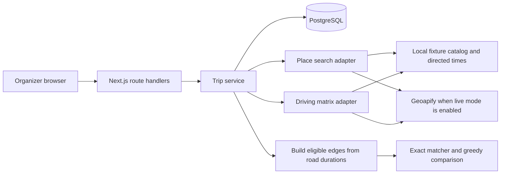

# GroupRide architecture extension for searchable U.S. pickups

**Proposed design · November 2026.** The next product milestone lets an organizer select a shared venue, driver starting addresses, and passenger pickup addresses anywhere the U.S. provider can resolve and route them. The proposed first implementation uses an offline catalog of fictional places. Austin is the first proposed live demonstration. The [released architecture](ARCHITECTURE.md) and its [W6 verification](EVIDENCE.md#w6-dense-benchmark-corrections) describe the zone-based application. All endpoints, schema changes, defaults and checks below are proposals.

## 1. Product and boundaries

An organizer creates an address-based trip by searching for a venue, confirming its address, and entering the departure time with an explicit UTC offset. For each driver, the organizer confirms a starting address, seats offered, and maximum extra driving time for an individual pickup. For each passenger, the organizer confirms a pickup address. The preview shows named pairings, unassigned passengers, and estimated extra driving minutes. Saving and reloading reproduces the reviewed assignments and estimates. The same workflow applies in another U.S. city without importing a city catalog.

| Decision | First release |
|---|---|
| Coverage | Search across provider results whose country code is `US`. Bias suggestions near the venue while allowing cross-city and cross-state carpools. Accept a street address or a named place with a usable pickup point. City, ZIP, street-only and ambiguous results require a more specific selection. Coverage depends on the provider; a search result can lack a drivable connection. |
| Roles | The existing organizer-operated, loopback app handles registration. Use public addresses in demos and retained evidence. A shared deployment accepting personal pickup addresses requires the access and retention work in section 7. |
| Trip size | Retain 20 driver records and 50 passenger records including inactive entries, 0–8 seats per driver, and one shared venue. Correcting a start, pickup or detour limit requires withdrawal/cancellation and a fresh registration. The inactive record still consumes its lifetime slot. Show remaining slots before cancellation. At the cap, warn before withdrawal that the trip has no slot for a replacement, even after cancellation. Collapse duplicate coordinates for routing while retaining separate participant identities. |
| Time | Store departure as the existing UTC instant. Show the entered offset or explicitly labelled display zone when confirming the trip. Use a single static driving profile for all legs. Departure identifies the event; the first estimate excludes live traffic, dwell time and predictions of arrival time. |
| Detour limit | Proposed default 15 minutes per driver, editable at registration as an integer from 0 to 120 inclusive. Apply the threshold separately to each driver–passenger pair. A driver collecting two people could exceed that threshold on the combined journey. |
| Later extensions | Multi-stop ordering, traffic-dependent departure and arrival times, additional countries, participant accounts and invitations each change a separate contract. Store an ISO country code and provider namespace now. Enable countries after testing local address formats, coverage, time display and routing. U.S. territories with separate country codes need explicit coverage decisions. |

## 2. Component boundaries and provider choice

Keep the Next.js app, PostgreSQL and the pure min-cost flow engine. Introduce server-only adapters under a proposed `src/locations/` for place search and `src/routing/` for driving durations. The trip service orchestrates both persistence and preview publication. The matcher continues to consume participant IDs, capacities and integer edge costs. SQL repositories, route handlers and browser components never calculate a detour independently.



### What must be available to run it

| Proposed server setting | Local requirements | External requirements and behavior |
|---|---|---|
| `GROUPRIDE_ADDRESS_PROVIDER=off` (default) | Existing Next.js and PostgreSQL setup | Zone trips operate normally. Address dashboards, stored hits, same-policy rematches fully covered by retained legs, commits of current previews and receipt replay use local data. Searches and previews requiring new provider observations are unavailable. |
| `fixture` (development, CI and offline demo) | Same stack plus a locally generated signing secret, a small, versioned catalog of fictional U.S. addresses and asymmetric car times shipped with the app | The entire search → confirm → register → preview → save → reload workflow runs on loopback. No account, API key, paid plan, map tiles, city data import or outbound geospatial request. The UI labels fixture addresses and estimates. Use conspicuous names such as “GROUPRIDE FIXTURE — Pickup Alpha” in the synthetic catalog, with invented address components and no residential street numbers tied to real homes. Fixture searches never reach a geocoder. Initial installation still requires obtaining the existing project dependencies, PostgreSQL and, for browser tests, Chromium. |
| `geoapify` (explicit live opt-in) | Same stack plus a selection signing secret, server-only `GEOAPIFY_API_KEY` from the owner’s free project | The Next.js server needs outbound DNS and HTTPS on port 443 to `api.geoapify.com`. Search calls `GET /v1/geocode/autocomplete` and driving times use `POST /v1/routematrix`. The browser calls only GroupRide. One provider account covers both APIs across U.S. cities. Availability and address precision vary by location. [Autocomplete](https://apidocs.geoapify.com/docs/geocoding/address-autocomplete/) · [Route Matrix](https://apidocs.geoapify.com/docs/route-matrix/) |

Use the venue selection’s provider namespace to pin each new address trip to its source. For an existing trip, any new selection and cold preview must use that source. If the required adapter is disabled, lacks a key, or is unreachable, explain which capability is unavailable. Never substitute invented locations or travel times for a live trip. Reading recorded evidence and determining the trip's current supported policy are local operations, independent of network configuration.

**Live budget.** As checked on 2026-11-24, Geoapify advertises a free account with 3,000 credits/day, up to five requests/second, and no credit card. Each autocomplete request costs one credit, including successive debounced searches. Route matrices share the same allowance. Use a dedicated free project without a payment method for the pilot. Confirm its current limits and attribution before use. Keep the key in an ignored local environment file or server secret, outside browser bundles, URLs in logs and test artifacts. Fixture work requires only a local signing secret. [Pricing](https://www.geoapify.com/pricing/) · [Pricing details](https://www.geoapify.com/pricing-details/) · [Storage guidance](https://www.geoapify.com/products-and-services/) · [Attribution terms](https://www.geoapify.com/terms-and-conditions/)

**Live retention decision (ISSUE-045, closed).** The owner selected Geoapify’s published free-plan guidance for this pilot. Address Autocomplete expressly allows caching suggestions and results. For Route Matrix the project relies on Geoapify’s platform-wide storage guidance. GroupRide may send 30-minute signed suggestions to the local organizer, retain selected public building addresses and coordinates until offline reset, and retain timestamped directed durations and no-route observations until reset for same-trip reuse and display. Show linked Geoapify credit, OpenStreetMap attribution and applicable source credits on suggestions, previews and saved estimates. Before a live run, verify the free project, key and available credits. [Owner’s decision and provider sources](EVIDENCE.md#issue-045-free-plan-decision)

**Adapter contracts.** Search takes text, country, purpose, optional venue bias, limit and an abort signal. It returns typed candidates with country, display label, address components, road-access coordinates and available accuracy/source metadata. Prefer an entrance where available. Mark approximate locations in the confirmation UI and allow the organizer to select a nearby named entrance instead. A matrix request takes ordered source and target coordinates, car profile and deadline. Its result has exactly one indexed cell per requested pair, with either a finite nonnegative duration in seconds or an explicit no-route result. The adapter owns coordinate order, units, batch limits and translation of provider errors. Reject missing, duplicate or malformed cells. An HTTP success alone cannot validate a matrix. Normalize Geoapify country codes to uppercase and send `filter=countrycode:us` plus `bias=proximity:lon,lat` when a venue is known. Decode `sources_to_targets[i][j]` against ordered source and target IDs using longitude/latitude coordinate order. Validate indices against the requested endpoints. Interpret a documented null time as no route. Discard the returned road-snapped coordinates after decoding. Evidence refers to the submitted immutable location IDs and the provider’s observed times. A snap cannot move a confirmed pickup or become an identity key.

## 3. Search, confirmation and HTTP contracts

The client debounces typing (initial target 300 ms), cancels superseded requests, and discards out-of-order replies using a monotonically increasing search generation. Show street, city, state and ZIP when available. Keyboard selection and an explicit confirmation identify the chosen result. Editing the text clears the selection. Disable submission until the selected address agrees with the displayed value. Require an affirmative choice of a result with usable precision. Reject a mismatched street number or a city-center fallback for a street-address query.

The following routes and fields extend the current [HTTP and idempotency contract](ARCHITECTURE.md#5-public-api-request-identity-and-browser-state).

| Proposed operation | Request and response |
|---|---|
| `POST /api/locations/search` | Accept `{query, purpose, tripId?}` where purpose is venue, driver start or pickup. For an existing trip, derive the venue bias on the server. Bound text length and return at most five displayable suggestions with a display label, precision and a signed selection token for each candidate. Return an empty list for no matches. Use a request body and `Cache-Control: no-store` for address searches. |
| `POST /api/trips` | Address form uses `{name, departAt, locationMode:"address", venueSelectionToken}`. Preserve the deployed `{name, departAt, destinationLabel}` form and its fingerprint for zone trips. Reject mixed forms. |
| `POST /api/trips/:id/drivers` | Address form uses `{name, startSelectionToken, seatCapacity, maxDetourMinutes}`. Validate the driver against the trip's mode. Existing zone registrations continue to send `zoneId`. |
| `POST /api/trips/:id/requests` | Address form uses `{name, pickupSelectionToken}`. Apply the same mode and scope checks. Cancellation, withdrawal and seat reduction use their existing routes and base-version rules. Correct an address or limit by canceling/withdrawing and registering anew in this release. |
| Dashboard, preview and commit | Keep `GET /api/trips/:id`, preview with `{}` and commit with `{previewId}`. Address-mode responses add `locationMode`, `costUnit:"detour_seconds"`, location display fields, and preview/committed estimate metadata. The browser converts seconds to minutes for display. Keep old DTOs readable and label zone costs in their existing units. |

The address form carries the exact token chosen by the organizer. The token below is abbreviated for display.

```json
{
  "name": "Austin evening event",
  "departAt": "2027-03-05T17:30:00-06:00",
  "locationMode": "address",
  "venueSelectionToken": "<signed venue token>"
}
```

An address preview keeps the public IDs and `optimal` / `greedy` shapes used by existing clients. It adds an estimate summary such as `{ costUnit, provider, routingPolicyVersion, observedFrom, observedTo }`. The optimal result’s numeric `totalCost` and each assignment’s `cost` use the stated unit. A saved dashboard reads the same summary through `committed_preview_id`. Enabling address trips requires the upgraded UI so an older client cannot present seconds as synthetic cost.

**Stateless selection.** Search performs no database writes. The server signs each eligible suggestion. Confirmation is the organizer’s explicit choice in the UI and makes no HTTP call. Keep unselected suggestions only in page memory and clear them on edit/navigation. Use the wire form `header.payload.tag` with three canonical, unpadded base64url segments. The header contains the format version, key identifier and dataset generation. The payload contains the random location UUID, issue/expiry times, purpose, nullable trip ID, provider namespace and allowlisted snapshot from section 4. Sign the ASCII bytes of the literal encoded `header.payload` with HMAC-SHA-256 under the dedicated selection key. The tag segment encodes the full 32-byte result. Size the complete token before offering it (4 KiB maximum). Anyone who can read a token can read its address.

**Admission and verification order.** The existing HTTP boundary checks the request key, valid JSON, outer request shape and 16 KiB body limit. An invalid outer request returns 400 before the keyed helper and has no receipt. For an admitted address form, preserve the token string exactly for the fingerprint. Inside the transaction, the existing receipt lookup and any required trip lookup precede token verification. [HTTP reader](../src/app/api/http.ts) · [Keyed mutation](../src/trips/mutation.ts)

1. In keyed work, bound the token to 4 KiB in encoded bytes. Check the three segments and canonical encoding, extract the signing input directly from the received string, and check the decoded tag length before constant-time comparison. Framing and base64url checks require no interpretation of the header or payload. Node’s base64url decoder also accepts regular base64, and its constant-time comparison requires equal byte lengths. [Node Buffer encodings](https://nodejs.org/docs/latest-v24.x/api/buffer.html#buffers-and-character-encodings) · [Node crypto comparison](https://nodejs.org/docs/latest-v24.x/api/crypto.html#cryptotimingsafeequala-b)
2. Load the master for the configured target and the generation from the database. Derive the current selection key and verify the MAC over the received signing input. The server chooses the algorithm, key and generation independently of the token. A failed MAC returns the same generic terminal 422 for all tokens. Optional failure counters are described below.
3. Only after a valid MAC, strictly decode the UTF-8 JSON header and payload. Require the supported version, current key identifier and generation, valid bounded snapshot, and matching purpose, trip, provider and timestamps. Venue tokens have null trip scope. Start/pickup tokens name an existing address trip and its provider. The token is valid from issue until expiry (exclusive), for at most 30 minutes. Encode issue and expiry as integer Unix milliseconds. At signing set expiry from one reading of the injectable Node server clock. After receipt lookup and the trip lock, read that clock again inside keyed work and require `issuedAt <= now < expiresAt` and `0 < expiresAt - issuedAt <= 1_800_000`. Search makes no database write, so no database timestamp is involved. Within scope and lifetime, two independent keys may reuse a pickup for two passengers or a venue for two trips. Copy the verified snapshot atomically.
4. Within this verifier, malformed segments, wrong tag length, invalid MAC, decoding/schema errors (including authenticated malformed JSON), expiry and scope failures all raise terminal `422 LOCATION_SELECTION_INVALID`. Translate expected input/decoder failures at their boundary. Key availability has its own retryable path. An unrelated internal exception still follows the existing internal-error protocol. Also validate the envelope at issuance so the server detects a faulty encoder before offering that suggestion.

- **Dataset generation.** Migration 002 adds a single-row `dataset_generation` table holding a random UUID. The setup role writes it on fresh installation and replaces it inside the same guarded reset transaction as the TRUNCATE, seed and starter trip. The app role has SELECT only. Reset therefore touches no files, and there is no window in which the data has been reset but old tokens still verify. If the reset COMMIT outcome is unknown, whichever state is durable carries its own generation, and the app follows it. Rerunning the guarded reset is the existing recovery.
- **Derived key.** Derive 32 bytes with HKDF-SHA-256 from the master bytes, the database UUID’s 16 bytes in canonical order as salt, and the fixed UTF-8 info string `GroupRide/selection/v1`. Use the derived bytes as the HMAC key. Search captures the generation and applicable trip scope in one short consistent read before signing. New-key attachment reads the generation on its checked-out mutation client under the existing shared dataset lock. Cache a validated master per target, never a generation across transactions. Reset changes token validity in the same commit as the dataset replacement.
- **Fixture master secret.** Store a random master secret (at least 32 bytes) in server-only configuration. In fixture mode the server creates it at `.groupride-local/<demo-or-test>/fixture-signing.key` if missing. Create it lazily on the first fixture search or token verification at runtime, never at module import: `next build` evaluates route modules while collecting page data, so import-time creation could write a key in the build environment or fail the build. Use an owner-only directory and file (0700/0600). Publish a complete key without overwriting a concurrent winner: write a uniquely named temporary file, `fsync` it, then `link(temp, final)`. Each initializer unlinks its own temporary name after a successful link, after `EEXIST` (then reads the winner) and on any other error. Do not use `rename`, which overwrites, or write the final path directly with an exclusive flag, which lets a racing reader see a partial key. Later starts reuse it, and reset never rewrites it. Load the secret once per server process after it validates, and cache it for that process; deleting or editing the file affects the next process, not the running one. A clean checkout requires no copied secret. Demo and test targets have separate master files, and a test reset never touches the demo target.
- **Live master secret.** In live mode the operator supplies the master secret through server-only configuration. GroupRide never generates or rewrites it. Replace it only with the app stopped, after suspected exposure. Replacement invalidates outstanding tokens for new attachments, as a reset does. Individual early revocation would require server state and is outside the loopback pilot.
- **Detectable key failures are never terminal.** Treat a missing (in live mode), unreadable, wrong-permission or malformed master secret, or a failed generation read, as a retryable availability failure. Throw it as a `TransientFailure` (`503 SELECTION_KEY_UNAVAILABLE`) so the keyed helper writes no receipt and the same key can succeed after repair. Validate the secret’s encoding, length and permissions before caching it. Cache only successful loads so a repaired file can be read on the next attempt. Extend the typed error-code and transient-code unions for the new 503. Preserve the existing dataset guard and database error classifications outside the selection-key read. A structurally valid token awaiting an unavailable verification key remains retryable. Receipt replay still precedes key loading, so finalized operations replay even while the key is unavailable. Report key availability in capability status separately from zone readiness.
- **Loss or replacement invalidates tokens.** Format checks cannot tell a lost fixture secret from a first run: if the file disappears, the next process creates a new, valid secret, and tokens signed with the old one fail verification. A new-key attachment of such a token finalizes a terminal 422, as after a deliberate replacement; the organizer searches again. For v1, the key identifier is the unpadded base64url encoding of the first 16 bytes of HMAC-SHA-256 of the UTF-8 label `GroupRide/selection/kid/v1` under the master. After a failed MAC, a bounded, best-effort inspection of the header may increment one coarse counter for a claimed key-ID mismatch, claimed generation mismatch or other invalid token. These unauthenticated hints cannot establish the cause of failure. They never select a key, change a response/receipt, or include caller-supplied identifier values in logs or metric labels. A fixture initializer that creates a master while address trips exist can warn that earlier tokens may have been invalidated. Persisting a key fingerprint in PostgreSQL would let the server return 503 instead, but a stale fingerprint would then block new attachments until an operator intervened. That trade is not worth it for a single-organizer loopback pilot.

**Recovery.** For a keyed mutation, structurally validate the bounded request and fingerprint the exact opaque token string along with the normalized business fields. Do not decode and reserialize the token during normalization. The existing key lock and receipt lookup come before signature, expiry, provider admission and trip checks. On a new key, verify the token inside keyed work. Matching applied or failed receipts replay after token expiry, restart or master-secret replacement, because none of these deletes receipts. A committed guarded reset truncates receipts and changes the generation. Retrying an address **trip creation** with its old venue token now finalizes a new 422, assuming key availability and normal address admission. Retrying a **registration against the deleted trip** reaches the existing trip lookup first and finalizes a new 404 `NOT_FOUND`. A repeated identical retry replays that new outcome. A rolled-back reset preserves the original receipt, so its replay is independent of the token’s current expiry. This follows the released dataset lifetime and lock order. [Seeded data lifetime](ARCHITECTURE.md#seeded-data-lifetime) · [Trip service](../src/trips/service.ts) A different token on the same key conflicts even if its address looks identical. Keep the exact body/key in the one tab-wide pending slot until its own terminal receipt arrives. Only the unresolved selected token enters session storage. Receipts store a fingerprint and minimal outcome, never the raw token or address. If pending storage is lost, reconcile the dashboard before deliberately issuing a new operation. [Fingerprint](../src/contracts/index.ts) · [Receipt protocol](../src/trips/mutation.ts) · [Pending storage](../src/app/trips/pendingStore.ts)

## 4. Data model and upgrade

Use an additive numbered migration after `001_foundation.sql`. Leave that file and its recorded checksum intact. Using an immutable location snapshot on a trip-owned row avoids a mutable global address book and allows old plans to retain the precise entrance that was confirmed.

| Table | Proposed change and invariant |
|---|---|
| `dataset_generation` | One row holding the random generation UUID used to derive selection signing keys (section 3). Written by the setup role at fresh installation and replaced in every guarded reset transaction. The app role has SELECT only. Upgrading a W6 database inserts an initial generation. |
| `trips` | Add `location_mode` default `zone` and a nullable `venue_location` snapshot. An address trip requires a venue and its pinned provider namespace. Preserve the existing required `destination_label` as a short display label within its current limit; keep the full selected address separately. Venue and departure remain immutable for this release. |
| `drivers`, `ride_requests` | Allow nullable `zone_id`, add mode and a nullable location snapshot. Zone mode requires a valid zone and no address. Address mode requires a snapshot and no zone. Only address drivers have a required `max_detour_minutes`. Add `UNIQUE (id, location_mode)` on trips. Reference it from each child’s `(trip_id, location_mode)` to enforce agreement. |
| `match_previews` | Store tagged cost unit and immutable routing evidence for address mode, including policy revision, adapter/profile, observation interval, participant-to-location mapping by internal IDs, directed leg durations/no-route flags and thresholds. Use an internal versioned JSONB structure with IDs for starts, pickups and venue, ordered leg endpoints, seconds or confirmed no-route, the source of each leg, its original provider observation timestamp when applicable, and the canonical routing-policy revision. Persist the compact public summary (unit, provider, routing policy, observation range, reused/fetched/local counts) in its own small column, separate from the private leg data. Reading one field out of a large JSONB value still decompresses the whole value, so dashboard and stored-hit queries must not select the evidence column. Validate the full evidence (coverage of legs needed by the current solve and the separate retained-leg bounds in section 5) on publication, on reuse as a prior preview, and at commit. Display reads, meaning dashboard and stored preview hits, never load the evidence column. They validate the public results and the summary column against the current roster IDs and unit. A stored preview hit is looked up by the current policy, so it validates against that policy. A committed dashboard validates against the policy recorded with its committed preview and the trip's `algorithm_version`, which must be one this build can still decode. A deployment that supersedes the policy then rejects new commits of old previews (`ALGORITHM_CHANGED`) but never makes a saved plan unreadable. Remove an evidence-schema decoder only after migrating or retiring the trips that still reference it. Corrupt evidence behind a valid display row is caught at commit, which fails safely as an internal error and keeps the prior plan, or at reuse, which falls back to a cold fetch (section 5). A same-version hit can still serve a valid public result and summary while the private evidence is corrupt. A new-key commit then fails internally. An effective roster change creates a new preview key, allowing a cold rebuild under the recovery rule in section 5. Corruption is a server defect, so this recovery need not be convenient, only available without a reset. No raw provider payload or address text is needed here. Zone previews retain their existing key and result shape. |
| `assignments`, `mutation_receipts` | Keep same-trip FKs, unique passenger assignment, integer `pickup_cost`, saved version, and existing receipt protocol. Interpret a saved cost with its trip mode and referenced preview. Store only IDs, outcome and necessary result fields in new receipts. Exact addresses belong to the scoped roster and venue. |

Canonical snapshot fields are internal location ID (the selection UUID), provider namespace and reference if available, country code, structured address, display label, latitude, longitude, precision, source attribution and token issue time. Record attachment time on the business row when selected. Record explicit longitude/latitude order at the adapter boundary. Validate finite coordinate ranges, required fields, purpose and text sizes before storage. Copy only allowlisted fields. Route evidence uses immutable location IDs. Request identity uses the full signed token as described in section 3.

Existing rows default to zone mode with empty new fields. Old driver/request inserts must still work with their existing defaults. Preserve cached zone previews, receipt fingerprints, pending browser requests and plan metadata. Extend each strict request schema as a union. In the contracts and trip service, branch before zone-specific ID validation. Preserve the byte-for-byte normalized zone body and fingerprint. Check a new roster write’s form against the locked trip inside keyed work. A mismatch produces a receipted 422 `LOCATION_MODE_MISMATCH`. [Contracts](../src/contracts/index.ts) · [Trip service](../src/trips/service.ts)

Scope the legacy zone fixture guard to its existing contract during the migration; keep the offline dataset lock/reset protocol. The existing guarded TRUNCATE covers attached snapshots and leg evidence on the trip, roster and preview tables. Stateless search adds no selection table, purge job or DELETE grant. Test both fresh installation and upgrade over retained data. Roll out schema and dual-mode readers before enabling address writes. To disable address intake, stop new searches and new address trips while allowing existing address dashboards, stored commits and receipt replay. Rolling back to zone-only binaries requires retiring or migrating address trips first.

## 5. Driving estimates and matching

For each active positive-seat driver start D, active passenger pickup P and trip venue V, obtain directed car travel times D→P, P→V and D→V. Normalize to seconds; retain finite durations at provider precision during calculation and round the **final difference** to the nearest whole second, with half-seconds rounded up. Define the score as the nonnegative extra time. Clamp a negative estimated difference to zero and count it in telemetry for profile-quality review. These independently estimated legs can disagree slightly. No-route and unknown durations must never become zero-cost edges.

```text
extraSeconds = max(0, round(seconds(D,P) + seconds(P,V) - seconds(D,V)))
eligible    = all three legs routable and extraSeconds <= maxDetourMinutes * 60
```

Only positive-seat active drivers generate current pickup demand. A zero-seat active driver can later regain capacity. Preserve previously observed legs for that driver as specified below. Include active passengers with no eligible edges in the unassigned list. A zero-minute limit permits a genuine on-the-way pickup. A confirmed no-route on D→V excludes that driver's edges; a no-route on P→V excludes that pickup's edges. Empty demand or supply yields the ordinary empty plan without a provider call. The 120-minute proposed maximum bounds an eligible edge to 7,200 seconds, within the 10,000 integer cap enforced by input validation, stored-result validation, feasibility checks and the assignment column. Even 50 such assignments sum to only 360,000 seconds. For unassigned passengers, derive aggregate explanations from the eligible edges and active capacity. Show whether there are no available drivers, no eligible pickups within the limits, or eligible drivers whose seats were allocated. Keep detailed provider diagnostics out of the public response.

Introduce a trip-service projection for address rosters beside the [zone projection](../src/matching/project.ts). It takes frozen durations and thresholds as inputs and returns the same `MatchInput`. GroupRide supplies these edges to the existing exact and greedy algorithms and retains their validated results. The primary objective remains maximum passenger coverage; among those plans the exact matcher minimizes summed individual detour seconds. The UI labels this “sum of estimated individual pickup detours,” displays the estimate time and threshold, and rounds only for presentation. It cannot infer a driver's combined route duration from the sum.

**Routing policy.** For the proposed Geoapify car profile, explicitly send the following fields on every matrix request. The explicit `max_speed` of 140 km/h pins Geoapify’s documented car default within its supported range of 10–252 km/h. Omit the optional `avoid` property and record its absence in the routing-policy identifier. It describes the estimate and is independent of each driver's detour limit. Assert the actual outbound JSON in adapter tests. [Route Matrix parameters](https://apidocs.geoapify.com/docs/route-matrix/)

```json
{"mode":"drive","traffic":"free_flow","type":"balanced","units":"metric","max_speed":140}
```

Include the provider namespace, endpoint/API revision, canonical profile fields and adapter interpretation of direction, units and no-route in the routing-policy identifier. A change to any of these starts a new duration history. The preview identifier additionally versions the solver, evidence schema, rounding and eligibility rules. A fixture policy includes its catalog/matrix revision. A static profile fixes how GroupRide interprets observations. The upstream road graph can still change between calls.

**Trip-local leg reuse.** In the same read snapshot as the roster, select the most recent compatible published preview for this trip and routing policy. Choose the highest base version at or below the captured version, breaking ties by preview UUID. Only supported evidence schemas are candidates. Persist the routing-policy ID separately from the composite preview ID for this lookup. Validate the candidate evidence and its original endpoint identities before reuse. If the **stored evidence** fails validation, count the invariant failure once for this preview attempt and discard the entire candidate. Start with zero reused legs, skip older rows and in-flight handoffs for this attempt, and rebuild using the ordinary cold path. Resolve identical endpoints locally and fetch all required nonlocal legs through the normal admission, quota and deadline checks. If no provider cells are needed, an empty or local-only plan can still publish offline. Otherwise a routing outage leaves this attempt without a new row. Database read failures keep their normal error classification. A malformed fresh matrix fails the attempt and cannot trigger another cold fallback. If no compatible prior preview exists, follow the ordinary first-preview path.

Keep two sets of directed (from location UUID, to location UUID) pairs:

- **Required for this solve.** With at least one positive-seat active driver and one active pickup, require each such driver→pickup, driver→venue and pickup→venue leg. With no supply or demand the required set is empty.
- **Eligible for retention.** Include driver→pickup, driver→venue and pickup→venue pairs for *all* active drivers and pickups, including zero-seat drivers, and the immutable venue. Retain an existing pair while any active participant still references the relevant endpoint in that role. Removing the last reference after cancellation or withdrawal drops that leg from the next preview. Historical previews remain immutable.

Copy prior evidence intersecting the retention set, including confirmed no-route and original timestamps. Fill only required pairs missing from that copy. Never fetch just to fill a dormant driver's row. When a new pickup registers while X has zero seats, X→new pickup can remain absent until X regains capacity. Validate that every required pair is resolved, every stored pair is allowed and unique, and every observation is well formed. Only the required pairs enter the address projection and commit feasibility check. Store the retained copy plus the newly resolved pairs, including on empty-plan previews. This preserves evidence across successive zero-seat versions. The existing service permits increasing an active driver’s capacity from zero. [Capacity edit](../src/trips/service.ts)

**Identical endpoints.** Compare the validated numeric longitude/latitude pairs for exact equality, including across distinct location UUIDs. For equal coordinates, resolve the leg locally to zero seconds with source `identical_endpoint` and a null provider observation time. Retain the ordered IDs. Close coordinates still require routing. A local zero establishes only that leg. If another leg is unreachable, the pairing remains ineligible. Version this rule in the routing policy. Exclude local-zero cells from upstream rectangles, splitting a rectangle when necessary.

Group remaining missing pairs by identical target sets and request venue legs separately. On zero missing provider legs, publish even during an outage. If a required provider leg is missing and routing fails, leave the version without a new preview. Timestamp fresh cells at batch response time. The public observation range and reused/fetched/local counts describe only legs needed for this solve. Exclude dormant legs and local zeros from the provider observation range (null when there are no provider observations). A deliberate policy revision starts a new duration history.

**Request budget.** With 20 distinct active starts, 50 distinct pickups and one venue, a cold preview needs at most 1,000 driver-to-pickup cells plus 70 venue legs. Deduplicate equal coordinates within batches and expand the resulting cells back to their ordered location IDs. Keep an ordered index map for each source/target batch and validate every expected cell before publishing. Geoapify documents a limit of 1,000 cells per synchronous request. Where the account permits, request one 20×50 matrix plus a 70×1 venue matrix. Four 10×25 matrices plus the venue matrix are a fallback if the larger request is impractical. [Route Matrix limits and credit formula](https://apidocs.geoapify.com/docs/route-matrix/)

| Live example, all coordinates distinct | Directed cells | Base matrix credits before autocomplete, retries and distance surcharges |
|---|---:|---:|
| 1 driver, 1 passenger, 1 venue | 3 | 3 |
| 20 drivers, 50 passengers, 1 venue, two rectangular requests | 1,070 | 500 + 70 = 570 |
| Same maximum roster, five smaller requests | 1,070 | 4 × 250 + 70 = 1,070 |
| Same-policy cancellation, capacity cut or withdrawal after a covering preview | 0 new | 0 |
| Add the 20th driver to 50 existing pickups, all prior legs covered | 50 driver→pickup + 1 driver→venue | 51 |
| Add the 50th pickup to 20 existing drivers, all prior legs covered | 20 driver→pickup + 1 pickup→venue | 21 |

Geoapify charges a base of `max(sources, targets) × min(sources, targets, 10)` per synchronous request and adds a surcharge for each full 500 km of returned distance per cell. Even at 570 base credits, six cold maximum-size previews exceed the advertised free daily allowance before searches. A small local demo and a repeated scale benchmark therefore have very different resource needs. [Matrix pricing](https://apidocs.geoapify.com/docs/route-matrix/) · [Account plans](https://www.geoapify.com/pricing/)

**Free-pilot admission.** Keep the project on the free plan with no payment method or automatic upgrade. The provider enforces its quota. Apply one process-local rate limiter across autocomplete and matrix calls within the free account's five requests/second. Honor upstream 429 or quota responses as `ROUTING_QUOTA` for previews, with Retry-After when available and no automatic fan-out of retries. Search reports the analogous quota failure in its own UI. Measure actual usage on the provider dashboard. The pilot maintains no daily ledger, reservations or assumed provider reset timezone. Before any paid rollout, establish a spending cap, provider quota-window boundaries, and how to reconcile crash-orphaned reservations against billed attempts. [Pricing](https://www.geoapify.com/pricing/) · [Credit calculation](https://www.geoapify.com/pricing-details/)

Run live mode as a single server process with one upstream preview workload per trip. The permit carries the server-observed base version, a unique holder identity and an abort signal. A same-version competitor gets retryable 429 `PREVIEW_BUSY`. An older request observing a newer holder gets 409 `STALE_VERSION`. A request with a strictly newer authoritative roster version signals the old holder to stop dispatching and abandon publication. If the newcomer needs routing, wait for the old holder's upstream calls to settle within the newcomer’s original deadline, then compete for the permit and recheck the current trip version and cache. Legs are keyed by (routing policy, from location UUID, to location UUID), and those never change for a trip. The old holder therefore hands its settled, validated cells to the newcomer through the in-process permit, including confirmed no-route results and their observation times, together with the trip and routing policy they belong to. Unless section 5 requires a cold rebuild after corrupt evidence, the newcomer accepts them only for the same trip and policy, then intersects them with its own retention set. A cell for an endpoint no active participant references at the newcomer's version (for example a driver canceled in between) is discarded, as is any cell outside the retained roles. Merge without replacing an observation the newcomer already holds from retained evidence. Then fetch only the required pairs still missing. This avoids paying twice for legs already bought (up to 570 credits for a cold maximum-size preview). Handed-off cells are still in memory only; if the newcomer also fails to publish, they are lost. Requests with fully covered legs may publish without waiting on upstream work. Old-holder cleanup releases only its own permit, and the under-lock version check still protects against a late provider success. Aborting cannot refund upstream calls already sent. Shared multi-process admission is a separate deployment prerequisite.

## 6. Preview publication, commit and failure handling

1. **Read and choose the policy.** In `publishPreviewInner`, derive the expected identifier from the stored trip mode and provider in the existing consistent transaction. For zones it is the current `ALGORITHM_VERSION`. For addresses it identifies the solver, evidence schema and provider/profile/cost-policy revision, including rounding and eligibility. Use it for **both** calls to `findPreviewByKey`. On a miss, branch the current `readRoster`: only zones call `listZoneCosts` and use zone IDs. Address rosters capture authoritative IDs, capacities, thresholds, frozen locations and venue at one base version. A validated stored hit returns immediately with its original estimate range. On a hit at a newer authoritative version, signal any older live holder before returning. [Preview service](../src/trips/preview.ts)
2. **Compute a new quote.** Capture compatible prior evidence during the read above and release the client. Apply section 5’s directed-leg reuse and admission rules. Fetch missing rectangles outside all database transactions, with at most two batches in flight per admitted preview. Branch the unconditional `projectMatchInput` between the zone and address projectors, then run the same `computeMatch`. Finish within the shared deadline below.
3. **Publish the winner.** Reacquire the existing dataset and trip locks in a short write transaction. Recheck the captured version and expected policy before insert. A changed roster produces `409 STALE_VERSION` with no stale row. Drain old application instances on a policy upgrade. Persist the chosen composite address identifier rather than copying the solver-only `computation.algorithmVersion`. Store costs, evidence and both results atomically with no trip-version bump. The unique (trip, base version, algorithm) key plus the under-lock second lookup chooses the winner. Every successful caller returns the winner’s public DTO through a mode-aware `toResponse`. At 1,070 legs, even 100 bytes per leg is about 107 KB per preview before database overhead. Keep retained legs and endpoint mappings server-side. Preview and dashboard queries serialize only their public allowlisted fields, including results, estimate range and aggregate counts. The dashboard and stored preview hits read the separate summary column described in section 4 and never select the evidence column. Only leg reuse and commit load the evidence. A caller rejected by live admission can retry against the winning row.
4. **Commit the reviewed plan.** In `commitPreview`, replay a matching receipt first. For a fresh key, lock key → trip → children, fetch the preview by trip and ID, and compare `preview.algorithm_version` with the mode-specific expected identifier instead of the single `ALGORITHM_VERSION`. Keep the base-version check. Branch the second `readRoster` and `projectMatchInput` here too. An address commit checks evidence tag, unit, provider/policy, exact roster/location/threshold mapping, required coverage, and the allowed bounds on extra retained legs. Rebuild eligible edges from only the current required durations, run `assertFeasible` against the stored optimal plan and copy the assignments. Write that validated identifier into `commitPlan.algorithmVersion` and label address costs in the response. A zone-only decode must never accept address evidence. An unknown/superseded policy produces 409 `ALGORITHM_CHANGED`. Corrupt server evidence is an internal failure and must leave the prior plan intact. Commit needs neither a provider call nor another solve. [Commit service](../src/trips/commit.ts) · [Mutation protocol](../src/trips/mutation.ts)
5. **Invalidate and recover.** First successful publication freezes estimates for that version/policy. An effective roster change increments the version and invalidates the full plan. A newer policy supersedes uncommitted previews while prior receipts and saved plans retain their historical meaning. A user-driven traffic refresh would require its own versioned input.

**Ten-second preview deadline.** Start one absolute monotonic deadline on entry. The existing transaction helper sets 2 s lock and 5 s statement timeouts and calls `pool.connect()` before either one applies. Extend `withTransaction` with an optional deadline for preview reads, admission rechecks and publication. Existing callers keep their defaults. Bound pool acquisition by remaining time and release any client delivered after cancellation. Before each blocking statement, including the trip lock and publication, recompute remaining milliseconds and apply transaction-local lock/statement timeouts capped at the smaller of their existing limits and that remainder. An expired or sub-millisecond remainder fails before issuing SQL (PostgreSQL interprets zero as unlimited). A timeout set once at BEGIN would restart its allowance on each statement. [Transaction helper](../src/db/transaction.ts)

Carry the same deadline through admission, upstream sends and body reads, solver entry/exit, and COMMIT. Reserve time for publication. Use an independent abort timer for stalled network or database I/O. On expiry stop dispatch, cancel outstanding operations and either roll back a known-open transaction or discard an uncertain client. A Promise race alone must never leave a client running work that can later be returned to the pool. If a publication COMMIT acknowledgment is lost at the boundary, report a retryable unavailable result and let the unique preview key resolve the next attempt. Do not claim the row was rolled back. Expiry bounds the caller's wait while connection disposal may finish separately.

**Browser during a slow preview.** On each new preview, advance the request generation, clear the previous saveable preview and enter a distinct loading state (“Estimating pickup times…”). Disable duplicate Preview and Save. Keep the unkeyed preview outside the persisted mutation slot. On roster change, navigation or cancellation, invalidate the generation and abort the browser request. Give the server deadline a small response grace period (proposed browser timeout 12 seconds). Only the current trip and generation can accept success, show an error or clear the loading state. Even a superseded reply for the same trip can raise the monotonic version floor and invalidate a stale plan. On timeout, show Retry and keep Save unavailable until a current preview is accepted. A retry can return an already published winner. [Dashboard reducer](../src/app/trips/reducer.ts)

| Situation | Observable behavior |
|---|---|
| Unresolved address, unsupported country, expired suggestion | Require a new selection in the affected field. A late search result cannot override a newer selection or resolve a pending mutation. |
| Per-cell confirmed no route | Exclude only dependent pairs. A complete matrix can legitimately lead to zero matches. |
| Incomplete matrix, provider timeout, bad credentials, throttling or quota exhaustion | Do not publish a partial preview. Return 503 with a routing-specific code (for example `ROUTING_UNAVAILABLE` or `ROUTING_QUOTA`), a request ID and a retry hint when known. Local per-trip contention returns retryable 429 `PREVIEW_BUSY` before any matrix call. Availability errors on this unkeyed operation carry no terminal mutation receipt. Apply backoff for throttling; represent disabled credentials as configuration failure with no automatic retry storm. Dashboard and stored-plan reads continue. |
| Unknown database commit outcome | Preserve same-key recovery and connection disposal. A successful durable commit returns its original receipt on retry regardless of subsequent routing availability. |
| Older preview or GET arrives after the roster changes | Apply the existing reducer version floor and preview generation guards to both estimate metadata and assignments; clear them together. |

## 7. Privacy and operations

Search discloses the typed query and optional venue bias to the live provider. Routing discloses coordinates and car-profile parameters. Keep participant names, app IDs and contact details local. Show this disclosure before live search and give attribution at suggestions, previews and saved estimates, including the required OpenStreetMap contributor credit, Geoapify credit on the free plan and other applicable upstream credits. Suppress full upstream URLs, addresses, coordinates, provider keys, autocomplete responses and pending bodies in logs, traces and analytics. Use public places for live demonstrations. Record aggregate timings and credits with the date and plan. [Provider terms](https://www.geoapify.com/terms-and-conditions/)

Bind the local demo to loopback. At route entry, before reading the body, replaying a receipt, issuing a token or contacting a provider, check every business write and both unkeyed search and preview POSTs. Apply the same check before changing or draining telemetry when the test-only endpoint is enabled. Return 403 without a receipt when `Sec-Fetch-Site` is `cross-site` or when a present `Origin` fails to match the configured local app origin (scheme, host and port). Reject opaque `null` and malformed origins. Use the trusted listening configuration for the comparison. The two checks are independent. A trusted loopback client that sends neither header can still use the API. L-02 reruns the existing suites unchanged. [Fetch Metadata](https://www.w3.org/TR/fetch-metadata/) Signed selections plus purpose and trip checks are sufficient for this single-organizer assumption. They confer no user identity. Browser tests exercise same-origin fetch normally, and direct test requests may omit `Origin`. Keep the selected token only while its operation is unresolved. Treat it as readable address data and exclude it from logs, analytics, screenshots and receipt bodies. Before a shared deployment, require authenticated trip membership and per-request access checks, define when drivers may see exact pickups, and agree deletion and backup retention periods. On loopback, attached snapshots and preview evidence survive until guarded offline reset. Unused suggestions expire in browser memory and leave no database rows.

Report zone readiness and live-provider availability independently. Distinguish fixture, live, and stored estimates in the UI. Track search latency, confirmation failures, batch/cell and request counts, estimated base credits, reused and fetched cells, quota responses, provider time, solver time, stale publishes, cache hits and end-to-end p95. Preserve the zone P-01 baseline. Record cached, cold fixture and cold live measurements separately. If a demo venue loses Internet access, show a saved live plan, or open a separately labelled fixture trip for the interactive demonstration. Roster reductions can produce a new preview offline whenever prior observations cover the remaining legs.

## 8. Independent example and delivery gates

Use a fictional minute-based fixture for arithmetic, with one seat per driver and a 15-minute limit. Direct times to the venue are 20 for D1 and 24 for D2. From P1 and P2 to the venue they are 10 and 12 respectively.

| Driver | To P1 | To P2 | Detour via P1 | Detour via P2 |
|---|---:|---:|---:|---:|
| D1 | 15 | 10 | 15 + 10 − 20 = 5 | 10 + 12 − 20 = 2 |
| D2 | 15 | 20 | 15 + 10 − 24 = 1 | 20 + 12 − 24 = 8 |

Both pairings seat two. D1→P2 and D2→P1 cost 3 minutes together; the alternative costs 13. The expected saved total is **180 seconds**, with the two named assignments intact after reload. This expectation comes directly from the input times.

### A fixture that distinguishes greedy, direction and the detour limit

Use seconds throughout. D1 and D2 each have one seat, a 900-second limit, and 1,200 seconds of direct driving to V. Both pickups take 600 seconds to reach V. P1’s canonical UUID sorts before P2’s, as in the existing greedy baseline. The table supplies **independent raw times** in both directions. Load them into the fixture adapter keyed by ordered endpoints.

| Pair | D→P seconds | P→D seconds | Expected forward detour | Eligible |
|---|---:|---:|---:|---|
| D1, P1 | 660 | 660 | 60 | yes |
| D1, P2 | 1,500 | 1,550 | 900 | yes, exactly at limit |
| D2, P1 | 720 | 1,600 | 120 | yes |
| D2, P2 | 1,501 | 720 | 901 | no, one second over |

Greedy seats P1 with D1 for **one match, 60 seconds**, leaving P2 unassigned. The exact matcher seats P1 with D2 and P2 with D1 for **two matches, 1,020 seconds**. Higher coverage wins even though the sum is larger. If an adapter requests P→D, it instead admits D1/P1 and D2/P2 at 60 and 120 seconds and falsely reports two matches for **180 seconds**. Assert each directional edge, the excluded pair, named assignments, unassigned IDs, counts and total seconds through publication, with the exact plan surviving commit/reload. Swapping D→P rows/columns or direct-to-venue values is also detectable with the first fixture.

### Delivery and acceptance

The L-series applies to the proposed address extension. W6’s 38 baseline IDs keep their original meaning. At checkpoint closeout, record each L-ID’s test or interaction, revision, expected and observed outcome, and evidence link. The workplan tracks checkpoint ownership and status. [Checkpoint rows](../WORKPLAN.md#next-product-milestone--searchable-us-pickups)

| ID | Gate | Acceptance observation |
|---|---|---|
| L-01 | A | Start fixture mode from a clean checkout and fresh database with no signing file or provider key. Concurrent initialization produces one complete owner-only master secret per target: racing creators all read the same winner, no reader observes a partial key, and no temporary files remain after success, `EEXIST` or an injected error. `next build` creates no key file. Restart preserves a token. Guarded test reset changes only the test generation and rewrites no key file: an old test venue token then gets 422, while a demo token still works. Inject a failure after TRUNCATE and before COMMIT: the old data, generation, receipts and tokens all survive, and a same-key retry of a pre-reset creation replays its original 201. After a committed reset, the creation retry finalizes a new 422, and a pre-reset registration retry on a deleted trip finalizes a new 404. Retry each again and verify its new receipt replays. Inject a lost COMMIT acknowledgement: after reconnecting, the durable generation and data agree, and the retry behaves as in whichever of those two cases is durable. Delete the fixture secret between processes: the next process creates a new secret, a fresh-key attachment with a pre-deletion token gets 422 with an advisory key-ID mismatch counter, and the warning is logged when address trips exist. |
| L-02 | A | Install fresh and upgrade a W6 database with a saved zone plan, preview, applied/failed receipts and pending zone payload. Verify zone reads, byte-identical request fingerprints and same-key replay. Run the existing zone suites on the candidate. |
| L-03 | A | With outbound geospatial traffic blocked, use keyboard search to confirm a venue, driver start and pickup through preview, save and reload. Check ambiguous/empty results, editing and superseded responses, fixture labels, correct cost units and zero suggestion writes. |
| L-04 | A | Exercise purpose/trip/mode, reuse, expiry and lifetime caps. Verify the outcome matrix below, including replay after expiry, restart and master replacement while receipts exist. Test a bounded token with a mismatching key-ID hint and confirm the hint changes no public behavior. Inspect durable receipts and business-row counts alongside HTTP results. Test each rejection header independently, including a different port on the same host and cross-site metadata paired with a matching Origin. Check 403 before receipt lookup or business effects, and zero provider dispatches for rejected search/preview. A same-origin browser request and a headerless loopback client both proceed. |
| L-05 | B | Run both hand fixtures through the real projection, preview and commit. Verify named results and saved costs, direction, coverage before cost, the inclusive 900-second threshold and exclusion at 901. |
| L-06 | B | Run the seeded independent projection and exhaustive-oracle comparison below. Retain seed range, inputs for failures, and discrepancies for both edge sets and optimal objectives. |
| L-07 | B | For fixed raw fixture times and identical roster IDs, compare a forced cold preview with a reused preview after edits. Require identical required leg values, eligible edges, optimal and greedy results, including unassigned IDs. Compare timestamps and call counts separately. |
| L-08 | B | Publish with X at two seats at v3, zero at v4 and two at v5, including a run where X is the only driver. Disable routing after v3. v4 makes no assignments to X and retains its observed legs. v5 restores the cold-equivalent plan with zero new upstream cells and original observation times. |
| L-09 | B | While X is at zero seats, add a new distinct pickup and confirm no request for X’s dormant row. On restoration fetch only missing required legs. With routing unavailable a genuinely missing leg prevents publication. Cancellation/withdrawal prunes unused endpoints while a shared active token keeps its legs. Check 0/51/21 incremental cells on the distinct-coordinate examples in section 5. |
| L-10 | B | Exercise equal coordinates under different IDs, nearly equal coordinates, a usable zero-cost edge, no-route on each leg type, empty demand, exhausted seats, negative differences and final rounding. Equal endpoints add zero upstream cells. A separate unreachable leg still excludes the pair. |
| L-11 | B | Reject missing required cells, reversed or duplicate keys, wrong policy/trip, unexpected retained endpoints and malformed durations. A policy change refetches required provider cells. A malformed reuse candidate falls back to a cold fetch, reuses none of its legs and never reaches the projector. Covered rematches, current stored hits, commit and receipt replay work with routing disabled. |
| L-12 | B | Inspect serialized preview (cold and hit), commit and dashboard responses for a maximum roster. Assert their allowlisted shapes, summary counts/range, and absence of raw cells, endpoint mappings and hidden dormant evidence. Read the DB independently to verify the evidence is present there. After a policy upgrade, reload a committed old-policy plan with its stored summary and verify its results still display; a fresh-key commit of a superseded uncommitted preview returns ALGORITHM_CHANGED. Capture the SQL issued by dashboard and stored-hit reads and assert neither selects the evidence column. Corrupt only the evidence of a stored preview: the hit still displays, and commit fails as an internal error with the prior plan intact. After an effective roster change, the next preview skips the corrupt candidate, increments the invariant-failure counter and fetches every required leg cold. Use separate runs beginning with the same corrupt candidate. With routing disabled and a required nonlocal leg, assert no new row, a routing-unavailable response and a readable dashboard. With only local or zero required legs, assert successful publication and zero upstream calls. |
| L-13 | C | Against a loopback stub, assert explicit profile fields, absent `avoid`, source/target indices and ignored snaps. Exercise 401/403, 429, missing credentials, malformed cells, transport errors and stalled bodies. No partial preview is published. |
| L-14 | C | Deterministically pause upstream work. Same-version misses admit one workload and return busy to a peer. A newer roster version aborts the old holder, publishes once, and rejects any late stale publication. With a counting stub, the newcomer requests zero upstream cells that the old holder already settled, and a handoff for a different trip or policy is refused. Cancel driver X while the old holder is fetching X→P, X→V and P→V, with Y now active: the newcomer reuses only P→V, discards both X cells, and the published evidence contains no X endpoint. Verify no overlapping local upstream workloads, permit cleanup on timeout, and a stored hit on retry. |
| L-15 | C | Race fixture publishers with differing observations and verify both return the same immutable winner. Pause a fetch across a roster edit and verify 409 with no stale preview row. |
| L-16 | C | Consume the deadline during routing, then block pool acquisition or publication on real PostgreSQL. Verify bounded response, safe client disposal/reuse, and retry after an uncertain publication COMMIT without duplicate effects. |
| L-17 | C | Deliver stale success, error and completion to the browser after a newer request or roster change. Verify the version floor, pending/Retry/Save states and recovery. Measure competing-trip responsiveness with a 20-driver/50-passenger fixture on loopback. |
| L-18 | D | Use the recorded ISSUE-045 retention decision for both APIs. Before live queries, verify the attribution displays with fixtures and confirm the owner’s free/no-card project, server key and available credit budget for the run. |
| L-19 | D | Demonstrate the West Campus apartment scenario below and a second U.S. region, starting with one driver and one pickup. Record observed precision, attribution, latency and dashboard credits. Disconnect after a covering preview and verify a reduction/rematch, commit, replay and reload. Get an explicit quota budget for any larger live run. |

### Austin live demo: West Campus apartments to one event

Model an organizer taking a group from apartments near UT Austin to a shared event. The organizer chooses the venue. One example is the Long Center, 701 W Riverside Dr, Austin, TX 78704. Use fictional drivers and passengers and the buildings’ published street addresses. Confirm the meeting point on the street-facing side during the rehearsal. [Long Center directions](https://thelongcenter.org/directions-parking/)

| Example search | Published building address |
|---|---|
| 2400 Nueces Apartments | 2400 Nueces St, Austin, TX 78705. [UT Housing](https://housing.utexas.edu/housing/2400-nueces-apartments/2400-nueces) |
| The Castilian | 2323 San Antonio St, Austin, TX 78705. [Property operator directory](https://www.americancampus.com/community-listing) |
| The Callaway House Austin | 505 W 22nd St, Austin, TX 78705. [Property operator directory](https://www.americancampus.com/community-listing) |

For L-19, start with one driver at 2400 Nueces and one pickup at Callaway House. For the group demonstration, add a second driver starting at The Castilian and two more passengers, one at each driver's building. Give the drivers two seats and one seat respectively. Preview and save the assignments, then remove one offered seat and rematch. The organizer can see who still has a ride and who needs another seat. Use observed road estimates for the demonstration; the deterministic fixtures establish the expected solver answers. Building-level searches and the live run are part of milestone D after the L-18 account and quota checks.

**Token outcomes for L-04.** Use the same canonical key and body on each retry, with a fresh key for each independent case.

| Starting condition | Expected observation |
|---|---|
| Invalid outer JSON, field type or HTTP body over 16 KiB | Existing 400 with no receipt. |
| Admitted create or registration on an existing trip with a token over 4 KiB, invalid framing/encoding, short tag or wrong MAC | Terminal 422 and one failure receipt. Identical retry replays it with no business write. |
| Controlled clock with an otherwise valid token and available keys | On fresh keys at expiry minus one millisecond and exactly at expiry, observe success then terminal 422. Retry the first successful key after expiry and verify receipt replay. |
| Valid MAC over a deliberately malformed JSON payload or unsupported header version | The test signer supplies these bytes. The verifier returns the same receipted 422 without leaking a parser exception. |
| Unexpired token issued under a good master; a new process first loads an unreadable or malformed file | Matching prior receipts still replay. An unused key yields 503 with no receipt. Restore the original master before expiry and retry in that process: the same body/key succeeds once. Also verify that changing a file after a successful load leaves the warm process using its cached master. |
| Current-generation read temporarily unavailable after the dataset guard passes | Prior receipts still replay; an operation needing verification gets 503 without a receipt and succeeds once on retry after repair. |

**Independent projection check (L-06 and L-07).** Use at least 100 fixed, reproducible seeds within the existing oracle’s bound of four drivers and seven passengers. Generate raw directed durations and explicit no-route cells, independent reverse-direction values, capacities (including zero), participant activity, thresholds, shared locations and ties. A test-only reference function indexes those raw legs by endpoint, applies the identical-coordinate rule and calculates the clamped, rounded detour and eligibility directly. It may use matching domain types, but must not call the production projector, batch decoder, evidence merger, detour helper or either matcher to build expected edges.

Compare the complete independently expected eligible edge map to the production projection, including absent edges. Feed the **reference** input to the existing exhaustive oracle and the **production** input to the exact matcher. Compare matched count and total cost so equal-optimum tie choices remain valid. For cold-versus-reused runs on a deterministic fixture, compare both algorithms’ full results using the same IDs and ordering. Run both through the production path in isolated histories so the ordinary preview hit cannot satisfy the cold control. Include seed, raw legs, edit sequence and differing edges in failure output. [Exhaustive oracle](../tests/matching/oracle.ts)

**Deferred alternatives.** A multi-stop route for each driver/passenger pair would change the travel model and the number of calls. The matrix reference describes discounted batch pricing. An asynchronous job and polling would change the interactive preview contract and require a separate end-to-end check. Revisit either if the interactive pilot needs it. If Geoapify cannot permit the required retention, evaluate a provider with suitable terms or a Texas-only self-hosted router with its own data licensing, imports and updates. The latter changes coverage and still needs an address search source. Multi-organizer access, paid use and additional countries each need separate acceptance criteria.
