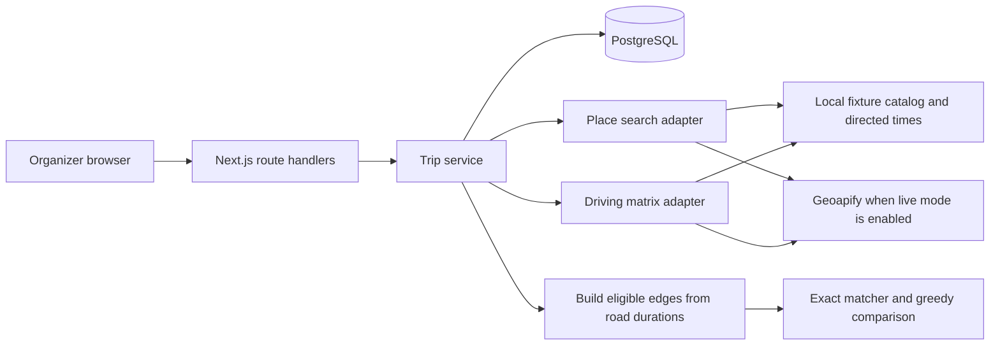

# GroupRide architecture extension for searchable U.S. pickups

**Design · November 2026. Checkpoints A (offline workflow) and B (independent verification, leg reuse and recovery) are implemented, as recorded in sections 9 and 10; C and D are still proposals.** The next product milestone lets an organizer select a shared venue, driver starting addresses, and passenger pickup addresses anywhere the U.S. provider can resolve and route them. The proposed first implementation uses an offline catalog of fictional places. Austin is the first proposed live demonstration. The [released architecture](ARCHITECTURE.md) and its [W6 verification](EVIDENCE.md#w6-dense-benchmark-corrections) describe the zone-based application. Sections 1–8 describe the full design; section 9 records exactly what checkpoint A built and where it differs. Everything not listed there is still a proposal.

[Section 12](#12-proposed-route-based-pickup-cost) proposes replacing per-pair address costs with route-based pickup costs. It is not implemented.

## 1. Product and boundaries

An organizer creates an address-based trip by searching for a venue, confirming its address, and entering the departure time with an explicit UTC offset. For each driver, the organizer confirms a starting address, seats offered, and maximum extra driving time for an individual pickup. For each passenger, the organizer confirms a pickup address. The preview shows named pairings, unassigned passengers, and estimated extra driving minutes. Saving and reloading reproduces the reviewed assignments and estimates. The same workflow applies in another U.S. city without importing a city catalog.

| Decision | First release |
|---|---|
| Coverage | Search across provider results whose country code is `US`. Bias suggestions near the venue while allowing cross-city and cross-state carpools. Accept a street address or a named place with a usable pickup point. City, ZIP, street-only and ambiguous results require a more specific selection. Coverage depends on the provider; a search result can lack a drivable connection. |
| Roles | The existing organizer-operated, loopback app handles registration. Use public addresses in demos and retained evidence. A shared deployment accepting personal pickup addresses requires the access and retention work in section 7. |
| Trip size | Retain 20 driver records and 50 passenger records including inactive entries, 0–8 seats per driver, and one shared venue. Correcting a start, pickup or detour limit requires withdrawal/cancellation and a fresh registration. The inactive record still consumes its lifetime slot. Show remaining slots before cancellation. At the cap, warn before withdrawal that the trip has no slot for a replacement, even after cancellation. Collapse duplicate coordinates for routing while retaining separate participant identities. |
| Time | Store departure as the existing UTC instant. Show the entered offset or explicitly labelled display zone when confirming the trip. Use a single static driving profile for all legs. Departure identifies the event; the first estimate excludes live traffic, dwell time and predictions of arrival time. |
| Detour limit | Proposed default 15 minutes per driver, editable at registration as an integer from 0 to 120 inclusive. Apply the threshold separately to each driver–passenger pair. A driver collecting two people could exceed that threshold on the combined journey. |
| Later extensions | Multi-stop ordering, traffic-dependent departure and arrival times, additional countries, participant accounts and invitations each change a separate contract. Store an ISO country code and provider namespace now. Enable countries after testing local address formats, coverage, time display and routing. U.S. territories with separate country codes need explicit coverage decisions. |

## 2. Component boundaries and provider choice

Keep the Next.js app, PostgreSQL and the pure min-cost flow engine. Introduce server-only adapters under a proposed `src/locations/` for place search and `src/routing/` for driving durations. The trip service orchestrates both persistence and preview publication. The matcher continues to consume participant IDs, capacities and integer edge costs. SQL repositories, route handlers and browser components never calculate a detour independently.



### What must be available to run it

| Proposed server setting | Local requirements | External requirements and behavior |
|---|---|---|
| `GROUPRIDE_ADDRESS_PROVIDER=off` (default) | Existing Next.js and PostgreSQL setup | Zone trips operate normally. Address dashboards, stored hits, same-policy rematches fully covered by retained legs, commits of current previews and receipt replay use local data. Searches and previews requiring new provider observations are unavailable. |
| `fixture` (development, CI and offline demo) | Same stack plus a locally generated signing secret, a small, versioned catalog of fictional U.S. addresses and asymmetric car times shipped with the app | The entire search → confirm → register → preview → save → reload workflow runs on loopback. No account, API key, paid plan, map tiles, city data import or outbound geospatial request. The UI labels fixture addresses and estimates. Use conspicuous names such as “GROUPRIDE FIXTURE — Pickup Alpha” in the synthetic catalog, with invented address components and no residential street numbers tied to real homes. Fixture searches never reach a geocoder. Initial installation still requires obtaining the existing project dependencies, PostgreSQL and, for browser tests, Chromium. |
| `geoapify` (explicit live opt-in) | Same stack plus a selection signing secret, server-only `GEOAPIFY_API_KEY` from the owner’s free project | The Next.js server needs outbound DNS and HTTPS on port 443 to `api.geoapify.com`. Search calls `GET /v1/geocode/autocomplete` and driving times use `POST /v1/routematrix`. The browser calls only GroupRide. One provider account covers both APIs across U.S. cities. Availability and address precision vary by location. [Autocomplete](https://apidocs.geoapify.com/docs/geocoding/address-autocomplete/) · [Route Matrix](https://apidocs.geoapify.com/docs/route-matrix/) |

Use the venue selection’s provider namespace to pin each new address trip to its source. For an existing trip, any new selection and cold preview must use that source. If the required adapter is disabled, lacks a key, or is unreachable, explain which capability is unavailable. Never substitute invented locations or travel times for a live trip. Reading recorded evidence and determining the trip's current supported policy are local operations, independent of network configuration.

**Live budget.** As checked on 2026-11-24, Geoapify advertises a free account with 3,000 credits/day, up to five requests/second, and no credit card. Each autocomplete request costs one credit, including successive debounced searches. Route matrices share the same allowance. Use a dedicated free project without a payment method for the pilot. Confirm its current limits and attribution before use. Keep the key in an ignored local environment file or server secret, outside browser bundles, URLs in logs and test artifacts. Fixture work requires only a local signing secret. [Pricing](https://www.geoapify.com/pricing/) · [Pricing details](https://www.geoapify.com/pricing-details/) · [Storage guidance](https://www.geoapify.com/products-and-services/) · [Attribution terms](https://www.geoapify.com/terms-and-conditions/)

**Live retention decision (ISSUE-045, closed).** The owner selected Geoapify’s published free-plan guidance for this pilot. Address Autocomplete expressly allows caching suggestions and results. For Route Matrix the project relies on Geoapify’s platform-wide storage guidance. GroupRide may send 30-minute signed suggestions to the local organizer, retain selected public building addresses and coordinates until offline reset, and retain timestamped directed durations and no-route observations until reset for same-trip reuse and display. Show linked Geoapify credit, OpenStreetMap attribution and applicable source credits on suggestions, previews and saved estimates. Before a live run, verify the free project, key and available credits. [Owner’s decision and provider sources](EVIDENCE.md#issue-045-free-plan-decision)

**Adapter contracts.** Search takes text, country, purpose, optional venue bias, limit and an abort signal. It returns typed candidates with country, display label, address components, road-access coordinates and available accuracy/source metadata. Prefer an entrance where available. Mark approximate locations in the confirmation UI and allow the organizer to select a nearby named entrance instead. A matrix request takes ordered source and target coordinates, car profile and deadline. Its result has exactly one indexed cell per requested pair, with either a finite nonnegative duration in seconds or an explicit no-route result. The adapter owns coordinate order, units, batch limits and translation of provider errors. Reject missing, duplicate or malformed cells. An HTTP success alone cannot validate a matrix. Normalize Geoapify country codes to uppercase and send `filter=countrycode:us` plus `bias=proximity:lon,lat` when a venue is known. Decode `sources_to_targets[i][j]` against ordered source and target IDs using longitude/latitude coordinate order. Validate indices against the requested endpoints. Interpret a documented null time as no route. Discard the returned road-snapped coordinates after decoding. Evidence refers to the submitted immutable location IDs and the provider’s observed times. A snap cannot move a confirmed pickup or become an identity key.

## 3. Search, confirmation and HTTP contracts

The client debounces typing (initial target 300 ms), cancels superseded requests, and discards out-of-order replies using a monotonically increasing search generation. Show street, city, state and ZIP when available. Keyboard selection and an explicit confirmation identify the chosen result. Editing the text clears the selection and, at once, every visible option and the active index: an option may be chosen only while it answers the CURRENT query, so Enter or a click cannot confirm a result of the previous query while the new search is pending. A field that is removed or rebuilt (for example by switching between zone and address trips) discards its selection in the parent form too, so no hidden token can be submitted. Disable submission until the selected address agrees with the displayed value. Require an affirmative choice of a result with usable precision. Reject a mismatched street number or a city-center fallback for a street-address query.

The following routes and fields extend the current [HTTP and idempotency contract](ARCHITECTURE.md#5-public-api-request-identity-and-browser-state).

| Proposed operation | Request and response |
|---|---|
| `POST /api/locations/search` | Accept `{query, purpose, tripId?}` where purpose is venue, driver start or pickup. For an existing trip, derive the venue bias on the server. Bound text length and return at most five displayable suggestions with a display label, precision and a signed selection token for each candidate. Return an empty list for no matches. Use a request body and `Cache-Control: no-store` for address searches. |
| `POST /api/trips` | Address form uses `{name, departAt, locationMode:"address", venueSelectionToken}`. Preserve the deployed `{name, departAt, destinationLabel}` form and its fingerprint for zone trips. Reject mixed forms. |
| `POST /api/trips/:id/drivers` | Address form uses `{name, startSelectionToken, seatCapacity, maxDetourMinutes}`. Validate the driver against the trip's mode. Existing zone registrations continue to send `zoneId`. |
| `POST /api/trips/:id/requests` | Address form uses `{name, pickupSelectionToken}`. Apply the same mode and scope checks. Cancellation, withdrawal and seat reduction use their existing routes and base-version rules. Correct an address or limit by canceling/withdrawing and registering anew in this release. |
| Dashboard, preview and commit | Keep `GET /api/trips/:id`, preview with `{}` and commit with `{previewId}`. Address-mode responses add `locationMode`, `costUnit:"detour_seconds"`, location display fields, and preview/committed estimate metadata. The browser converts seconds to minutes for display. Keep old DTOs readable and label zone costs in their existing units. |

The address form carries the exact token chosen by the organizer. The token below is abbreviated for display.

```json
{
  "name": "Austin evening event",
  "departAt": "2027-03-05T17:30:00-06:00",
  "locationMode": "address",
  "venueSelectionToken": "<signed venue token>"
}
```

An address preview keeps the public IDs and `optimal` / `greedy` shapes used by existing clients. It adds an estimate summary such as `{ costUnit, provider, routingPolicyVersion, observedFrom, observedTo }`. The optimal result’s numeric `totalCost` and each assignment’s `cost` use the stated unit. A saved dashboard reads the same summary through `committed_preview_id`. Enabling address trips requires the upgraded UI so an older client cannot present seconds as synthetic cost.

**Stateless selection.** Search performs no database writes. The server signs each eligible suggestion. Confirmation is the organizer’s explicit choice in the UI and makes no HTTP call. Keep unselected suggestions only in page memory and clear them on edit/navigation. Use the wire form `header.payload.tag` with three canonical, unpadded base64url segments. The header contains the format version, key identifier and dataset generation. The payload contains the random location UUID, issue/expiry times, purpose, nullable trip ID, provider namespace and allowlisted snapshot from section 4. Sign the ASCII bytes of the literal encoded `header.payload` with HMAC-SHA-256 under the dedicated selection key. The tag segment encodes the full 32-byte result. Size the complete token before offering it (4 KiB maximum). Anyone who can read a token can read its address.

**Admission and verification order.** The existing HTTP boundary checks the request key, valid JSON, outer request shape and 16 KiB body limit. An invalid outer request returns 400 before the keyed helper and has no receipt. For an admitted address form, preserve the token string exactly for the fingerprint. Inside the transaction, the existing receipt lookup and any required trip lookup precede token verification. [HTTP reader](../src/app/api/http.ts) · [Keyed mutation](../src/trips/mutation.ts)

1. In keyed work, bound the token to 4 KiB in encoded bytes. Check the three segments and canonical encoding, extract the signing input directly from the received string, and check the decoded tag length before constant-time comparison. Framing and base64url checks require no interpretation of the header or payload. Node’s base64url decoder also accepts regular base64, and its constant-time comparison requires equal byte lengths. [Node Buffer encodings](https://nodejs.org/docs/latest-v24.x/api/buffer.html#buffers-and-character-encodings) · [Node crypto comparison](https://nodejs.org/docs/latest-v24.x/api/crypto.html#cryptotimingsafeequala-b)
2. Load the master for the configured target and the generation from the database. Derive the current selection key and verify the MAC over the received signing input. The server chooses the algorithm, key and generation independently of the token. A failed MAC returns the same generic terminal 422 for all tokens. Optional failure counters are described below.
3. Only after a valid MAC, strictly decode the UTF-8 JSON header and payload. Require the supported version, current key identifier and generation, valid bounded snapshot, and matching purpose, trip, provider and timestamps. Venue tokens have null trip scope. Start/pickup tokens name an existing address trip and its provider. The token is valid from issue until expiry (exclusive), for at most 30 minutes. Encode issue and expiry as integer Unix milliseconds. At signing set expiry from one reading of the injectable Node server clock. After receipt lookup and the trip lock, read that clock again inside keyed work and require `issuedAt <= now < expiresAt` and `0 < expiresAt - issuedAt <= 1_800_000`. Search makes no database write, so no database timestamp is involved. Within scope and lifetime, two independent keys may reuse a pickup for two passengers or a venue for two trips. Copy the verified snapshot atomically.
4. Within this verifier, malformed segments, wrong tag length, invalid MAC, decoding/schema errors (including authenticated malformed JSON), expiry and scope failures all raise terminal `422 LOCATION_SELECTION_INVALID`. Translate expected input/decoder failures at their boundary. Key availability has its own retryable path. An unrelated internal exception still follows the existing internal-error protocol. Also validate the envelope at issuance so the server detects a faulty encoder before offering that suggestion.

- **Dataset generation.** Migration 002 adds a single-row `dataset_generation` table holding a random UUID. The setup role writes it on fresh installation and replaces it inside the same guarded reset transaction as the TRUNCATE, seed and starter trip. The app role has SELECT only. Reset therefore touches no files, and there is no window in which the data has been reset but old tokens still verify. If the reset COMMIT outcome is unknown, whichever state is durable carries its own generation, and the app follows it. Rerunning the guarded reset is the existing recovery.
- **Derived key.** Derive 32 bytes with HKDF-SHA-256 from the master bytes, the database UUID’s 16 bytes in canonical order as salt, and the fixed UTF-8 info string `GroupRide/selection/v1`. Use the derived bytes as the HMAC key. Search captures the generation and applicable trip scope in one short consistent read before signing. New-key attachment reads the generation on its checked-out mutation client under the existing shared dataset lock. Cache a validated master per target, never a generation across transactions. Reset changes token validity in the same commit as the dataset replacement.
- **Fixture master secret.** Store a random master secret (at least 32 bytes) in server-only configuration. In fixture mode the server creates it at `.groupride-local/<demo-or-test>/fixture-signing.key` if missing. Create it lazily on the first fixture search or token verification at runtime, never at module import: `next build` evaluates route modules while collecting page data, so import-time creation could write a key in the build environment or fail the build. Use an owner-only directory and file (0700/0600). Publish a complete key without overwriting a concurrent winner: write a uniquely named temporary file, `fsync` it, then `link(temp, final)`. Each initializer unlinks its own temporary name after a successful link, after `EEXIST` (then reads the winner) and on any other error. Do not use `rename`, which overwrites, or write the final path directly with an exclusive flag, which lets a racing reader see a partial key. Later starts reuse it, and reset never rewrites it. Load the secret once per server process after it validates, and cache it for that process; deleting or editing the file affects the next process, not the running one. A clean checkout requires no copied secret. Demo and test targets have separate master files, and a test reset never touches the demo target.
- **Live master secret.** In live mode the operator supplies the master secret through server-only configuration. GroupRide never generates or rewrites it. Replace it only with the app stopped, after suspected exposure. Replacement invalidates outstanding tokens for new attachments, as a reset does. Individual early revocation would require server state and is outside the loopback pilot.
- **Detectable key failures are never terminal.** Treat a missing (in live mode), unreadable, wrong-permission or malformed master secret, or a failed generation read, as a retryable availability failure. Throw it as a `TransientFailure` (`503 SELECTION_KEY_UNAVAILABLE`) so the keyed helper writes no receipt and the same key can succeed after repair. Validate the secret’s encoding, length and permissions before caching it. Cache only successful loads so a repaired file can be read on the next attempt. Extend the typed error-code and transient-code unions for the new 503. Preserve the existing dataset guard and database error classifications outside the selection-key read. A structurally valid token awaiting an unavailable verification key remains retryable. Receipt replay still precedes key loading, so finalized operations replay even while the key is unavailable. Report key availability in capability status separately from zone readiness.
- **Loss or replacement invalidates tokens.** Format checks cannot tell a lost fixture secret from a first run: if the file disappears, the next process creates a new, valid secret, and tokens signed with the old one fail verification. A new-key attachment of such a token finalizes a terminal 422, as after a deliberate replacement; the organizer searches again. For v1, the key identifier is the unpadded base64url encoding of the first 16 bytes of HMAC-SHA-256 of the UTF-8 label `GroupRide/selection/kid/v1` under the master. After a failed MAC, a bounded, best-effort inspection of the header may increment one coarse counter for a claimed key-ID mismatch, claimed generation mismatch or other invalid token. These unauthenticated hints cannot establish the cause of failure. They never select a key, change a response/receipt, or include caller-supplied identifier values in logs or metric labels. A fixture initializer that creates a master while address trips exist can warn that earlier tokens may have been invalidated. Persisting a key fingerprint in PostgreSQL would let the server return 503 instead, but a stale fingerprint would then block new attachments until an operator intervened. That trade is not worth it for a single-organizer loopback pilot.

**Recovery.** For a keyed mutation, structurally validate the bounded request and fingerprint the exact opaque token string along with the normalized business fields. Do not decode and reserialize the token during normalization. The existing key lock and receipt lookup come before signature, expiry, provider admission and trip checks. On a new key, verify the token inside keyed work. Matching applied or failed receipts replay after token expiry, restart or master-secret replacement, because none of these deletes receipts. A committed guarded reset truncates receipts and changes the generation. Retrying an address **trip creation** with its old venue token now finalizes a new 422, assuming key availability and normal address admission. Retrying a **registration against the deleted trip** reaches the existing trip lookup first and finalizes a new 404 `NOT_FOUND`. A repeated identical retry replays that new outcome. A rolled-back reset preserves the original receipt, so its replay is independent of the token’s current expiry. This follows the released dataset lifetime and lock order. [Seeded data lifetime](ARCHITECTURE.md#seeded-data-lifetime) · [Trip service](../src/trips/service.ts) A different token on the same key conflicts even if its address looks identical. Keep the exact body/key in the one tab-wide pending slot until its own terminal receipt arrives. Only the unresolved selected token enters session storage. Receipts store a fingerprint and minimal outcome, never the raw token or address. If pending storage is lost, reconcile the dashboard before deliberately issuing a new operation. [Fingerprint](../src/contracts/index.ts) · [Receipt protocol](../src/trips/mutation.ts) · [Pending storage](../src/app/trips/pendingStore.ts)

## 4. Data model and upgrade

Use an additive numbered migration after `001_foundation.sql`. Leave that file and its recorded checksum intact. Using an immutable location snapshot on a trip-owned row avoids a mutable global address book and allows old plans to retain the precise entrance that was confirmed.

| Table | Proposed change and invariant |
|---|---|
| `dataset_generation` | One row holding the random generation UUID used to derive selection signing keys (section 3). Written by the setup role at fresh installation and replaced in every guarded reset transaction. The app role has SELECT only. Upgrading a W6 database inserts an initial generation. |
| `trips` | Add `location_mode` default `zone` and a nullable `venue_location` snapshot. An address trip requires a venue and its pinned provider namespace. Preserve the existing required `destination_label` as a short display label within its current limit; keep the full selected address separately. Venue and departure remain immutable for this release. |
| `drivers`, `ride_requests` | Allow nullable `zone_id`, add mode and a nullable location snapshot. Zone mode requires a valid zone and no address. Address mode requires a snapshot and no zone. Only address drivers have a required `max_detour_minutes`, enforced as NOT NULL and 0–120 by the CHECK itself: a CHECK passes when its expression is NULL and `NULL BETWEEN 0 AND 120` is NULL, so migration `003_address_driver_limit.sql` (which replaces 002's constraint without editing 002's recorded checksum) adds the explicit `IS NOT NULL` test and validates existing rows. Add `UNIQUE (id, location_mode)` on trips. Reference it from each child’s `(trip_id, location_mode)` to enforce agreement. |
| `match_previews` | Store tagged cost unit and immutable routing evidence for address mode, including policy revision, adapter/profile, observation interval, participant-to-location mapping by internal IDs, directed leg durations/no-route flags and thresholds. Use an internal versioned JSONB structure with IDs for starts, pickups and venue, ordered leg endpoints, seconds or confirmed no-route, the source of each leg, its original provider observation timestamp when applicable, and the canonical routing-policy revision. Persist the compact public summary (unit, provider, routing policy, observation range, reused/fetched/local counts) in its own small column, separate from the private leg data. Reading one field out of a large JSONB value still decompresses the whole value, so dashboard and stored-hit queries must not select the evidence column. Validate the full evidence (coverage of legs needed by the current solve and the separate retained-leg bounds in section 5) on publication, on reuse as a prior preview, and at commit. Display reads, meaning dashboard and stored preview hits, never load the evidence column. They validate the public results and the summary column against the current roster IDs and unit. A stored preview hit is looked up by the current policy, so it validates against that policy. A committed dashboard validates against the policy recorded with its committed preview and the trip's `algorithm_version`, which must be one this build can still decode. A deployment that supersedes the policy then rejects new commits of old previews (`ALGORITHM_CHANGED`) but never makes a saved plan unreadable. Remove an evidence-schema decoder only after migrating or retiring the trips that still reference it. Corrupt evidence behind a valid display row is caught at commit, which fails safely as an internal error and keeps the prior plan, or at reuse, which falls back to a cold fetch (section 5). A same-version hit can still serve a valid public result and summary while the private evidence is corrupt. A new-key commit then fails internally. An effective roster change creates a new preview key, allowing a cold rebuild under the recovery rule in section 5. Corruption is a server defect, so this recovery need not be convenient, only available without a reset. No raw provider payload or address text is needed here. Zone previews retain their existing key and result shape. |
| `assignments`, `mutation_receipts` | Keep same-trip FKs, unique passenger assignment, integer `pickup_cost`, saved version, and existing receipt protocol. Interpret a saved cost with its trip mode and referenced preview. Store only IDs, outcome and necessary result fields in new receipts. Exact addresses belong to the scoped roster and venue. |

Address trips accept driver `{ baseVersion, details: { name, seatCapacity, maxDetourMinutes, startSelectionToken? } }` and passenger `{ baseVersion, details: { name, pickupSelectionToken? } }` on the existing participant PATCH routes. Omitting the selection token retains the stored address. When present, a replacement token must match the participant role, trip and provider. The service verifies it on the mutation client under the trip lock. A changed registration invalidates the plan and prevents a stale preview from being saved.

Invitation pickup search uses `POST /api/invites/:inviteId/search`. The lookup uses the invitation ID to load the trip’s mode and venue bias. The issued token binds to the invitation ID, which guest registration verifies in place of the organizer trip ID. This keeps the organizer ID out of guest selection tokens and prevents their use in organizer registration or on another invite.

Canonical snapshot fields are internal location ID (the selection UUID), provider namespace and reference if available, country code, structured address, display label, latitude, longitude, precision, source attribution and token issue time. Record attachment time on the business row when selected. Record explicit longitude/latitude order at the adapter boundary. Validate finite coordinate ranges, required fields, purpose and text sizes before storage. Copy only allowlisted fields. Route evidence uses immutable location IDs. Request identity uses the full signed token as described in section 3.

Existing rows default to zone mode with empty new fields. Old driver/request inserts must still work with their existing defaults. Preserve cached zone previews, receipt fingerprints, pending browser requests and plan metadata. Extend each strict request schema as a union. In the contracts and trip service, branch before zone-specific ID validation. Preserve the byte-for-byte normalized zone body and fingerprint. Check a new roster write’s form against the locked trip inside keyed work. A mismatch produces a receipted 422 `LOCATION_MODE_MISMATCH`. [Contracts](../src/contracts/index.ts) · [Trip service](../src/trips/service.ts)

Scope the legacy zone fixture guard to its existing contract during the migration; keep the offline dataset lock/reset protocol. The existing guarded TRUNCATE covers attached snapshots and leg evidence on the trip, roster and preview tables. Stateless search adds no selection table, purge job or DELETE grant. Test both fresh installation and upgrade over retained data. Roll out schema and dual-mode readers before enabling address writes. To disable address intake, stop new searches and new address trips while allowing existing address dashboards, stored commits and receipt replay. Rolling back to zone-only binaries requires retiring or migrating address trips first.

## 5. Driving estimates and matching

For each active positive-seat driver start D, active passenger pickup P and trip venue V, obtain directed car travel times D→P, P→V and D→V. Normalize to seconds; retain finite durations at provider precision during calculation and round the **final difference** to the nearest whole second, with half-seconds rounded up. Define the score as the nonnegative extra time. Clamp a negative estimated difference to zero and count it in telemetry for profile-quality review. These independently estimated legs can disagree slightly. No-route and unknown durations must never become zero-cost edges.

```text
extraSeconds = max(0, round(seconds(D,P) + seconds(P,V) - seconds(D,V)))
eligible    = all three legs routable and extraSeconds <= maxDetourMinutes * 60
```

Only positive-seat active drivers generate current pickup demand. A zero-seat active driver can later regain capacity. Preserve previously observed legs for that driver as specified below. Include active passengers with no eligible edges in the unassigned list. A zero-minute limit permits a genuine on-the-way pickup. A confirmed no-route on D→V excludes that driver's edges; a no-route on P→V excludes that pickup's edges. Empty demand or supply yields the ordinary empty plan without a provider call. The 120-minute proposed maximum bounds an eligible edge to 7,200 seconds, within the 10,000 integer cap enforced by input validation, stored-result validation, feasibility checks and the assignment column. Even 50 such assignments sum to only 360,000 seconds. For unassigned passengers, derive aggregate explanations from the eligible edges and active capacity. Show whether there are no available drivers, no eligible pickups within the limits, or eligible drivers whose seats were allocated. Keep detailed provider diagnostics out of the public response.

Introduce a trip-service projection for address rosters beside the [zone projection](../src/matching/project.ts). It takes frozen durations and thresholds as inputs and returns the same `MatchInput`. GroupRide supplies these edges to the existing exact and greedy algorithms and retains their validated results. The primary objective remains maximum passenger coverage; among those plans the exact matcher minimizes summed individual detour seconds. The UI labels this “sum of estimated individual pickup detours,” displays the estimate time and threshold, and rounds only for presentation. It cannot infer a driver's combined route duration from the sum.

**Routing policy.** For the proposed Geoapify car profile, explicitly send the following fields on every matrix request. The explicit `max_speed` of 140 km/h pins Geoapify’s documented car default within its supported range of 10–252 km/h. Omit the optional `avoid` property and record its absence in the routing-policy identifier. It describes the estimate and is independent of each driver's detour limit. Assert the actual outbound JSON in adapter tests. [Route Matrix parameters](https://apidocs.geoapify.com/docs/route-matrix/)

```json
{"mode":"drive","traffic":"free_flow","type":"balanced","units":"metric","max_speed":140}
```

Include the provider namespace, endpoint/API revision, canonical profile fields and adapter interpretation of direction, units and no-route in the routing-policy identifier. A change to any of these starts a new duration history. The preview identifier additionally versions the solver, evidence schema, rounding and eligibility rules. A fixture policy includes its catalog/matrix revision. A static profile fixes how GroupRide interprets observations. The upstream road graph can still change between calls.

**Trip-local leg reuse.** In the same read snapshot as the roster, select the most recent compatible published preview for this trip and routing policy. Choose the highest base version at or below the captured version, breaking ties by preview UUID. Only supported evidence schemas are candidates. Persist the routing-policy ID separately from the composite preview ID for this lookup. Validate the candidate evidence and its original endpoint identities before reuse. If the **stored evidence** fails validation, count the invariant failure once for this preview attempt and discard the entire candidate. Start with zero reused legs, skip older rows and in-flight handoffs for this attempt, and rebuild using the ordinary cold path. Resolve identical endpoints locally and fetch all required nonlocal legs through the normal admission, quota and deadline checks. If no provider cells are needed, an empty or local-only plan can still publish offline. Otherwise a routing outage leaves this attempt without a new row. Database read failures keep their normal error classification. A malformed fresh matrix fails the attempt and cannot trigger another cold fallback. If no compatible prior preview exists, follow the ordinary first-preview path.

Keep two sets of directed (from location UUID, to location UUID) pairs:

- **Required for this solve.** With at least one positive-seat active driver and one active pickup, require each such driver→pickup, driver→venue and pickup→venue leg. With no supply or demand the required set is empty.
- **Eligible for retention.** Include driver→pickup, driver→venue and pickup→venue pairs for *all* active drivers and pickups, including zero-seat drivers, and the immutable venue. Retain an existing pair while any active participant still references the relevant endpoint in that role. Removing the last reference after cancellation or withdrawal drops that leg from the next preview. Historical previews remain immutable.

Copy prior evidence intersecting the retention set, including confirmed no-route and original timestamps. Fill only required pairs missing from that copy. Never fetch just to fill a dormant driver's row. When a new pickup registers while X has zero seats, X→new pickup can remain absent until X regains capacity. Validate that every required pair is resolved, every stored pair is allowed and unique, and every observation is well formed. Only the required pairs enter the address projection and commit feasibility check. Store the retained copy plus the newly resolved pairs, including on empty-plan previews. This preserves evidence across successive zero-seat versions. The existing service permits increasing an active driver’s capacity from zero. [Capacity edit](../src/trips/service.ts)

**Identical endpoints.** Compare the validated numeric longitude/latitude pairs for exact equality, including across distinct location UUIDs. For equal coordinates, resolve the leg locally to zero seconds with source `identical_endpoint` and a null provider observation time. Retain the ordered IDs. Close coordinates still require routing. A local zero establishes only that leg. If another leg is unreachable, the pairing remains ineligible. Version this rule in the routing policy. Exclude local-zero cells from upstream rectangles, splitting a rectangle when necessary.

Group remaining missing pairs by identical target sets and request venue legs separately. On zero missing provider legs, publish even during an outage. If a required provider leg is missing and routing fails, leave the version without a new preview. Timestamp fresh cells at batch response time. The public observation range and reused/fetched/local counts describe only legs needed for this solve. Exclude dormant legs and local zeros from the provider observation range (null when there are no provider observations). A deliberate policy revision starts a new duration history.

**Request budget.** With 20 distinct active starts, 50 distinct pickups and one venue, a cold preview needs at most 1,000 driver-to-pickup cells plus 70 venue legs. Deduplicate equal coordinates within batches and expand the resulting cells back to their ordered location IDs. Keep an ordered index map for each source/target batch and validate every expected cell before publishing. Geoapify documents a limit of 1,000 cells per synchronous request. Where the account permits, request one 20×50 matrix plus a 70×1 venue matrix. Four 10×25 matrices plus the venue matrix are a fallback if the larger request is impractical. [Route Matrix limits and credit formula](https://apidocs.geoapify.com/docs/route-matrix/)

| Live example, all coordinates distinct | Directed cells | Base matrix credits before autocomplete, retries and distance surcharges |
|---|---:|---:|
| 1 driver, 1 passenger, 1 venue | 3 | 3 |
| 20 drivers, 50 passengers, 1 venue, two rectangular requests | 1,070 | 500 + 70 = 570 |
| Same maximum roster, five smaller requests | 1,070 | 4 × 250 + 70 = 1,070 |
| Same-policy cancellation, capacity cut or withdrawal after a covering preview | 0 new | 0 |
| Add the 20th driver to 50 existing pickups, all prior legs covered | 50 driver→pickup + 1 driver→venue | 51 |
| Add the 50th pickup to 20 existing drivers, all prior legs covered | 20 driver→pickup + 1 pickup→venue | 21 |

Geoapify charges a base of `max(sources, targets) × min(sources, targets, 10)` per synchronous request and adds a surcharge for each full 500 km of returned distance per cell. Even at 570 base credits, six cold maximum-size previews exceed the advertised free daily allowance before searches. A small local demo and a repeated scale benchmark therefore have very different resource needs. [Matrix pricing](https://apidocs.geoapify.com/docs/route-matrix/) · [Account plans](https://www.geoapify.com/pricing/)

**Free-pilot admission.** Keep the project on the free plan with no payment method or automatic upgrade. The provider enforces its quota. Apply one process-local rate limiter across autocomplete and matrix calls within the free account's five requests/second. Honor upstream 429 or quota responses as `ROUTING_QUOTA` for previews, with Retry-After when available and no automatic fan-out of retries. Search reports the analogous quota failure in its own UI. Measure actual usage on the provider dashboard. The pilot maintains no daily ledger, reservations or assumed provider reset timezone. Before any paid rollout, establish a spending cap, provider quota-window boundaries, and how to reconcile crash-orphaned reservations against billed attempts. [Pricing](https://www.geoapify.com/pricing/) · [Credit calculation](https://www.geoapify.com/pricing-details/)

Run live mode as a single server process with one upstream preview workload per trip. The permit carries the server-observed base version, a unique holder identity and an abort signal. A same-version competitor gets retryable 429 `PREVIEW_BUSY`. An older request observing a newer holder gets 409 `STALE_VERSION`. A request with a strictly newer authoritative roster version signals the old holder to stop dispatching and abandon publication. If the newcomer needs routing, wait for the old holder's upstream calls to settle within the newcomer’s original deadline, then compete for the permit and recheck the current trip version and cache. Legs are keyed by (routing policy, from location UUID, to location UUID), and those never change for a trip. The old holder therefore hands its settled, validated cells to the newcomer through the in-process permit, including confirmed no-route results and their observation times, together with the trip and routing policy they belong to. Unless section 5 requires a cold rebuild after corrupt evidence, the newcomer accepts them only for the same trip and policy, then intersects them with its own retention set. A cell for an endpoint no active participant references at the newcomer's version (for example a driver canceled in between) is discarded, as is any cell outside the retained roles. Merge without replacing an observation the newcomer already holds from retained evidence. Then fetch only the required pairs still missing. This avoids paying twice for legs already bought (up to 570 credits for a cold maximum-size preview). Handed-off cells are still in memory only; if the newcomer also fails to publish, they are lost. A request with all required legs covered (including an empty required set) can publish immediately. When it supersedes an older holder, it snapshots the cells already settled for the same policy, merges eligible dormant legs under the same retention and precedence rules, and leaves outstanding batches to the older holder. Keep the eligible snapshot available to other publishers of the same version until publication completes. Each publisher releases its reference on exit. The last reference frees the snapshot, and releasing an older version cannot remove a newer handoff. Old-holder cleanup releases only its own permit, and the under-lock version check still protects against a late provider success. Aborting cannot refund upstream calls already sent. Shared multi-process admission is a separate deployment prerequisite.

## 6. Preview publication, commit and failure handling

1. **Read and choose the policy.** In `publishPreviewInner`, derive the expected identifier from the stored trip mode and provider in the existing consistent transaction. For zones it is the current `ALGORITHM_VERSION`. For addresses it identifies the solver, evidence schema and provider/profile/cost-policy revision, including rounding and eligibility. Use it for **both** calls to `findPreviewByKey`. On a miss, branch the current `readRoster`: only zones call `listZoneCosts` and use zone IDs. Address rosters capture authoritative IDs, capacities, thresholds, frozen locations and venue at one base version. A validated stored hit returns immediately with its original estimate range. On a hit at a newer authoritative version, signal any older live holder before returning. [Preview service](../src/trips/preview.ts)
2. **Compute a new quote.** Capture compatible prior evidence during the read above and release the client. Apply section 5’s directed-leg reuse and admission rules. Fetch missing rectangles outside all database transactions, with at most two batches in flight per admitted preview. Branch the unconditional `projectMatchInput` between the zone and address projectors, then run the same `computeMatch`. Finish within the shared deadline below.
3. **Publish the winner.** Reacquire the existing dataset and trip locks in a short write transaction. Recheck the captured version and expected policy before insert. A changed roster produces `409 STALE_VERSION` with no stale row. Drain old application instances on a policy upgrade. Persist the chosen composite address identifier rather than copying the solver-only `computation.algorithmVersion`. Store costs, evidence and both results atomically with no trip-version bump. The unique (trip, base version, algorithm) key plus the under-lock second lookup chooses the winner. Every successful caller returns the winner’s public DTO through a mode-aware `toResponse`. At 1,070 legs, even 100 bytes per leg is about 107 KB per preview before database overhead. Keep retained legs and endpoint mappings server-side. Preview and dashboard queries serialize only their public allowlisted fields, including results, estimate range and aggregate counts. The dashboard and stored preview hits read the separate summary column described in section 4 and never select the evidence column. Only leg reuse and commit load the evidence. A caller rejected by live admission can retry against the winning row.
4. **Commit the reviewed plan.** In `commitPreview`, replay a matching receipt first. For a fresh key, lock key → trip → children, fetch the preview by trip and ID, and compare `preview.algorithm_version` with the mode-specific expected identifier instead of the single `ALGORITHM_VERSION`. Keep the base-version check. Branch the second `readRoster` and `projectMatchInput` here too. An address commit checks evidence tag, unit, provider/policy, exact roster/location/threshold mapping, required coverage, and the allowed bounds on extra retained legs. Rebuild eligible edges from only the current required durations, run `assertFeasible` against the stored optimal plan and copy the assignments. Write that validated identifier into `commitPlan.algorithmVersion` and label address costs in the response. A zone-only decode must never accept address evidence. An unknown/superseded policy produces 409 `ALGORITHM_CHANGED`. Corrupt server evidence is an internal failure and must leave the prior plan intact. Commit needs neither a provider call nor another solve. [Commit service](../src/trips/commit.ts) · [Mutation protocol](../src/trips/mutation.ts)
5. **Invalidate and recover.** First successful publication freezes estimates for that version/policy. An effective roster change increments the version and invalidates the full plan. A newer policy supersedes uncommitted previews while prior receipts and saved plans retain their historical meaning. A user-driven traffic refresh would require its own versioned input.

**Ten-second preview deadline.** Start one absolute monotonic deadline on entry. The existing transaction helper sets 2 s lock and 5 s statement timeouts and calls `pool.connect()` before either one applies. Extend `withTransaction` with an optional deadline for preview reads, admission rechecks and publication. Existing callers keep their defaults. Bound pool acquisition by remaining time and release any client delivered after cancellation. Before each blocking statement, including the trip lock and publication, recompute remaining milliseconds and apply transaction-local lock/statement timeouts capped at the smaller of their existing limits and that remainder. An expired or sub-millisecond remainder fails before issuing SQL (PostgreSQL interprets zero as unlimited). A timeout set once at BEGIN would restart its allowance on each statement. [Transaction helper](../src/db/transaction.ts)

Carry the same deadline through admission, upstream sends and body reads, solver entry/exit, and COMMIT. Reserve time for publication. Use an independent abort timer for stalled network or database I/O. On expiry stop dispatch, cancel outstanding operations and either roll back a known-open transaction or discard an uncertain client. A Promise race alone must never leave a client running work that can later be returned to the pool. If a publication COMMIT acknowledgment is lost at the boundary, report a retryable unavailable result and let the unique preview key resolve the next attempt. Do not claim the row was rolled back. Expiry bounds the caller's wait while connection disposal may finish separately.

**Browser during a slow preview.** On each new preview, advance the request generation, clear the previous saveable preview and enter a distinct loading state (“Estimating pickup times…”). Disable duplicate Preview and Save. Keep the unkeyed preview outside the persisted mutation slot. On roster change, navigation or cancellation, invalidate the generation and abort the browser request. Give the server deadline a small response grace period (proposed browser timeout 12 seconds). Only the current trip and generation can accept success, show an error or clear the loading state. Even a superseded reply for the same trip can raise the monotonic version floor and invalidate a stale plan. On timeout, show Retry and keep Save unavailable until a current preview is accepted. A retry can return an already published winner. [Dashboard reducer](../src/app/trips/reducer.ts)

| Situation | Observable behavior |
|---|---|
| Unresolved address, unsupported country, expired suggestion | Require a new selection in the affected field. A late search result cannot override a newer selection or resolve a pending mutation. |
| Per-cell confirmed no route | Exclude only dependent pairs. A complete matrix can legitimately lead to zero matches. |
| Incomplete matrix, provider timeout, bad credentials, throttling or quota exhaustion | Do not publish a partial preview. Return 503 with a routing-specific code (for example `ROUTING_UNAVAILABLE` or `ROUTING_QUOTA`), a request ID and a retry hint when known. Local per-trip contention returns retryable 429 `PREVIEW_BUSY` before any matrix call. Availability errors on this unkeyed operation carry no terminal mutation receipt. Apply backoff for throttling; represent disabled credentials as configuration failure with no automatic retry storm. Dashboard and stored-plan reads continue. |
| Unknown database commit outcome | Preserve same-key recovery and connection disposal. A successful durable commit returns its original receipt on retry regardless of subsequent routing availability. |
| Older preview or GET arrives after the roster changes | Apply the existing reducer version floor and preview generation guards to both estimate metadata and assignments; clear them together. |

## 7. Privacy and operations

Search discloses the typed query and optional venue bias to the live provider. Routing sends the selected driver start, passenger pickup and venue coordinates and car-profile parameters to Geoapify. Keep participant names, app IDs and contact details local. Show this disclosure before live search and give attribution at suggestions, previews and saved estimates, including the required OpenStreetMap contributor credit, Geoapify credit on the free plan and other applicable upstream credits. Suppress full upstream URLs, addresses, coordinates, provider keys, autocomplete responses and pending bodies in logs, traces and analytics. Use public places for live demonstrations. Record aggregate timings and credits with the date and plan. [Provider terms](https://www.geoapify.com/terms-and-conditions/)

Bind the local demo to loopback. At route entry, before reading the body, replaying a receipt, issuing a token or contacting a provider, check every business write and both unkeyed search and preview POSTs. Apply the same check before changing or draining telemetry when the test-only endpoint is enabled. A same-origin GET carries no `Origin` header, so those two checks cannot identify the destination of a request that a DNS-rebinding page sends to the telemetry endpoint; before enabling, resetting or draining, the endpoint also requires the request's `Host` to be one of the trusted authorities (the host and port of each trusted origin). A header-less script calling the configured local service has such a Host and is unaffected. Return 403 without a receipt when `Sec-Fetch-Site` is `cross-site` or when a present `Origin` fails to match the configured local app origin (scheme, host and port). Reject opaque `null` and malformed origins. Use the trusted listening configuration for the comparison, never the request's own `Host`, which a DNS-rebinding page controls together with its `Origin`: the trusted origins are `GROUPRIDE_TRUSTED_ORIGINS` when set (and then only those), otherwise the loopback names (`127.0.0.1`, `localhost`, `[::1]`) on the listening `PORT`, with a loopback-only Host fallback when no port is known. Accept `Sec-Fetch-Site` values `same-origin` and `none` only. The two checks are independent. A trusted loopback client that sends neither header can still use the API. L-02 reruns the existing suites unchanged. [Fetch Metadata](https://www.w3.org/TR/fetch-metadata/) Signed selections plus purpose and trip checks are sufficient for this single-organizer assumption. They confer no user identity. Browser tests exercise same-origin fetch normally, and direct test requests may omit `Origin`. Keep the selected token only while its operation is unresolved. Treat it as readable address data and exclude it from logs, analytics, screenshots and receipt bodies. Before a shared deployment, require authenticated trip membership and per-request access checks, define when drivers may see exact pickups, and agree deletion and backup retention periods. On loopback, attached snapshots and preview evidence survive until guarded offline reset. Unused suggestions expire in browser memory and leave no database rows.

Report zone readiness and live-provider availability independently. Distinguish fixture, live, and stored estimates in the UI. Track search latency, confirmation failures, batch/cell and request counts, estimated base credits, reused and fetched cells, quota responses, provider time, solver time, stale publishes, cache hits and end-to-end p95. Preserve the zone P-01 baseline. Record cached, cold fixture and cold live measurements separately. If a demo venue loses Internet access, show a saved live plan, or open a separately labelled fixture trip for the interactive demonstration. Roster reductions can produce a new preview offline whenever prior observations cover the remaining legs.

## 8. Independent example and delivery gates

Use a fictional minute-based fixture for arithmetic, with one seat per driver and a 15-minute limit. Direct times to the venue are 20 for D1 and 24 for D2. From P1 and P2 to the venue they are 10 and 12 respectively.

| Driver | To P1 | To P2 | Detour via P1 | Detour via P2 |
|---|---:|---:|---:|---:|
| D1 | 15 | 10 | 15 + 10 − 20 = 5 | 10 + 12 − 20 = 2 |
| D2 | 15 | 20 | 15 + 10 − 24 = 1 | 20 + 12 − 24 = 8 |

Both pairings seat two. D1→P2 and D2→P1 cost 3 minutes together; the alternative costs 13. The expected saved total is **180 seconds**, with the two named assignments intact after reload. This expectation comes directly from the input times.

### A fixture that distinguishes greedy, direction and the detour limit

Use seconds throughout. D1 and D2 each have one seat, a 900-second limit, and 1,200 seconds of direct driving to V. Both pickups take 600 seconds to reach V. P1’s canonical UUID sorts before P2’s, as in the existing greedy baseline. The table supplies **independent raw times** in both directions. Load them into the fixture adapter keyed by ordered endpoints.

| Pair | D→P seconds | P→D seconds | Expected forward detour | Eligible |
|---|---:|---:|---:|---|
| D1, P1 | 660 | 660 | 60 | yes |
| D1, P2 | 1,500 | 1,550 | 900 | yes, exactly at limit |
| D2, P1 | 720 | 1,600 | 120 | yes |
| D2, P2 | 1,501 | 720 | 901 | no, one second over |

Greedy seats P1 with D1 for **one match, 60 seconds**, leaving P2 unassigned. The exact matcher seats P1 with D2 and P2 with D1 for **two matches, 1,020 seconds**. Higher coverage wins even though the sum is larger. If an adapter requests P→D, it instead admits D1/P1 and D2/P2 at 60 and 120 seconds and falsely reports two matches for **180 seconds**. Assert each directional edge, the excluded pair, named assignments, unassigned IDs, counts and total seconds through publication, with the exact plan surviving commit/reload. Swapping D→P rows/columns or direct-to-venue values is also detectable with the first fixture.

### Delivery and acceptance

The L-series applies to the proposed address extension. W6’s 38 baseline IDs keep their original meaning. At checkpoint closeout, record each L-ID’s test or interaction, revision, expected and observed outcome, and evidence link. The workplan tracks checkpoint ownership and status. [Checkpoint rows](../WORKPLAN.md#next-product-milestone--searchable-us-pickups)

| ID | Gate | Acceptance observation |
|---|---|---|
| L-01 | A | Start fixture mode from a clean checkout and fresh database with no signing file or provider key. Concurrent initialization produces one complete owner-only master secret per target: racing creators all read the same winner, no reader observes a partial key, and no temporary files remain after success, `EEXIST` or an injected error. `next build` creates no key file. Restart preserves a token. Guarded test reset changes only the test generation and rewrites no key file: an old test venue token then gets 422, while a demo token still works. Inject a failure after TRUNCATE and before COMMIT: the old data, generation, receipts and tokens all survive, and a same-key retry of a pre-reset creation replays its original 201. After a committed reset, the creation retry finalizes a new 422, and a pre-reset registration retry on a deleted trip finalizes a new 404. Retry each again and verify its new receipt replays. Inject a lost COMMIT acknowledgement: after reconnecting, the durable generation and data agree, and the retry behaves as in whichever of those two cases is durable. Delete the fixture secret between processes: the next process creates a new secret, a fresh-key attachment with a pre-deletion token gets 422 with an advisory key-ID mismatch counter, and the warning is logged when address trips exist. |
| L-02 | A | Install fresh and upgrade a W6 database with a saved zone plan, preview, applied/failed receipts and pending zone payload. Verify zone reads, byte-identical request fingerprints and same-key replay. Run the existing zone suites on the candidate. |
| L-03 | A | With outbound geospatial traffic blocked, use keyboard search to confirm a venue, driver start and pickup through preview, save and reload. Check ambiguous/empty results, editing and superseded responses, fixture labels, correct cost units and zero suggestion writes. |
| L-04 | A | Exercise purpose/trip/mode, reuse, expiry and lifetime caps. Verify the outcome matrix below, including replay after expiry, restart and master replacement while receipts exist. Test a bounded token with a mismatching key-ID hint and confirm the hint changes no public behavior. Inspect durable receipts and business-row counts alongside HTTP results. Test each rejection header independently, including a different port on the same host and cross-site metadata paired with a matching Origin. Check 403 before receipt lookup or business effects, and zero provider dispatches for rejected search/preview. A same-origin browser request and a headerless loopback client both proceed. |
| L-05 | B | Run both hand fixtures through the real projection, preview and commit. Verify named results and saved costs, direction, coverage before cost, the inclusive 900-second threshold and exclusion at 901. |
| L-06 | B | Run the seeded independent projection and exhaustive-oracle comparison below. Retain seed range, inputs for failures, and discrepancies for both edge sets and optimal objectives. |
| L-07 | B | For fixed raw fixture times and identical roster IDs, compare a forced cold preview with a reused preview after edits. Require identical required leg values, eligible edges, optimal and greedy results, including unassigned IDs. Compare timestamps and call counts separately. |
| L-08 | B | Publish with X at two seats at v3, zero at v4 and two at v5, including a run where X is the only driver. Disable routing after v3. v4 makes no assignments to X and retains its observed legs. v5 restores the cold-equivalent plan with zero new upstream cells and original observation times. |
| L-09 | B | While X is at zero seats, add a new distinct pickup and confirm no request for X’s dormant row. On restoration fetch only missing required legs. With routing unavailable a genuinely missing leg prevents publication. Cancellation/withdrawal prunes unused endpoints while a shared active token keeps its legs. Check 0/51/21 incremental cells on the distinct-coordinate examples in section 5. |
| L-10 | B | Exercise equal coordinates under different IDs, nearly equal coordinates, a usable zero-cost edge, no-route on each leg type, empty demand, exhausted seats, negative differences and final rounding. Equal endpoints add zero upstream cells. A separate unreachable leg still excludes the pair. |
| L-11 | B | Reject missing required cells, reversed or duplicate keys, wrong policy/trip, unexpected retained endpoints and malformed durations. A policy change refetches required provider cells. A malformed reuse candidate falls back to a cold fetch, reuses none of its legs and never reaches the projector. Covered rematches, current stored hits, commit and receipt replay work with routing disabled. |
| L-12 | B | Inspect serialized preview (cold and hit), commit and dashboard responses for a maximum roster. Assert their allowlisted shapes, summary counts/range, and absence of raw cells, endpoint mappings and hidden dormant evidence. Read the DB independently to verify the evidence is present there. After a policy upgrade, reload a committed old-policy plan with its stored summary and verify its results still display; a fresh-key commit of a superseded uncommitted preview returns ALGORITHM_CHANGED. Capture the SQL issued by dashboard and stored-hit reads and assert neither selects the evidence column. Corrupt only the evidence of a stored preview: the hit still displays, and commit fails as an internal error with the prior plan intact. After an effective roster change, the next preview skips the corrupt candidate, increments the invariant-failure counter and fetches every required leg cold. Use separate runs beginning with the same corrupt candidate. With routing disabled and a required nonlocal leg, assert no new row, a routing-unavailable response and a readable dashboard. With only local or zero required legs, assert successful publication and zero upstream calls. |
| L-13 | C | Against a loopback stub, assert explicit profile fields, absent `avoid`, source/target indices and ignored snaps. Exercise 401/403, 429, missing credentials, malformed cells, transport errors and stalled bodies. No partial preview is published. |
| L-14 | C | Deterministically pause upstream work. Same-version misses admit one workload and return busy to a peer. A newer roster version aborts the old holder, publishes once, and rejects any late stale publication. With a counting stub, the newcomer requests zero upstream cells that the old holder already settled, and a handoff for a different trip or policy is refused. Cancel driver X while the old holder is fetching X→P, X→V and P→V, with Y now active: the newcomer reuses only P→V, discards both X cells, and the published evidence contains no X endpoint. Verify no overlapping local upstream workloads, permit cleanup on timeout, and a stored hit on retry. |
| L-15 | C | Race fixture publishers with differing observations and verify both return the same immutable winner. Pause a fetch across a roster edit and verify 409 with no stale preview row. |
| L-16 | C | Consume the deadline during routing, then block pool acquisition or publication on real PostgreSQL. Verify bounded response, safe client disposal/reuse, and retry after an uncertain publication COMMIT without duplicate effects. |
| L-17 | C | Deliver stale success, error and completion to the browser after a newer request or roster change. Verify the version floor, pending/Retry/Save states and recovery. Measure competing-trip responsiveness with a 20-driver/50-passenger fixture on loopback. |
| L-18 | D | Use the recorded ISSUE-045 retention decision for both APIs. Before live queries, verify the attribution displays with fixtures and confirm the owner’s free/no-card project, server key and available credit budget for the run. |
| L-19 | D | Demonstrate the West Campus apartment scenario below and a second U.S. region, starting with one driver and one pickup. Record observed precision, attribution, latency and dashboard credits. Disconnect after a covering preview and verify a reduction/rematch, commit, replay and reload. Get an explicit quota budget for any larger live run. |

### Austin live demo: West Campus apartments to one event

Model an organizer taking a group from apartments near UT Austin to a shared event. The organizer chooses the venue. One example is the Long Center, 701 W Riverside Dr, Austin, TX 78704. Use fictional drivers and passengers and the buildings’ published street addresses. Confirm the meeting point on the street-facing side during the rehearsal. [Long Center directions](https://thelongcenter.org/directions-parking/)

| Example search | Published building address |
|---|---|
| 2400 Nueces Apartments | 2400 Nueces St, Austin, TX 78705. [UT Housing](https://housing.utexas.edu/housing/2400-nueces-apartments/2400-nueces) |
| The Castilian | 2323 San Antonio St, Austin, TX 78705. [Property operator directory](https://www.americancampus.com/community-listing) |
| The Callaway House Austin | 505 W 22nd St, Austin, TX 78705. [Property operator directory](https://www.americancampus.com/community-listing) |

For L-19, start with one driver at 2400 Nueces and one pickup at Callaway House. For the group demonstration, add a second driver starting at The Castilian and two more passengers, one at each driver's building. Give the drivers two seats and one seat respectively. Preview and save the assignments, then remove one offered seat and rematch. The organizer can see who still has a ride and who needs another seat. Use observed road estimates for the demonstration; the deterministic fixtures establish the expected solver answers. Building-level searches and the live run are part of milestone D after the L-18 account and quota checks.

**Token outcomes for L-04.** Use the same canonical key and body on each retry, with a fresh key for each independent case.

| Starting condition | Expected observation |
|---|---|
| Invalid outer JSON, field type or HTTP body over 16 KiB | Existing 400 with no receipt. |
| Admitted create or registration on an existing trip with a token over 4 KiB, invalid framing/encoding, short tag or wrong MAC | Terminal 422 and one failure receipt. Identical retry replays it with no business write. |
| Controlled clock with an otherwise valid token and available keys | On fresh keys at expiry minus one millisecond and exactly at expiry, observe success then terminal 422. Retry the first successful key after expiry and verify receipt replay. |
| Valid MAC over a deliberately malformed JSON payload or unsupported header version | The test signer supplies these bytes. The verifier returns the same receipted 422 without leaking a parser exception. |
| Unexpired token issued under a good master; a new process first loads an unreadable or malformed file | Matching prior receipts still replay. An unused key yields 503 with no receipt. Restore the original master before expiry and retry in that process: the same body/key succeeds once. Also verify that changing a file after a successful load leaves the warm process using its cached master. |
| Current-generation read temporarily unavailable after the dataset guard passes | Prior receipts still replay; an operation needing verification gets 503 without a receipt and succeeds once on retry after repair. |

**Independent projection check (L-06 and L-07).** Use at least 100 fixed, reproducible seeds within the existing oracle’s bound of four drivers and seven passengers. Generate raw directed durations and explicit no-route cells, independent reverse-direction values, capacities (including zero), participant activity, thresholds, shared locations and ties. A test-only reference function indexes those raw legs by endpoint, applies the identical-coordinate rule and calculates the clamped, rounded detour and eligibility directly. It may use matching domain types, but must not call the production projector, batch decoder, evidence merger, detour helper or either matcher to build expected edges.

Compare the complete independently expected eligible edge map to the production projection, including absent edges. Feed the **reference** input to the existing exhaustive oracle and the **production** input to the exact matcher. Compare matched count and total cost so equal-optimum tie choices remain valid. For cold-versus-reused runs on a deterministic fixture, compare both algorithms’ full results using the same IDs and ordering. Run both through the production path in isolated histories so the ordinary preview hit cannot satisfy the cold control. Include seed, raw legs, edit sequence and differing edges in failure output. [Exhaustive oracle](../tests/matching/oracle.ts)

**Deferred alternatives.** A multi-stop route for each driver/passenger pair would change the travel model and the number of calls. The matrix reference describes discounted batch pricing. An asynchronous job and polling would change the interactive preview contract and require a separate end-to-end check. Revisit either if the interactive pilot needs it. If Geoapify cannot permit the required retention, evaluate a provider with suitable terms or a Texas-only self-hosted router with its own data licensing, imports and updates. The latter changes coverage and still needs an address search source. Multi-organizer access, paid use and additional countries each need separate acceptance criteria.

## 9. Checkpoint A as implemented

Checkpoint A built the offline workflow: schema upgrade, stateless signed selections, fixture search, dual-mode registration, and a mode-aware preview, commit and dashboard. [Evidence](EVIDENCE.md#checkpoint-a-closeout)

| Area | As built |
|---|---|
| Configuration | `GROUPRIDE_ADDRESS_PROVIDER` is `off` (default), `fixture`, or `geoapify`; any other value fails closed to `off`, and `geoapify` enables server-side autocomplete and matrix routing. `GROUPRIDE_LOCAL_DIR` overrides the `.groupride-local` key root (the integration suites use temporary directories). `GROUPRIDE_TRUSTED_ORIGINS` (optional, comma-separated) replaces the default loopback origins with an explicit list of trusted full origins. `GROUPRIDE_SELECTION_SECRET` is the operator-supplied live master (read only in live mode). |
| Schema | Migrations `002_address_trips.sql` and `003_address_driver_limit.sql` (a NOT NULL repair of one CHECK, added rather than edited so databases that applied 002 keep their recorded checksum): single-row `dataset_generation` (app role SELECT only); `location_mode`, `venue_location` and `UNIQUE (id, location_mode)` on `trips`; nullable `zone_id`, `location_mode`, `location` (and `max_detour_minutes` on drivers) with mode CHECKs and a `(trip_id, location_mode)` foreign key on `drivers` and `ride_requests`; `cost_unit`, `routing_policy`, `summary` and private `evidence` on `match_previews` with a CHECK tying them to the unit. `001_foundation.sql` is unchanged and its checksum is verified. |
| Reset | `runSetup(..., "reset")` replaces the generation inside the same transaction as TRUNCATE, seed and the starter trip, and writes no files. |
| Search | `POST /api/locations/search` takes `{query, purpose, tripId?}` (query 2–100 code points, NFC, no control characters; `venue` takes no trip, the other purposes require one). It runs one READ ONLY snapshot and writes nothing. A venue search reads no trip data at all (only the dataset guard and the generation), so a busy `trips` table cannot affect it; a trip-scoped search reads the one trip it needs. Transient database conditions (lock or statement timeout, connection loss) are a retryable `503 DATABASE_BUSY` or `DATABASE_UNAVAILABLE`, classified by the same unkeyed-failure classifier as preview publication. Whether address trips exist matters only to the replacement warning, so it is asked only when a secret was just created, in a separate best-effort read whose failure is ignored. It returns `{provider, attribution, suggestions[]}`; each suggestion has `label`, `detail`, `precision`, `selectable` and, only when selectable, a signed `token`. City and street-only precisions are returned unselectable. Results are capped at five and ranked by distance to the trip's venue. |
| Token | `header.payload.tag`, canonical unpadded base64url; header `{v:1, kid, gen}`; payload `{id, iat, exp, purpose, tripId, provider, snapshot}`; HMAC-SHA-256 over the literal `header.payload` under an HKDF-SHA-256 key derived from the master secret and the generation UUID. The MAC is checked before anything is parsed. Lifetime is 30 minutes from the Node clock, valid until expiry exclusive. Every failure of client bytes is the one receipted `422 LOCATION_SELECTION_INVALID`. |
| Keys | Fixture master created lazily on first use: temporary file, `fsync`, `link`, with the temporary name unlinked on success, `EEXIST` and error; directory `0700`, file `0600`; only successful loads are cached. A detectable key failure, and ANY failure to read the generation (a query that raises as well as an empty table), is a retryable `503 SELECTION_KEY_UNAVAILABLE` with no receipt; only transport and already-retryable database errors keep their own classification. A secret created during verification warns once, like one created during search, through a probe wrapped in its own savepoint so a failing diagnostic can never abort the request. |
| Requests | Zone and address forms are disjoint strict unions. Address registration requires an explicit `maxDetourMinutes` (0–120); the browser form defaults it to 15. Tokens are opaque strings whose exact bytes are fingerprinted. The form is checked against the locked trip inside keyed work (`422 LOCATION_MODE_MISMATCH`), then the token is verified, then record caps are checked. |
| Snapshot | Stored as `{id, provider, providerRef, countryCode, label, address, lon, lat, precision, attribution, issuedAt}`; `id` is the immutable location ID. A venue's label (at most 120 code points) is also the trip's `destination_label`. The dashboard exposes only `label`, `detail`, `precision`, `provider` and `attribution`: never coordinates or IDs. |
| Preview | Address previews use the identifier `mincostflow-v1+address-evidence-2+<routing policy>` (checkpoint A used `address-evidence-1`, which stored only the required legs; the bump supersedes those previews as the design requires); the fixture policy is `fixture/drive/<catalog revision>/rounding-1`. Display reads and stored hits select the `summary` column only; commit loads the evidence and proves it matches the current roster before rebuilding edges. Checkpoint B's evidence and reuse are described in section 10. |
| Cross-site writes | All eight write routes return `403 CROSS_SITE_REQUEST` before any keyed work, with no receipt; the telemetry endpoint applies the same guard plus a trusted-`Host` check, because its state-changing operations are GETs that browsers send without an `Origin`. Each is refused unless `Sec-Fetch-Site` is absent, `same-origin` or `none` and any `Origin` equals a trusted full origin as described in section 7. `same-site` and unknown `Sec-Fetch-Site` values are refused, as section 7 states. Requests with neither header proceed. |

**Clarification found during implementation.** With no supply or no demand a solve needs no legs at all, so the projection must also build an empty plan without demanding a venue leg for a driver (a registered driver with no passengers). The first version demanded one and failed; this is ISSUE-053, now covered by a unit regression and the empty-roster integration test.

**Not built in checkpoint A:** leg reuse, the independent comparison and the corrupt-candidate fallback (all built in checkpoint B, section 10).

## 10. Checkpoint B as implemented

Checkpoint B verified the address projection independently and built trip-local leg reuse with retention. [Evidence](EVIDENCE.md#checkpoint-b-closeout)

| Area | As built |
|---|---|
| Evidence `address-evidence-2` | Records the venue, **every active** driver (seats 0–8, including a driver offering none) and active passenger with locations and limits, and one record per **retained** directed leg (`seconds` or null no-route, `source`, `observedAt`), sorted by key. Retained legs are driver→pickup, driver→venue and pickup→venue over all active participants; required legs are the subset for drivers with seats and are the only ones that enter the projection. |
| Candidate selection | The newest earlier preview of the trip under the same routing policy (highest base version at or below the current one, ties by preview ID) is the one candidate. Its schema is not in the query. A row is a *legacy* row, and so neither a candidate nor a failure, only when it carries a known earlier evidence schema **and** that release's own algorithm identifier together (for checkpoint A, `address-evidence-1` with `mincostflow-v1+address-evidence-1+<policy>`). A self-declared tag alone proves nothing: a typo, an unknown revision, or an old label on a current row is corruption and is counted. Only this newest row is considered. |
| Candidate validation | `validateCandidate` checks the candidate against its own recorded participants (every leg joins two recorded endpoints in a legal role, well-formed observations, consistent local classification) and against the immutable identities of the current trip (every location it names, its venue, its driver and passenger IDs). The candidate must also be COMPLETE for the roster it records: every leg that roster required (drivers with seats against its passengers, and each to the venue) must be present, even if the later roster would no longer need it. A retained (dormant) leg may be absent; a required one may not. Failing validation discards the whole candidate: counted once in `addressCounters.reuseCandidateDiscarded`, none of its legs are reused, older rows are not tried, and the ordinary cold path runs. A database failure keeps its normal classification. |
| Reuse | Carried legs are those of the candidate that this roster still retains, with their original observation times. Each required leg is then classified as carried, local (equal coordinates, resolved without the provider), or to fetch. Only the third kind reaches routing, so a dormant driver's row is never fetched. Every fetched leg shares one timestamp. A leg is dropped once no active participant references it. |
| Summary counts | `required` is the number of legs this solve needed. `local` counts required legs resolved as identical endpoints, whether just now or carried; `reused` counts required **provider** legs carried over; `fetched` counts provider cells requested now. They always sum to `required`. `observedFrom` and `observedTo` span only required provider legs; dormant legs and local zeros are excluded. |
| Routing availability | Routing is touched only when a required leg must be fetched, so a fully covered rematch publishes while routing is disabled or down. When a required nonlocal leg is missing and routing is disabled, down or returns a malformed matrix, the preview is `503 ROUTING_UNAVAILABLE` and publishes nothing (a distinct code from search and registration's `ADDRESS_PROVIDER_UNAVAILABLE`). A malformed fresh matrix does not trigger a second cold attempt. |
| Commit | Validates the evidence against the current roster (every stored leg is one the roster may retain and is well formed, every required leg is present, participants and limits match), then rebuilds edges from the required legs only. |
| Counters | `addressCounters.negativeDetourClamped` counts estimates that were NEGATIVE before rounding and so clamped to zero (a -0.25 s estimate rounds to a zero-cost edge but is still counted); `reuseCandidateDiscarded` counts discarded candidates. Counts only: no address, coordinate or name reaches a counter or log line. |
| Stored previews are never echoed | A stored hit is rebuilt from the contract's fields only (no stored extra field reaches a response) and is checked against the roster at its version before it is served: every assigned driver is an active driver with room, every passenger active and assigned once, nobody outside the trip appears, and assigned plus unassigned are exactly the active passengers. The address summary is checked without the private evidence: its counts partition `required`, its observation range exists exactly when provider legs were needed and is ordered, and its policy and provider are the applicable ones (a current-policy hit against today's policy; a saved dashboard against the policy recorded in its own preview row, so an older plan stays readable after an upgrade). Anything inconsistent is a `StoredDataError`, a server-side failure (HTTP 500). It is deliberately not a `ZodError`, which the HTTP layer reports as a 400 about the request; a corrupt stored location snapshot is the same kind of failure. |
| Test seams | `__setRoutingAdapterForTests` substitutes the adapter and its policy identifier for the fixture provider (a counting double, an injected outage, a policy change). It is test-only. |

**Stored-data rules added after review (ISSUE-071–073).** Commit parses the preview summary against the trip's provider, routing policy and the row's own policy column, then recomputes the required-leg totals, local count and observation range from the validated evidence; the fetched/reused split cannot be recomputed and only its sum is checked. Any failure is a terminal 500 that leaves the prior plan. Timestamps in evidence, summaries and snapshots must be real instants in canonical form. A candidate may not list a participant twice or use one location in two roles, although distinct participants may share a location. `tests/unit/address-field-poison.test.ts` fails when a stored field has no corruption case.

**Found while testing.** Selecting the candidate by evidence schema skipped a row whose schema was wiped and silently used an older row, which the design forbids; the newest row now decides. Evidence whose integrity cannot be checked beyond its structure (a well-formed but altered duration) is accepted: there is no signature on stored evidence, so the checks prove structure, identity and consistency, not authenticity.

At B closeout the live routing adapter, per-trip permit, settled-cell handoff, shared deadline and slow-preview browser states were queued for C.

## 11. Checkpoint C implementation

The [matrix planner](../src/routing/matrix.ts) splits missing directed pairs into pickup and venue rectangles. Sources with the same set of missing target coordinates share a rectangle. Each cell maps back to every corresponding immutable pair. The [Geoapify adapter](../src/routing/geoapify.ts) sends one rectangle at a time, validates its dimensions, indices and seconds, and timestamps a complete batch before starting the next. Its process-wide limiter allows five dispatches per rolling second. A 429 applies a cooldown and returns `ROUTING_QUOTA`. An upstream 5xx returns `ROUTING_UNAVAILABLE`. Both forward valid Retry-After guidance in seconds, including zero. The adapter checks the IMF-fixdate wire layout, including the four-digit year, before calendar validation. A malformed hint on a 429 leaves the one-second fallback cooldown in effect. The parser accepts either permitted single-digit day spelling in asctime and resolves an RFC 850 year against the UTC receive instant, including the exact 50-year boundary. [HTTP-date grammar and year rule](https://www.rfc-editor.org/rfc/rfc9110.html#section-5.6.7) Production selects the fixed Route Matrix v1 endpoint and server-side `GEOAPIFY_API_KEY`. The loopback tests supply their own endpoint and dummy key. Live search and the account pilot belong to D. [Provider API contract](https://apidocs.geoapify.com/docs/route-matrix/)

The [live routing permit](../src/trips/routing-permit.ts) stays with the holder through publication. Each successor takes ownership of its predecessor’s settled cells for the same trip and policy before rechecking the database version and stored winner. A holder that exits stale during that recheck passes those observations on to the next queued request. A successor that needs no new routing takes a separate snapshot of already-settled cells when it supersedes the holder. Covered publishers share the filtered cells for their trip, version and policy through publication, so either peer can insert the immutable winner after the routing holder exits. Both paths filter the handoff against the current roster’s retention set and give validated stored evidence precedence. Corrupt prior evidence forces a cold rebuild. Fixture publishers still compete at the immutable database key. The [transaction helper](../src/db/transaction.ts) uses one ten-second preview budget from entry, caps each work statement and COMMIT, releases late pool acquisitions and discards an in-use client on expiry. Live requests reserve the final 100 ms for publication. The browser allows twelve seconds including the body read, tags each attempt with a generation and clears Save immediately when a new attempt begins. Trip navigation remounts the dashboard and cancels its outstanding request.

The [L-17 benchmark](../scripts/eval-responsiveness.ts) uses the shipped offline catalog on the production loopback server. It measures a cold address preview followed by ordinary covered rematches on new roster versions and retains their individual leg counts and timings. The competing trip continues to issue GET and PATCH requests. The external provider’s latency and charges require the live pilot.

### Checkpoint D pilot preparation

The autocomplete adapter requests JSON results from the fixed Geoapify v1 endpoint. Only US results with valid coordinates enter the search response. Buildings and street-addressed amenities can be confirmed as approximate building locations. Signed selections store a bounded provider reference. A long or absent provider ID uses a SHA-256 digest. [Autocomplete adapter](../src/locations/geoapify.ts) · [Geoapify response fields](https://apidocs.geoapify.com/docs/geocoding/address-autocomplete/)

For a numbered street, matching uses the entire structured `housenumber` at building precision, including fractions, ranges, hyphenated suffixes and alphanumeric grid numbers such as `N6W23001` and `6W220`. A preceding place name and trailing apartment identifier leave the primary number in place. An unmarked unit identifier needs a digit or a single letter. Use `#` for longer alphabetic identifiers, as in `Suite #Alpha`. This keeps a city such as Ste. Genevieve in the locality comparison. Search checks for a second numbered street while reading comma-separated components. A dash or “, or” between two complete addresses gives HTTP 400 `INVALID_INPUT` before dispatch. A hyphen in a primary number or highway designation stays within that street, including after a compass direction in `N TX-35` or `North TX-35`. During the separator check, a recognized highway code and its route number form one token, including in `North OR-99 Frontage Road`. An Oregon state and ZIP ending such as `OR 97201` is a locality. [Primary number and name classification](../src/locations/house-number.ts) · [USPS Publication 28, Appendix D3](https://pe.usps.com/text/pub28/28apd_004.htm) · [USPS grid examples](https://pe.usps.com/text/pub28/28ape_003.htm)

A name such as `Studio 54 Theater` or `7-Eleven` goes to autocomplete with the original text. These searches require a matching structured place name, with case, Unicode and whitespace normalized. When the query supplies a street, each selectable result must have both the requested number and the complete street in its own structured address. Comparison recognizes common directional and suffix abbreviations in position, and spaced or hyphenated highway numbers. The matcher finds the end of the complete structured street, then checks any inline and comma-delimited locality against the same US building. It consumes an optional US country label, ZIP, state and city. Each supplied field must have supporting data on that row. A five-digit ZIP can match the base of a ZIP+4. A supplied ZIP+4 must match all nine digits. A shared postal table maps each state name and abbreviation to its USPS code. Geoapify rows with contradictory structured state fields are discarded before candidate selection, including searches that supply no state. A matching ZIP lets an exact city name serve as the locality when it is also a full state name. A separately supplied state still has to match. Bare `FL` followed by a five-digit ZIP or ZIP+4 denotes Florida. A floor remains expressible as `FL 4`, `Floor 33101` or `Fl #33101`. The saved address retains the provider’s spelling. The fixture and Geoapify providers apply the same locality check to numbered streets and to qualifiers following a venue name or free-text search. [US locality matcher](../src/locations/us-locality.ts) · [USPS Publication 28, Appendix B](https://pe.usps.com/text/pub28/28apb.htm)

If there is no supported street match, an exact structured venue name such as `F45 Training` on an eligible building prompts for clarification. If both interpretations lack a match, search returns an empty list. A numbered venue name that consists solely of a house number also requires clarification. The organizer can enter `"F45 Training", Austin, TX` to select by exact venue name. Geoapify receives the unquoted name and the locality.

Search and matrix calls use a shared Node HTTPS transport to keep provider URLs out of Next.js fetch spans, fetch metrics and full-URL development logs. Both calls use the same process-wide rate limiter. The search route starts one five-second monotonic deadline before reading the body. Pool acquisition, SQL, signing-key loading, quota waits, and the entire provider response consume that budget. Caller cancellation or expiry interrupts waiting, including a stalled body read. [Transport](../src/geoapify/transport.ts) · [Quota handling](../src/geoapify/quota.ts) · [Search route](../src/app/api/locations/search/route.ts)

The pilot begins with one driver and one passenger in Austin. Seattle is the proposed second region, using City Hall as the starting point, Central Library as the pickup and the Museum of Pop Culture as the venue. Three single-shot autocomplete searches and a cold three-cell matrix per region give a planning estimate of 12 base credits across the two small trips. Extra searches, retries, distance surcharges and any larger group run require budget headroom. Dashboard usage supplies the actual cost. [Austin scenario](#austin-live-demo-west-campus-apartments-to-one-event) · [City Hall](https://seattle.gov/council/meetings/visiting-city-hall) · [Central Library](https://www.spl.org/hours-and-locations/central-library) · [Museum of Pop Culture](https://www.mopop.org/plan-your-visit)

## 12. Proposed: route-based pickup cost

**Status: proposal, not implemented.** The student requested this change on 2026-11-26. Revision 2 incorporates the [route-cost bounds review](EVIDENCE.md#technical-review-of-route-cost-bounds) and the student's credit constraint. No single preview should consume a heavy share of the 3,000 daily credits. The design applies only to address trips; zone trips keep `mincostflow-v1` unchanged. If accepted, this section replaces the following address rules:

- the per-pair detour limit in [section 1](#1-product-and-boundaries);
- the "sum of estimated individual pickup detours" objective in [section 5](#5-driving-estimates-and-matching);
- the deferral of multi-stop ordering.

### 12.1 Problem

Today each driver–passenger pair costs `D→P + P→V − D→V`, and a plan's cost is the sum over its pairs. Passengers who ride together therefore pay independent detours:

- **Same address.** Alex and Casey share coordinates. Dana picks both up with one 4-minute stop, but the plan is charged 8. If another driver can take Casey for 3 minutes, the matcher splits them at 7.
- **Nearby addresses.** Alex and Casey live a minute apart and far from Dana. Dana's long trip out is charged twice.
- **Zig-zag.** Two pickups on opposite sides of Dana's direct route each look cheap alone, but the route through both is long. The sum underestimates the cost and can hide a breach of Dana's limit.

The per-pair sum can err in either direction, and changing only the displayed total would leave the matching decision unchanged.

### 12.2 Cost model and limits

A **stop** is the set of active passengers whose validated coordinates are exactly equal, using the `identical_endpoint` equality. For driver D and a non-empty set S of distinct stops:

```text
routeDetour(D, S) = max(0, round( min over orders s1..sk of
                      [ D→s1 + s1→s2 + … + sk→V ]  −  D→V ))
```

- Use provider-precision seconds and round only the final difference, half-up, under the section 5 rule. ISSUE-104 must be fixed first. A clamped negative is counted as before.
- An order that uses a confirmed no-route leg is invalid.
- Held–Karp evaluates every order of up to 8 stops exactly. Equal orders are broken by ascending stop key.
- A single stop costs exactly what it costs today.

**Feasible route.** D may serve S when:

1. S's passengers fit D's seats;
2. **each pickup fits D's limit on its own** (today's single-stop rule);
3. **the whole route fits D's limit**: `routeDetour(D, S) ≤ limit`.

The driver-facing wording is: "Each pickup must fit your limit on its own, and your complete pickup route must fit it too."

Rule 2 is a deliberate conservative product choice, pending the student's decision under ISSUE-105. Independently observed directed times can make a route through A and B measure 4 extra minutes while A alone measures 6. The rule rejects that route, so it can leave someone unassigned even though the two-stop itinerary would fit. In exchange, the min-cost-flow value K\* over single-stop eligibility remains a valid upper bound on coverage. The revision-1 rule requiring every subset to pass is withdrawn.

On the same canonical matrix (12.3), rules 2–3 are at least as strict as the per-pair rule, so coverage can only stay the same or fall. Compared with the application today it can move in either direction, because canonical observations can change single-stop eligibility (RT-04). Existing registrations keep their stored minutes under the new meaning, and the change must be visible:

- the registration and edit forms use the wording above;
- each driver card on an existing trip shows a one-time notice that the limit now covers the whole route.

Saved plans keep their original meaning. Passenger ride time and dwell time remain outside the model.

**Objective.** Maximize matched passengers, then minimize `Σ_D routeDetour(D, S_D)`. Seats are counted per passenger.

### 12.3 Canonical driving times

Legs are keyed today by location ID, so co-located passengers can hold conflicting estimates. Choosing by "smallest active location ID" would let one withdrawal change everyone else's estimate. The proposal instead keys one authoritative observation per coordinate pair:

- **Key:** (routing policy, from coordinates, to coordinates) within the trip, as a new evidence schema.
- **Conflict rule:** the earliest `observedAt` wins, and a confirmed no-route counts as an observation. A conflict at equal timestamps cannot come from one deduplicated batch, so it is treated as corrupt evidence and takes the cold-rebuild path.
- **Reuse:** a new participant at known coordinates inherits the stored observation.
- **Retention:** an observation stays while any active participant references those coordinates in that role.
- **Legacy:** per-ID evidence is merged once, under the same rule.
- **Build order:** the canonical matrix is built before any solve phase, so coverage and cost use identical eligibility.

### 12.4 Credit budget and pricing modes

Credits are the binding constraint. A rectangle request costs `max(s, t) × min(s, t, 10)` base credits, so cells are cheapest in blocks with both sides of at least 10. Every preview runs in three steps:

1. **Round 1 (unchanged).** Fetch the driver→pickup, pickup→venue and driver→venue legs. These give single-stop eligibility, K\* and a starting plan.
2. **Predict.** Before any further dispatch, compute the exact requests and credits each pricing mode would send, after reuse, deduplication and same-coordinate collapse.
3. **Choose a mode** against the owner-set **route-pricing allowance** (proposed default 400 base credits per preview, ISSUE-107):
   - **Full** when its prediction fits. Fetch every inter-stop leg that could be needed, meaning both stops are individually eligible for one driver with at least two seats. Optimize on road times as described in 12.5.
   - **Economy** otherwise. Choose groupings with a zero-credit approximation, then fetch only the legs inside the chosen cars (12.6).
   - **Neither fits** (possible only with an allowance below 400): fail before dispatch with zero credits spent, and report the credits required.

**Batching.** For full mode, the planner must deliberately request square blocks that include the diagonal and then discard the diagonal cells. The current planner groups sources by identical target sets, and because each pickup excludes itself, 2,450 off-diagonal pairs become 50 requests of 1×49 costing 2,450 credits. For economy mode, the planner sends one k×k request per car with k ≥ 2 distinct stops, costing k² credits. Generated request dimensions and predicted credits are acceptance tests (RT-11) before any live trial.

| Roster (distinct coordinates, cold) | Round 1 | Full inter-stop | Economy inter-stop | Mode chosen at 400 |
|---|---:|---:|---:|---|
| 3 drivers, 6 pickups | 3×6 → 18, venue 9 → **27** | one 6×6 → 36 | ≤ 36 | Full, **63 total (2%)** |
| 6 drivers, 15 pickups | 6×15 → 90, venue 21 → **111** | one 15×15 → 150 | e.g. cars of 3,3,3,2,2,2 → 39 | Full, **261 total (9%)** |
| 20 drivers, 50 pickups | **570** | four 25×25 → 1,000 | worst case six cars of 8 plus one of 2 → 388; ten cars of 5 → 250 | Economy, **820–958 total (27–32%)** |

- At maximum size, round 1 dominates. It is the existing cost of a cold maximum preview (19%) and is not new.
- Rematches reuse stored legs and usually cost little or nothing.
- Surcharges for long distances and retries are extra.
- Reducing round 1 itself, for example by geographic pruning with a provable lower bound on driving time, is a separate proposal. It would need evidence that provider times never beat straight-line distance at the pinned 140 km/h.

### 12.5 Full mode: solver

Full mode has every leg the problem can use, so optimality claims are meaningful. The following rules apply throughout:

- **Incumbent.** Keep the best validated feasible plan, compared by (coverage, cost), across every stage below. A stage that runs out of budget never discards it. For example, if Phase A proves 18 is the maximum and Phase B stops early, the 18-passenger incumbent survives.
- **Budgets.** Deterministic budgets count work: candidate sets examined, MILP nodes and local-search iterations, not just columns emitted.
- **Deadline.** Enumeration, repair and solving all share the preview deadline, which only aborts. An abort returns a retryable failure that says changing the roster helps, and publishes nothing.

1. **Feasible start.** Take the min-cost flow plan on single-stop costs and price its routes exactly. Repair any car that breaks rule 3. Try removing each of its stops in turn, re-seat the removed stop where it is cheapest and still feasible (or leave it unassigned), and keep the outcome best by (coverage, cost), breaking ties by stop key. Also run greedy insertion. Keep the better of the two.
2. **Enumerate.** For each driver, list every subset of its individually eligible stops up to its capacity, and price each feasible one. Enumeration is complete only if it finishes within the work budget.
3. **Exact solve** (only when enumeration completed). HiGHS MILP in a worker thread:
   - Binary `z[D,S]` selects at most one set per driver. Integer `x[D,s]` counts seats.
   - Constraints:
     - `Σ_S z[D,S] ≤ 1`;
     - `Σ_{S∋s} z ≤ x[D,s] ≤ min(n_s, cap_D) · Σ_{S∋s} z`;
     - `Σ_s x[D,s] ≤ cap_D`;
     - `Σ_D x[D,s] ≤ n_s`.
   - Phase A maximizes `Σx`. Phase B minimizes cost with `Σx = N`, where N is Phase A's optimum or, if A stopped early, the incumbent's coverage.
   - Settings: zero relative and absolute gaps, one thread, canonical input order.
   - Accept a proof only when the solver reports optimal status, the objective recomputed from the integer solution matches, and the bound agrees.
4. **Improve.** Run local search from the incumbent (relocate, swap, seat an unassigned passenger), re-pricing touched routes exactly.
5. **Expand and validate.** Seat each stop's passengers in ascending ID order. Derive stops only from positive seat counts. Recompute every route from the canonical matrix before publishing.

The pinned HiGHS version (WebAssembly build, source and license recorded at prototype time) is part of the algorithm version, so equal optima from different versions never silently replace a stored winner.

### 12.6 Economy mode: price the chosen routes

Economy mode starts from the student's proposal: take an arrangement from the existing solver, then price each driver's actual route. Two additions keep it correct and useful:

1. **Start.** Run the existing min-cost flow on single-stop costs. This reaches K\* passengers.
2. **Regroup with a free approximation.** Estimate each inter-stop time as `r × great-circle distance`. Here r is the median ratio of road seconds to great-circle kilometres over this trip's round-1 legs, so it is deterministic and costs no credits. Stored road legs replace the estimate wherever they exist. Deterministic local search relocates and swaps stops to reduce approximate route cost without losing coverage.
   - Without this step the flow plan keeps the per-pair grouping: in RT-01 it would split A and B (10 minutes) instead of pairing them (7). Approximations only choose groupings; they are never displayed, saved or used for a limit check.
3. **Price.** Fetch each chosen car's k×k block within the predicted allowance. Compute the exact best order and route cost from road times.
4. **Repair.** If a priced route breaks rule 3, try removing each of its stops in turn. Re-seat the removed stop only where every leg it needs is already stored: an empty driver, whose single-stop legs come from round 1, or a car whose legs to it are known. Otherwise leave it unassigned. Keep the outcome best by (coverage, cost), breaking ties by stop key. Keep the best validated plan. Repair never fetches beyond the predicted allowance.

Economy plans report exact road-time costs for the routes they chose, and coverage is checked against K\*. They make no claim of being cheapest, because the cost of unchosen groupings was never observed.

### 12.7 What each plan claims

Every published plan states "N passengers placed · E min estimated extra driving in total", after the 12.8 validation. Proof of maximum coverage and proof of minimum cost are tracked separately. Cost claims are always "for N passengers", because a plan placing more passengers could cost more.

| Label | Shown when | Wording |
|---|---|---|
| Coverage proven | Phase A optimal, or N = K\* | "Most passengers possible" |
| Coverage bound | otherwise | "At most M can be placed", where M is the smaller of K\* and Phase A's bound |
| Cost proven | full mode, complete enumeration, Phase B optimal at N | "Cheapest arrangement for N passengers" |
| Cost bounded | full mode, complete enumeration, Phase B stopped with lower bound L > 0 | "Within X min of the cheapest arrangement for N passengers", with X = ⌈(E − L)/60⌉ |
| Economy note | economy mode | "Pickup groups were chosen using approximate distances between pickups; times shown are road estimates for these routes" |

- L comes only from a solve over the complete route enumeration and is rounded conservatively. A bound from a partial route list is never shown, because an omitted route could be cheaper.
- When no cost label applies, the plan shows N and E with no optimality wording.
- Every claim concerns the stored estimates. Traffic, dwell time and routing error are outside the model. Labels are published with the immutable preview, saved with the plan and shown unchanged after reload.

### 12.8 Result, storage and compatibility

- **Result version** (proposed `address-route-v1`):
  - per driver: ordered stops with passenger IDs, and the route detour;
  - unassigned IDs, N and E;
  - the coverage and cost labels with their bounds;
  - mode, predicted and actual credits, and solver identity and budgets.

  Routes own their cost; passengers have none.
- **Validation** of the preview, the stored result and the commit dispatches on result version. For route results it checks:
  - seats and rules 1–3;
  - that the cost of the **stored pickup sequence**, recomputed leg by leg, equals the stored route cost *and* the best-order cost over the same legs. This catches a wrong displayed order carrying a correct minimum.
  - that E equals the sum of route costs.

  Older results keep today's check, where the total equals the sum of assignment costs.
- **Storage.** A per-driver route record holds the cost and order. Assignment rows gain a stop position and no cost, with `pickup_cost` nullable under a check tied to the result version. The saved-plan record holds N, E and the labels. Reload must sum route costs; the current `pickup_cost` sum in `src/trips/service.ts` would double a shared stop.
- **Two legacy cases:**
  1. *Replay of a save that already committed* returns its original receipt and plan unchanged.
  2. *An old preview that was never saved* is rejected at commit by the existing guard as `ALGORITHM_CHANGED` (`src/trips/commit.ts`). The organizer must preview again, so no new plan can be created under the old per-pickup limit after rollout.
- Zone trips are untouched.

### 12.9 Independent fixtures

Times are fictional minutes; expectations come from hand enumeration. The test oracle is independent of HiGHS, Held–Karp and the approximation:

- It enumerates every passenger→driver-or-unassigned assignment for up to 7 passengers and 4 drivers.
- It prices routes by brute-force permutation and applies rules 1–3.
- It returns **the minimum cost at each achievable passenger count.**

Tests compare coverage with the oracle's maximum. They compare cost, and any reported gap, with the oracle's entry for the N actually placed. The suite retains 100 seeded cases with shared coordinates, asymmetric legs and no-route legs.

| ID | Setup | Expected | Defects it detects |
|---|---|---|---|
| RT-01 Nearby riders share | D1: 2 seats, limit 15. D2: 1 seat, limit 15. D1→V 20, D1→A 12, D1→B 13, D2→V 20, D2→A 15, D2→B 10, A→V 14, B→V 14, A↔B 1. | D1 takes A then B, 7 min (420 s). The splits cost 6 + 4 = 10 and 7 + 9 = 16. | Per-pair or per-stop costing, which picks the 10-minute split. |
| RT-02 Zig-zag | D1: 2 seats, limit 10. D2: 1 seat, limit 10. D1→V 20, D1→A 12, D1→B 12, A→V 13, B→V 13, A↔B 15, D2→V 20, D2→A 20, D2→B 14. | D1{A,B} = 20, over the limit. D1{A} + D2{B} = 5 + 7 = 12 min (720 s), 2 placed. | Per-pair costing, which picks D1{A,B} at 10. A limit applied per stop only. |
| RT-03 Route limit lowers coverage | RT-02 without D2. | 1 placed, 300 s. Coverage proven. K\* = 2 is not achievable. | A coverage claim taken from K\* alone. |
| RT-04 Conflicting estimates, then withdrawal | Dana: 2 seats, limit 5. Alex and Casey share coordinates. Legacy estimates give 4 min (earlier, Alex's smaller ID) and 6 min (later). Alex withdraws. | Before: one stop, 2 placed, 240 s. After: Casey, 1 placed, 240 s. | "Latest wins". "Smallest active ID". Per-ID legs. |
| RT-05 Shared stop must split | One 2-passenger stop. Two 1-seat drivers with detours 4 and 3. | 2 placed, 420 s. | Keeping a stop together. Charging a stop once across all drivers. |
| RT-06 Save and reload | RT-01 through preview, Save and reload. | Each view shows D1: A → B, 7 min, 2 seats, total 420 s, and the same labels. | Cost doubling on reload. A lost order or lost labels. |
| RT-07 Labels and incumbents | Rosters run with test-only work budgets that stop Phase B, and separately stop enumeration. | Coverage matches the oracle maximum when proven. E ≥ oracle[N]. A bounded gap satisfies E − 60·X ≤ oracle[N]. No cost label after incomplete enumeration. Phase A's incumbent is kept when B stops. Identical output on repeat. | Overclaimed proofs. A lost incumbent. Nondeterminism. |
| RT-08 Legacy | An older saved address plan with a same-key replay. An older unsaved preview committed after rollout. A zone trip. | The replay returns the original plan. The unsaved preview gets `ALGORITHM_CHANGED`. The zone trip is unchanged. | Version dispatch errors. Old-limit plans created after rollout. |
| RT-09 Economy regroups | RT-01 forced into economy mode, with coordinates placing A and B close together. | The approximation pairs A and B. One 2×2 request (4 credits). Priced at 7 min. | The flow-only arrangement (10 min). Fetching beyond the chosen cars. |
| RT-10 Economy repair | RT-02 forced into economy mode, with coordinates close but the road leg A↔B 15. | The approximation pairs A and B. The priced route is 20 > 10. Repair moves B to the empty D2: 720 s, 2 placed, no further fetch. | Publishing an over-limit route. Using approximations for limit checks. |
| RT-11 Request plan | Fixed fictional 6×15 and 20×50 rosters, no network. | Full: one 15×15 request (150 credits); four 25×25 requests (1,000). Economy: one k×k request per car, total Σk². Mode chosen against the allowance. | 1×49 request explosions. Unpredicted spending. |

### 12.10 Proposed delivery

| Step | Scope | Gate |
|---|---|---|
| RT0 · Decide | Student decisions on this section, the rule-2 policy, the limit wording and the route-pricing allowance (ISSUE-105, ISSUE-107). Fix ISSUE-104. | Decision recorded in EVIDENCE |
| RT1 · Canonical legs and request planner | Coordinate-keyed evidence and legacy merge. Square-block and per-car planners with credit prediction. Inter-stop legs in the fixture and loopback providers (ISSUE-108). | RT-04 at projection level, RT-11, existing reuse and handoff checks |
| RT2 · Pure route model | Held–Karp, rules 1–3, the per-count oracle, greedy, economy regrouping and repair. | RT-01–RT-03, RT-05, RT-09, RT-10 |
| RT3 · Full-mode solver | HiGHS worker, enumeration, incumbents, labels, work budgets. Benchmark crowded stops, tight capacities, many equal optima, generous limits, and a concurrent edit on a second trip (ISSUE-106). | RT-07. Budgets set from measurements. Decide whether to continue. |
| RT4 · Contract and UI | Result version, validation, storage, commit and reload, driver cards, labels, limit notice. | RT-06, RT-08, PostgreSQL and Chromium suites |
| RT5 · Live check | One small live trip with a nearby pair, within an owner-confirmed cap. | Predicted versus observed credits in EVIDENCE |

Accepting the design changes the address claim to "maximum passengers first, then minimum estimated route detour, with proofs stated per plan." The claim, limits, fixtures and evidence must be updated together, per AGENTS.md.

## 13. Proposed: reuse of known places and driving times

**Status: revision 4 with the ownerless-trip correction, ready for offline implementation.** The student requested this on 2026-11-26. GroupRide trips are expected to repeat the same venues and participant addresses, and Geoapify credits are the main operating constraint. This section works with today's matcher and does not change matching or saved plans.

Two reviews shaped it. Revision 2 answered an independent agent review of revision 1 (V1–V11). Revision 3 answered the [technical review of revision 2](EVIDENCE.md#technical-review-of-reuse-revision-2) (ISSUE-113, W1–W12). Revision 4 answers the [independent technical review of revision 3](EVIDENCE.md#independent-technical-review-of-reuse-revision-3) (X1–X6). 13.12 lists every issue and its resolution.

### 13.1 What costs credits today

| Activity | Credits | Code |
|---|---|---|
| Address search | One autocomplete request per pause in typing (300 ms debounce), about 1 credit each. Scripted selections dispatched one request with uninterrupted typing and three with two pauses. [SC-14 measurements](EVIDENCE.md#reuse-0-measurement-checkpoint) | `src/app/locations/LocationPicker.tsx`, `src/locations/geoapify.ts` |
| Driving times | `max(s, t) × min(s, t, 10)` base credits per matrix request, plus distance surcharges. A cold 20×50 preview costs about 570. Reuse is trip-local and keyed by location ID. | `src/trips/address-preview.ts`, `src/routing/matrix.ts` |

Every selection receives a new random location ID, so "the same place" can only be recognized by coordinates.

### 13.2 Goals, guarantees and non-goals

**Goals:**

1. Avoid refetching a directed coordinate pair that the same organizer observed within the freshness window.
2. Let the organizer re-select a known place without a provider search, with no weaker wrong-building protection than provider search.
3. Let a returning invitee re-select their own earlier address without a provider search.
4. Reveal no address, and no fact about an organizer's other trips, to anyone who could not already see it.

**Guarantees (testable):**

- **Credits.** For a given roster and trip evidence, a preview's **predicted base credits** never exceed what today's planner would predict using **today's rules alone**: ID matches and identical endpoints, with no coordinate or store reuse (13.7). Actual spend can still differ, through distance surcharges, retries, concurrent misses or expiry.
- **Reuse writes never fail anything.** Store writes, saved-place writes and pass creation never fail or delay a preview or registration beyond their time boxes.
- **Store reads fail before spending.** A store **read** failure returns the same retryable database failure as any other read, before any credits are spent (13.6).

**Non-goals:**

- Participant accounts.
- Sharing between organizers.
- Merging nearby coordinates.
- Cheaper first-ever lookups.
- Section 12's inter-pickup legs. Those exceed today's 1,100-leg evidence limit and need their own schema and benchmark gate.

### 13.3 Organizer workspace and who may use it

GroupRide has no organizer login. A trip ID authorizes organizer routes, and anyone who can reach the server can create a trip. Reuse therefore needs its own credential.

**Sessions.**

- **Creating a workspace.** The organizer page calls `POST /api/workspace` before enabling any write. Without a valid session cookie, this creates a workspace and a session. With one, it returns the existing workspace.
- **The cookie.** It holds a 256-bit session secret: `HttpOnly`, `SameSite=Strict`, scoped to the app origin, and `Secure` over HTTPS. Only its SHA-256 hash is stored.
- **Concurrent first tabs.** The browser serializes the call across tabs with the Web Locks API (`navigator.locks`). The second tab then sees the cookie the first one set. Where Web Locks is unavailable, two simultaneous first tabs can still create two workspaces; this is a documented residual, covered by SC-10.
- **Ownership is fixed at creation.** Trip creation requires a session (409 `WORKSPACE_REQUIRED` otherwise; the page creates one and retries). The trip's `workspace_id` is written in the same keyed transaction as the trip, from the session at first application. A same-key replay returns the original receipt, so ownership never changes, even if the cookie has changed since. Pre-migration trips have no owner and cannot access a workspace store.

**Who may use what.** Only a valid session whose workspace matches a non-null `trip.workspace_id` owns the trip.

| Requester for a trip | Workspace store, read and write | Saved places | Estimate details shown (13.8) |
|---|---|---|---|
| Owner | Yes | Yes | Full: per-origin counts, request and credit metrics, and observation dates |
| A different workspace, or no cookie (including the owner after clearing cookies, until recovery) | **No**: the preview behaves exactly as today | No | **None**: the plan, estimated detours and attribution only |
| Guest, through an invite | No | No | None; guests never see summaries |

- **Previews.** A preview requested by a non-owner skips both store reads and store writes. If its result becomes the stored winner for that version, the owner later sees a correct preview that simply didn't use the store.
- **Stored winners and saved dashboards.** These are shown to non-owners the same way, with no counts, credit metrics or dates. This holds on every trip version and after reload, so an estimate inherited as `trip` origin in a later rematch cannot reveal its earlier date (X3). Apply this rule on the server to every ownerless trip, including a pre-migration trip and a trip whose workspace was purged. Both retain the plan, estimated detours and attribution.
- **Residual.** A trip-link holder can still infer that the store was used from a fast first preview with zero fetches. This is accepted and documented: it shows only that the owner saw this trip's own coordinates before, and those addresses are already visible to a link holder.

**Recovery and revocation.**

- **Recovery codes.** A separate recovery code is shown once on request, and only its hash is stored. Redeeming it in another browser creates a **new** session for the same workspace, so several browsers can hold their own sessions.
- **"Rotate recovery code"** invalidates the previous code.
- **"Sign out other browsers"** deletes every other session.

### 13.4 Components

| Component | Saves | Visible to | Phase |
|---|---|---|---|
| **A. Workspace driving-time store** | Matrix credits for pairs the owner's earlier trips observed | Nobody: server-internal | REUSE-1 |
| **B. Trip-local coordinate reuse** | Matrix credits when a second person registers at a known address in the same trip. Prevents new conflicting estimates (ISSUE-108, partly). | Nobody | REUSE-1 |
| **C. Workspace saved places** | Search credits for venues and organizer-entered participants | The owner's sessions | REUSE-2 |
| **D. Guest place pass** | Search credits for returning invitees | Only the guest's browser | REUSE-3 |
| **E. Autocomplete response reuse** | Repeated query text | Nobody | Deferred until SC-14 |

### 13.5 Data model (proposed migration `006_reuse.sql`)

```sql
CREATE TABLE workspaces (
  id            uuid        PRIMARY KEY DEFAULT gen_random_uuid(),
  recovery_hash text        UNIQUE,                 -- NULL until a code is issued
  last_used_at  timestamptz NOT NULL DEFAULT now()
);
CREATE TABLE workspace_sessions (
  secret_hash  text        PRIMARY KEY,
  workspace_id uuid        NOT NULL REFERENCES workspaces (id) ON DELETE CASCADE,
  last_used_at timestamptz NOT NULL DEFAULT now()
);
ALTER TABLE trips ADD COLUMN workspace_id uuid REFERENCES workspaces (id) ON DELETE SET NULL;

CREATE TABLE travel_times (           -- A. coordinates only; never returned by any API
  workspace_id   uuid             NOT NULL REFERENCES workspaces (id) ON DELETE CASCADE,
  routing_policy text             NOT NULL,
  from_point     text             NOT NULL,   -- exported coordinateKey(): JSON.stringify([lon, lat])
  to_point       text             NOT NULL,
  seconds        double precision NOT NULL CHECK (seconds >= 0 AND seconds <= 1000000),  -- the evidence validator's ceiling
  observed_at    timestamptz      NOT NULL,
  PRIMARY KEY (workspace_id, routing_policy, from_point, to_point),
  CHECK (from_point <> to_point)
);
CREATE INDEX travel_times_observed ON travel_times (observed_at);

CREATE TABLE saved_places (           -- C. owner-entered places only
  id           uuid        PRIMARY KEY DEFAULT gen_random_uuid(),
  workspace_id uuid        NOT NULL REFERENCES workspaces (id) ON DELETE CASCADE,
  provider     text        NOT NULL CHECK (provider IN ('fixture', 'geoapify')),
  kind         text        NOT NULL CHECK (kind IN ('venue', 'participant')),
  point_key    text        NOT NULL,
  snapshot     jsonb       NOT NULL,        -- snapshotBodySchema
  last_used_at timestamptz NOT NULL DEFAULT now(),
  UNIQUE (workspace_id, provider, kind, point_key, snapshot)
);

CREATE TABLE place_passes (           -- D. browser-generated secret; hash only
  pass_hash    text        PRIMARY KEY,
  provider     text        NOT NULL CHECK (provider IN ('fixture', 'geoapify')),
  snapshot     jsonb       NOT NULL,
  last_used_at timestamptz NOT NULL DEFAULT now()
);
GRANT SELECT, INSERT, UPDATE, DELETE ON workspaces, workspace_sessions, travel_times, saved_places, place_passes TO groupride_app;
```

**Freshness and deletion are separate:**

| Data | Used while | Deleted after |
|---|---|---|
| Driving time | `observed_at ≥ now − maxAge` (30 days proposed) | `maxAge + 7 days` |
| Saved place | Always | 365 days unused (proposed) |
| Pass | Used within 180 days. Expiry is checked **before** `last_used_at` is refreshed. | 180 days unused |
| Workspace and its sessions | — | 365 days unused, cascading to its data |

**What the deletion ages cover.** They apply only to the reuse tables. A place or an observation copied into a trip's own records (participant snapshots, preview evidence, saved plans) stays there under the existing retention, until the offline reset (ISSUE-045). **When deletion happens.** It is opportunistic: cleanup starts at the next server startup or reuse write after an age passes. A backlog can require several passes. An idle app has no fixed deletion date. A guaranteed date would need a scheduled job, which is part of the ISSUE-109 decision.

**Purge.** Expired data is purged globally, not only for the workspace that happens to write. Any reuse write transaction also deletes up to 1,000 expired rows from each table, oldest first, and so does server startup. An inactive workspace's coordinates are therefore removed even if that workspace never writes again, as long as the app keeps being used. The offline reset truncates all five tables in its existing transaction, and reset refuses to run while the app is connected.

**Generation binding.** Every reuse write runs under the shared dataset lock and first reads `dataset_generation`. If the value differs from the generation captured when the work began, the write is discarded. Holding the lock after a reset proves nothing on its own; the generation comparison does.

### 13.6 Driving-time lookup

**Resolution order.** For each required pair, `computeAddressPreview` stops at the first hit. Each source is recorded as the leg's **origin** (13.8):

1. **`trip`: this trip's evidence by location ID.** Unchanged and never expired.
2. **`trip`: this trip's evidence by coordinates.** Index the **unfiltered** validated candidate by coordinate pair, using its recorded participant points. The earliest `observedAt` wins. This prevents new conflicts for co-located people; legacy conflicts persist (ISSUE-108).
3. **`local`: identical endpoints.** Unchanged.
4. **`store`: the workspace store.** Only when the requester owns the trip (13.3) and `maxAge > 0`. The query takes rows for that workspace and policy with `observed_at` between `now − maxAge` and `now + 5 min` (allowing clock skew). Rows outside that window are misses.
5. **`fetched`: the provider**, through the credit-guaranteed planner (13.7).

**Before the permit.** Steps 2 and 4 run **before** routing-permit acquisition, and `needsLive` is computed after steps 1–4, so a fully covered preview never takes the permit.

**The store read.** It is one parameterized `unnest` query against the primary key, in a short `READ ONLY` transaction with the dataset lock, bounded by the preview deadline. If it fails, the preview returns the normal retryable database failure before anything is dispatched. This is a deliberate choice for credits over availability: a preview that cannot read the database is unlikely to publish.

**Batch persistence.** Every adapter, the fixture adapter included, calls `onBatch(cells, observedAt)` once a batch has decoded and validated:

- The decoded batch is reported **before** the abort check. Supersession stops only further dispatch; a deadline abort can still lose an in-flight batch, and that is accepted.
- The hook hands cells to the permit handoff.
- For an owned trip, it also upserts finite cells into the store, under the generation binding (13.5), in a separate transaction with a 200 ms time box. Failures are counted and ignored.

The upsert also repairs a future-dated corrupt row:

```sql
ON CONFLICT (workspace_id, routing_policy, from_point, to_point) DO UPDATE
  SET seconds = EXCLUDED.seconds, observed_at = EXCLUDED.observed_at
  WHERE EXCLUDED.observed_at > travel_times.observed_at
     OR travel_times.observed_at > now() + interval '5 minutes'
```

**Not shared:** confirmed no-route results stay trip-local.

### 13.7 Credit-guaranteed request planning

The planner resolves the remaining required pairs into three candidate request plans and prices each with the documented formula:

| Plan | Fetches | Purpose |
|---|---|---|
| **P0 · Today's plan** | The pairs left after **steps 1 and 3 only** (ID matches and identical endpoints), batched by today's `matrixBatches`. Neither coordinate reuse (step 2) nor the store (step 4) is applied. This is exactly what GroupRide sends today. | Defines the guarantee |
| **P1 · Residual** | The pairs left after steps 1–4 | Cheapest when hits are aligned |
| **P2 · Covering** | The covering rectangle of each P1 batch family | Avoids fragmentation |

- **Choice.** The plan with the lowest predicted base credits is sent. On a tie, the order of preference is P1, P2, P0.
- **Guarantee.** Because P0 is always a candidate, predicted base credits never exceed today's. Two reviewed counterexamples show why P0 must be computed before **any** new reuse:
  - 16 drivers missing the same 20 pickups plus 4 missing all 50 cost **400** under P0. One scattered store hit per driver raises both P1 and P2 to **500**.
  - On a roster where today's batches cost **424**, coordinate reuse alone fragments the rows, giving 500 for the residual and 520 for the covering plan, even with an empty store. Revision 3 applied step 2 before P0 and so lost this case (X1).
- **Precedence.** When P0 or P2 refetches cells already resolved by step 2 or step 4, those legs keep their resolved origin and value (`trip` or `store`). That keeps co-located estimates consistent. The fresh cells only refresh the store.
- **Prediction recorded.** The chosen plan's predicted credits are logged per preview, and the summary records them as physical cells and predicted credits (13.8).

### 13.8 Summary, provenance and validation

Logical provenance (which source answered each leg) and physical cost (what was requested and billed) are recorded separately, so neither can be inferred from the other.

- **Evidence schema `address-evidence-3`** adds an `origin` field (`trip`, `local`, `store` or `fetched`) to each **required** leg. Version 2 stays readable for reuse and commit, so its stored previews are unchanged.
- **Summary version 2** (a discriminated union with version 1) has:
  - **logical counts** by origin, which sum to the required legs;
  - **physical** `requests`: the list of dispatched rectangle shapes `[sources, targets]`;
  - `predictedBaseCredits`;
  - `observedFrom` and `observedTo` over all provider-origin legs.
- **Logical and physical are validated separately (X2).** Logical counts are recomputed from the required legs' origins. Physical fields are checked only against themselves: `predictedBaseCredits` must equal the formula summed over `requests`, and each shape must be within provider limits. **No rule relates cells to fetched legs.** Coordinate deduplication legitimately makes cells fewer than legs: one driver and two passengers at one address need 5 logical legs from 3 cells. Handed-off cells from a superseded preview make legs `fetched` with no dispatch of this preview's own.
- **Commit check.** `assertSummaryMatchesEvidence` recomputes **every** logical count from the version-3 origins. Shifting one leg between `trip` and `store` fails, even with the sum unchanged.
- **Owner display:** "N reused stored estimates" (not "from earlier trips", since a batch from a superseded preview of the same trip also lands in the store), the credit metrics, and observation dates.
- **Non-owner display (X3):** the plan, each assignment's estimated detour, the total and the provider attribution, which licensing requires. **No** origin counts, request or credit metrics, or observation dates, on any trip version, stored winner or saved plan.
  - Revision 3's redacted date range is withdrawn: an estimate first used with origin `store` is inherited as `trip` on the next rematch, so the range would reveal its earlier date.
  - Only verified owners receive the estimate details, including when the database contains a pre-upgrade summary.

### 13.8a Compatibility across the upgrade

The address algorithm identifier embeds the evidence schema (`addressAlgorithmId` = solver + evidence schema + routing policy), and Save rejects any preview whose identifier differs from the current one (`ALGORITHM_CHANGED`, `src/trips/commit.ts`). Moving to `address-evidence-3` would therefore strand every preview made just before deployment (X4). Revision 4 adds:

- **Committable identifiers.** `committableAlgorithms(trip)` returns the current identifier plus `mincostflow-v1+address-evidence-2+<same policy>`. Version 3 changes only provenance fields, not matching, eligibility, rounding or the routing policy, so a version-2 preview's plan is equally valid. Any other identifier, such as another solver or another policy, is still rejected with `ALGORITHM_CHANGED`.
- **Save keeps the original identifier.** It records the **preview's own** `algorithm_version`, not the current one. Today `commitPlan` is passed the expected identifier. The preview identifier determines the accepted pair of formats. The legacy evidence-2 identifier requires the existing untagged summary. The evidence-3 identifier requires summary version 2.
- **Stored winners.** A version-2 winner stays readable and committable for its version. A new preview request at the same version after the upgrade looks up the current identifier, as today, so it may publish a version-3 preview beside it. Either can be saved.
- **Reuse.** A version-2 preview remains a valid reuse candidate. Its legs have no origins, and they enter the next preview as `trip`.
- **Retiring version 2.** A later, recorded decision can retire it, after which `ALGORITHM_CHANGED` applies.

### 13.9 Workspace saved places

**Saving.** A selection attached through an organizer route **by the owner** is upserted after the keyed mutation commits. This runs as post-response work (Next.js `after()`, documented in `node_modules/next/dist/docs/01-app/03-api-reference/04-functions/after.md`), in its own transaction with a 50 ms lock timeout and the generation binding. It is capped at 500 places, evicting the least recently used. Invite-route selections are never saved.

**Choosing a saved place is explicit, never inferred from text.** This avoids the wrong-building risk of text-matched tokens (W3: a search for `12 Example Road` must not yield `112 Example Road`):

1. The owner's picker loads the workspace's places with `GET /api/workspace/places`, which needs the owner session. Venue searches get `kind = 'venue'` and need **no trip**, so a saved venue can be chosen while creating a trip. Trip-scoped searches also get participants, and only for an owned trip.
2. Typing filters this list in the browser for display. **Free text never produces a token.**
3. Selecting a place by ID calls `POST /api/workspace/places/{id}/select` with the purpose and scope. For a venue the scope is null, matching today's venue tokens. For a participant the scope is an owned trip. The server checks the session, the workspace, the provider and, for participants, trip ownership. It then issues a fresh token through the existing `signSelection`. Attachment verification is unchanged.

**When to skip the provider.** The picker withholds the provider search, and so the credit, only while a saved place is a **strict match** for the typed text:

- The text is classified with the existing `classifyLocationQuery`, and ambiguous text raises the same clarification as today.
- **Numbered addresses.** The normalized saved street line must begin with exactly the query's house number followed by a space. The remainder's `streetKey` must equal the query's, and any given locality must pass `matchesUsLocality` against the saved city, state and postcode.
- **Named places.** The normalized saved label must equal the query's name. If the query supplies a city or other locality, it must pass `matchesUsLocality` against the saved place. Without a locality, only a single saved place with that name may withhold the provider.
- **Anything else** (partial street text, or a substring match such as `12` versus `112`) shows saved places under "Other saved places" but **does not** withhold the provider search. Today's provider filter then runs.
- **Missing structured fields.** If a saved snapshot lacks the fields needed for the check, it is never treated as a strict match.

These rules reuse the pure modules `house-number.ts` and `us-locality.ts` on both client and server. Their checkpoint-D wrong-building cases are rerun against saved snapshots (SC-11).

"Search all addresses" is always available. The owner can delete a saved place.

### 13.10 Guest place pass

**Default off** (proposed for ISSUE-112), because the stored label is visible to the next person using the same browser profile. The checkbox reads: "Remember this address on this device. Anyone using this browser profile will see it."

**Creation:**

- **Before submit.** The browser generates a 256-bit secret with `crypto.getRandomValues` and keeps it **pending** alongside the request key. It sends only `passHash = SHA-256(secret)` with the registration. A retry with the same key resends the same hash.
- **Server.** On first application of the key, the server stores the pass under a savepoint. A failure there is ignored, and the response carries `passSaved: false`. The receipt holds no secret, and a replay returns the same `passSaved`.
- **Success.** If registration succeeds and `passSaved` is true, the pending pass becomes saved. If `passSaved` is false, it is discarded and the page says the address wasn't remembered.
- **Failure.** If registration fails terminally, the pending pass is discarded. If the outcome is unknown, it stays pending until the same-key retry resolves it.

**Use.** `POST /api/invites/{inviteId}/place` with the secret **in the request body**, never in a URL:

- The server rejects any pass unused for more than 180 days **before** refreshing it.
- It checks the provider.
- It returns a token scoped to the **invite ID**, which is what invite registration verifies (`scopeId`).
- Unknown, expired and forgotten passes all get one generic response, and the browser drops the entry.

**Forget**, also offered on Leave:

- The browser hides the entry at once, marks it "forget pending" and sends the delete.
- If the request fails or the guest is offline, the browser retries on the next visit. The server row expires anyway after 180 days unused.

**Secret handling.** Pass routes are excluded from request-body logging. A test asserts that no secret reaches Next.js spans, metrics or logs, following the existing provider-privacy tests.

### 13.11 Latency and savings

| Path | Added work | Basis |
|---|---|---|
| Rematch with no new places | None | L-17: a 20×50 preview reusing all 1,070 times took median 44 ms, worst 61 ms |
| Preview needing new times | One indexed read of at most 1,070 keys and pricing three plans before dispatch, plus a time-boxed write per batch | Provider calls measured at 929–973 ms live |
| Owner picker | One list fetch per page, then filtering in the browser | Replaces 524–2,384 ms provider searches when a place is chosen |

REUSE-0 established the [isolated PostgreSQL baseline](EVIDENCE.md#reuse-0-measurement-checkpoint). Integrated routing and pricing are measured in REUSE-1 and the saved-place picker in REUSE-2.

| Scenario, same owner, within freshness | Today | With components A–D |
|---|---:|---:|
| Weekly 20×50 trip, same people and venue, every required finite observation fresh | ≈ 570 matrix credits plus searches | 0 matrix credits. Searches only for guests without a pass and for owner "Search all". |
| Same trip growing from 49 to 50 passengers, all older legs covered | 21 (20 driver→pickup + 1 pickup→venue) | 21, or 0 if the new address is a known one |
| Second person at a known address in the same trip | 21 | 0 |
| First-ever trip, a non-owner's preview, or a new workspace | ≈ 570 | Unchanged |

### 13.12 Issues and resolutions

**Revision 1** (R1–R18) and the **agent review** (V1–V11) are resolved as in revision 2, except where revised below.

**Technical review of revision 2:**

| # | Issue | Resolution |
|---|---|---|
| W1 | Previews used the workspace of the trip, so a trip-link holder got a preview seeded from the owner's other trips, with revealing provenance. | Reads and writes only when the requester owns the trip. Display is redacted for non-owners, stored winners and saved dashboards included (13.3). |
| W2 | The planner could spend more than today: 500 against 400 in the review's counterexample. | P0 is always a candidate. The guarantee is stated in predicted base credits (13.7). |
| W3 | Substring search could sign a token for the wrong building (`12` against `112`). | Free text never signs. Selection is by ID. Strict-match rules decide only whether a provider search is withheld (13.9). |
| W4 | "Reused from earlier trips" could be false, and aggregate checks couldn't detect a shift between origins. | Per-leg origins in evidence version 3, every count recomputed at commit, physical cost recorded separately (13.8). |
| W5 | Expiry happened only when the same workspace wrote again. Pass expiry was refreshed before being checked. The cache allowed larger values than the validator. Future-dated rows could never be replaced. | Global purge with separate deletion ages. Pass expiry checked before refresh. A 1,000,000-second ceiling. An upsert that repairs future-dated rows (13.5–13.6). |
| W6 | "Never fail a preview" contradicted failing on a store read error. | Goals restated: writes never fail; a read failure fails before spending (13.2). |
| W7 | A lock taken after a reset cannot show that delayed work belongs to the new generation. | Capture the generation, then compare it inside each write (13.5). |
| W8 | The pass secret reaches the server on use and forget; failure states were undefined; defaulting on exposes the label. | Body-only with no logging, and a test. Pending, saved and forget-pending states. Default off (13.10). |
| W9 | Two first tabs could create two workspaces. Replay and ownership were unspecified. Recovery could be neither rotated nor revoked. | Workspace established before any write, serialized with Web Locks. Ownership fixed in the trip transaction. Sessions, rotation and revocation (13.3). |
| W10 | The 21-credit example assumed a 51st passenger, beyond the limit. | The 49→50 fixture (13.11). |
| W11 | "Pay at most once per pair" isn't true: covering refetch, concurrent misses and expiry all repeat payment. | Goal restated as avoiding refetch within freshness. The guarantee is a bound on predicted credits. |
| W12 | Section 12's inter-pickup legs exceed the 1,100-leg evidence limit. | Out of scope here, and recorded as a gate for section 12. |

**Independent review of revision 3:**

| # | Issue | Resolution |
|---|---|---|
| X1 | "Today's plan" was computed after coordinate reuse, which alone can fragment batches: 424 today against 500 or 520 proposed, with an empty store. | P0 uses today's rules only, and both counterexamples are in SC-04 (13.7). |
| X2 | The rule "cells ≥ fetched legs" rejects a valid shared pickup (5 legs from 3 cells). | Physical fields are validated from dispatched shapes alone, and a cold shared-address round trip is in SC-16 (13.8). |
| X3 | A store estimate inherited as `trip` in a later rematch reveals its date through the redacted range. | Non-owners see no counts, metrics or dates on any version, and SC-02 spans two versions and a reload (13.8). |
| X4 | Version-2 previews could not be saved after the upgrade, because the identifier includes the evidence schema. | A committable identifier set, Save records the original identifier, and the upgrade is tested with a real pending preview (13.8a). |
| X5 | Venues could not be chosen before a trip exists. A named venue could withhold the provider without checking a supplied city. | Venue selection takes a null scope, and a supplied locality must match (13.9). |
| X6 | Deletion ages cover only reuse tables, with no fixed date while the app is idle. | Stated explicitly, and a scheduled job is left to the ISSUE-109 decision (13.5). |

**Residual limits:**

- Trips without a surviving owner, including legacy trips, display the plan, detours and attribution.
- A trip-link holder can infer store use from a fast first preview, which reveals only this trip's own coordinates.
- Two first tabs without Web Locks can split a workspace.
- A deadline abort can lose an in-flight batch.
- Legacy conflicting estimates persist.
- ISSUE-062 still blocks real addresses.

### 13.13 Acceptance checks

All database checks use the designated PostgreSQL test database and a counting loopback provider.

| ID | Check |
|---|---|
| SC-01 | An owner's second trip with the same coordinates, within `maxAge`, makes zero matrix calls and takes no permit. Its summary shows all legs with origin `store`. Commit and reload succeed. |
| SC-02 | **Same trip, three viewers, two versions.** The same trip is previewed and viewed by its owner, by a different workspace, and by the owner after clearing cookies. Only the owner's preview reads and writes the store; the others skip the workspace store. Then the owner edits the roster, so a store estimate is inherited as `trip`, rematches, saves and reloads. On both versions, on the stored winner and on the reloaded saved plan, non-owner responses contain no origin counts, request or credit metrics, or observation dates, while the plan, detours and attribution appear. Purge the owning workspace in PostgreSQL, confirm the trip survives with a null owner, then repeat the stored-preview and saved-dashboard response checks. Apply the same checks to a genuine pre-migration trip. |
| SC-03 | **Upgrade.** A preview published under the pre-upgrade identifier (evidence version 2, summary version 1) is pending when the new build starts. It still saves, the plan records its original identifier, a same-key replay returns the original receipt, and reload displays it. A preview with another solver or policy is still rejected with `ALGORITHM_CHANGED`. The dashboard and stored-hit reads accept both versions. **Moving one leg's origin from `trip` to `store`, with the sum unchanged, fails the commit check.** |
| SC-04 | **Credit guarantee.** The 400-versus-500 store-hit fixture chooses P0. The 424-versus-500/520 coordinate-reuse fixture, with an empty store, chooses P0 computed by today's rules alone. An aligned-hit fixture chooses P1, and a fragmented fixture chooses P2. Every chosen plan is at most today's prediction, and `predictedBaseCredits` matches the formula over the recorded shapes. |
| SC-05 | `maxAge` exceeded refetches exactly the expired pairs. `maxAge = 0` neither reads nor writes. A future-dated row is a miss and is replaced by the next fetch. Global purge removes another workspace's expired rows. |
| SC-06 | A second passenger at a known address inherits the trip's observation. A no-route is not shared. |
| SC-07 | A supersession during an in-flight batch still stores and hands off the batch. An injected write failure still publishes. A store read failure returns the retryable error with zero provider calls. The fixture adapter fires `onBatch`. |
| SC-08 | **Generation.** Three separate cases: a batch write delayed past a reset is discarded; a superseding preview's late write is discarded after a reset; a post-response saved-place write delayed past a reset is discarded. Reset is refused while the app is connected and empties all five tables. |
| SC-09 | **Isolation.** A stranger's own trip gets no saved places and no store hits. Requests with no session, the wrong session, or a non-owned trip get no places. Invite routes never see or create saved places. |
| SC-10 | **Workspaces.** Two tabs open concurrently with Web Locks create one workspace. Without Web Locks the split is observed and documented. Replaying trip creation after a cookie change keeps the original owner. Recovery creates a new session; rotating invalidates the old code; "sign out other browsers" revokes other sessions. |
| SC-11 | **Saved-place selection.** Typing `12 Example Road` with saved `112 Example Road` does not withhold the provider, and no token is issued without selection by ID. Checkpoint-D wrong-building cases rerun as saved-place cases: house number versus prefix, directional, locality versus city name, numeric venue names. A strict match withholds the provider, and selection by ID attaches through the unchanged verifier. A saved venue can be selected before any trip exists. A saved venue name with a mismatched supplied city does not withhold the provider. |
| SC-12 | **Pass lifecycle:** default off; pending, saved and discarded on each registration outcome; `passSaved: false` path; replay; invite-scoped token; expiry checked before refresh; generic response; forget-pending retry; no secret in receipts, spans or logs. Includes a Chromium flow across two invites. |
| SC-13 | Latency: added p95 for the store read, three-plan pricing, the batch upsert and the places list. Recorded in EVIDENCE. |
| SC-14 | Autocomplete requests per address entry, scripted, to size the search savings and decide on component E. Run in REUSE-0 so the result can shape REUSE-2. |
| SC-15 | Existing suites pass (matching, unit, concurrency, Chromium). |
| SC-16 | **Cold shared address.** One driver and two passengers at the same coordinates: the preview needs 3 cells for 5 logical legs, then saves and reloads with matching counts and credits. |

### 13.14 Proposed delivery

| Step | Scope | Gate |
|---|---|---|
| REUSE-0 · Decide and measure | ISSUE-109 (retention, freshness and deletion ages), ISSUE-112 (pass default off and retention), confirm the workspace model. Run SC-13 (database) and SC-14 (search) as early probes. | Decisions and measurements in EVIDENCE |
| REUSE-1 · Workspace and driving times | Migration, sessions, ownership, steps 2 and 4, three-plan planner with P0 by today's rules, `onBatch`, abort order, evidence version 3, summary version 2, non-owner omission, committable identifiers, generation binding, purge | SC-01–SC-10 for workspace and routing, SC-13, SC-15, SC-16. Finish saved-place assertions in REUSE-2. |
| REUSE-2 · Saved places | Post-commit saving, places list and select-by-ID including trip-less venues, strict-match withholding with the locality rule, delete | Saved-place assertions of SC-08 and SC-09, SC-11 |
| REUSE-3 · Guest place pass | Browser states, endpoints, join and leave UI, logging exclusion | SC-12 |
| REUSE-4 · Component E decision | Based on SC-14 | Recorded decision |

Live cross-trip reuse stays off until the owner decides ISSUE-109. Until then, REUSE-1 can be built and tested on fixture and loopback providers.
