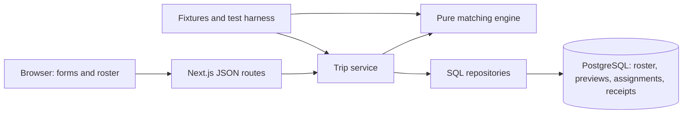

# GroupRide — initial implementation design

**Status:** Initial implementation baseline selected on 2026-11-19 at the user's request to finalize a combination of designs. This specifies what to build; it is not evidence of implemented correctness, performance, or independent human acceptance. Record actual results and subsequent decisions in [EVIDENCE.md](EVIDENCE.md). [PROJECT_SPEC.md](../PROJECT_SPEC.md) remains the course requirements reference.

The [searchable U.S. pickups design](ARCHITECTURE-v2.md) extends this baseline with address selection, road-time estimates and versioned evidence for address-based previews. It describes the next product milestone.

## 1. Selected components and rationale

| Area | Initial decision | Why this combination |
|---|---|---|
| Application | One Next.js application with internal UI, service, and matching modules | One deployment and language; boundaries still allow isolated tests |
| Persistence | PostgreSQL + `pg` + explicit SQL migrations | Visible transaction behavior and per-trip coordination |
| Matching | Bounded min-cost max-flow using Bellman–Ford; greedy comparison and independent exhaustive oracle | Exact coverage/cost objective with testable custom logic |
| Preview/commit | **Persist server-generated previews; commit by preview ID** | Saves the reviewed plan without a second optimizer run or a client plan-digest contract |
| Concurrency | Consistent read snapshots, computation outside locks, short version-checked publication and commit transactions | Detects changed inputs while keeping database write locks short |
| Roster changes | Clear the complete committed plan, then rematch manually | One explicit invalidation rule for the initial implementation |
| Retries | Durable terminal success/failure receipts + pending operation in browser session storage | One effective mutation across retries; a finalized failed key can never apply later |
| UI | One React reducer and JSON route handlers, with version and response ordering guards | Atomic snapshot/preview transitions without a separate state framework |
| Execution | Bounded synchronous matcher initially, subject to measured responsiveness gates | Avoid worker infrastructure until actual measurements justify it |

This supersedes the earlier recompute-on-commit proposal. Alternatives remain in section 8 for comparison, not as unresolved implementation branches. Exact dependency patches are selected and locked during setup; no core behavior choice is left to individual endpoints.

## 2. Product, scope, and supported inputs

An organizer coordinates carpools to one shared event: create trip → register drivers/passengers → preview → commit → reload → change availability → rematch. Drivers offer passenger seats excluding themselves; each passenger requests one seat. The UI displays per-driver assignments, unassigned riders, seats used/available, and total estimated pickup cost. A preview is not a reservation.

**Claims:** (1) maximize accommodated passengers, then minimize additive pickup cost among maximum-cardinality feasible plans; (2) preserve capacity, uniqueness, trip membership, and active-status invariants during overlapping updates, rejecting plans whose input version is stale.

**Core:** A single destination/departure, synthetic zones/costs, matching and comparison, persistence, driver capacity edits/cancellation, passenger withdrawal, reproducible fixtures, and controlled concurrency checks.

**Deferred:** Authentication, invitations, confirmations, polling, CSV, maps, editable cost tables, messaging, automatic rematching, and production deployment. The model establishes neither actual route quality nor fairness. Demo roles are not security identities. Different registration keys represent different participants; recognizing the same human across registrations is unsupported.

| Input | Enforced initial limit |
|---|---|
| Roster | 20 driver records and 50 passenger records per trip **including inactive records**; UI explains these lifetime record limits separately from available seats |
| Seats | Integer 0–8; active zero-seat drivers are allowed but receive no passengers |
| Costs/zones | At most 16 seeded zones; directional integer cost 0–10,000; missing pair = incompatible, zero = valid cost |
| Labels | Nonempty participant/trip names up to 80 Unicode code points; destination label up to 120 |
| Departure | Valid ISO timestamp with explicit offset and at most millisecond precision; past dates permitted for fixtures |
| IDs/version | UUIDs; nonnegative 32-bit trip version starting at 0 |
| JSON body | Maximum 16 KiB; reject unknown fields, invalid types, and unknown zones |

Names/zones are immutable after registration. Driver cancellation and passenger withdrawal are terminal; capacity edits require an active driver. Correct a bad registration by canceling it and registering anew, subject to the stated record limit. A rematch needs a quiet interval without roster changes; progress under continuous edits is not guaranteed. These restrictions deliberately bound the class demo and must be visible rather than silently truncating inputs.

## 3. Stack and module boundaries

Target Node.js 24 LTS, Next.js 16, React 19, TypeScript strict mode, PostgreSQL 18, npm, and Docker Compose. Use `pg` for parameterized SQL, Zod for request contracts, Vitest for unit/integration checks, and `tsx` for scripts. Plain CSS/CSS modules are sufficient. Add Playwright for the core browser checks when feasible; otherwise retain exact manual reproduction steps. Pin compatible exact dependency versions, runtime patch, and database image during E0 and verify a clean build. [Node releases](https://nodejs.org/en/about/previous-releases), [Next.js setup](https://nextjs.org/docs/app/getting-started/installation).



- `src/app/`: UI and HTTP translation; Node-runtime route handlers, no domain decisions in components.
- `src/contracts/`: strict DTOs, normalization, error codes; safe for client/server use, no credentials or SQL imports.
- `src/matching/`: greedy, min-cost flow, feasibility validator, stable output ordering; no database/network dependencies.
- `src/trips/`: create/register/edit/withdraw, consistent reads, preview publication, commit, and idempotency; sole owner of application writes.
- `src/db/`: process-level pool, transaction helpers, repositories receiving a transaction client, numbered SQL migrations.
- `tests/{matching,concurrency,e2e,fixtures}/`: fixtures plus a separate exhaustive oracle; `scripts/`: setup, reset, demonstration, comparison harnesses.

Every transaction uses one checked-out client; release it before running the matcher. Do not use `pool.query` to distribute statements within a transaction. [node-postgres transactions](https://node-postgres.com/features/transactions)

## 4. Database and trip state

### Schema contract

This is the contract for future migrations. Fields are required unless marked nullable. Trip/driver/request/preview identifiers are UUIDs; zone IDs are seeded strings.

| Table | Fields and constraints |
|---|---|
| `trips` | UUID `id` PK; `name`, `destination_label`, `depart_at`, `created_at`; `status` checked to `open` / `assigned` / `needs_rematch`, default `open`; integer `version >= 0` default 0; nullable `plan_version`, `committed_preview_id`, `algorithm_version`, `committed_at` |
| `zones` | Text `id` PK, `label` |
| `zone_costs` | Zone foreign keys `driver_zone_id`, `passenger_zone_id`; composite PK on that pair; integer `cost` checked 0–10,000 |
| `drivers` | UUID `id` PK, trip/zone foreign keys, `name`, `seat_capacity` checked 0–8, boolean `active`, `created_at`; unique `(trip_id, id)` |
| `ride_requests` | UUID `id` PK, trip/zone foreign keys, `name`, boolean `active`, `created_at`; unique `(trip_id, id)` |
| `match_previews` | UUID `id` PK, trip FK, `base_version`, `algorithm_version`, `optimal_result` JSONB, `greedy_result` JSONB, `created_at`; unique `(trip_id, base_version, algorithm_version)` and `(trip_id, id)` |
| `assignments` | `trip_id`, `request_id`, `driver_id`, integer `pickup_cost` checked 0–10,000, `committed_version`; PK `(trip_id, request_id)`; composite FKs to requests/drivers using `(trip_id, entity_id)` |
| `mutation_receipts` | UUID `request_key` PK globally; `request_fingerprint`; `outcome` checked to `applied` / `not_applied`; original `http_status`, `response_json`, `created_at`; no trip FK, so a failed creation can have a receipt without creating a trip |

Add `(trip_id, active)` roster indexes and `(trip_id, driver_id)` for assignments. Composite FKs prevent cross-trip assignments. Add the same-trip FK from `(trips.id, committed_preview_id)` to `(match_previews.trip_id, id)` after creating both tables. Trip deletion is maintenance-only; migrations specify cascading cleanup of trip-owned rows. No runtime preview deletion/expiry job is needed: retain immutable previews and receipts until offline demo reset, which explicitly clears the global receipt table too. [PostgreSQL constraints](https://www.postgresql.org/docs/18/ddl-constraints.html)

### Seeded data lifetime

Zones and directional costs are immutable for the **entire lifetime of the stored trips**, including across restarts. Keep one canonical fixture at `data/zones.json`. The app database role can only read `zones` and `zone_costs`; separate setup credentials own seed changes. Before serving trip requests, compare the sorted database zone/cost rows with the bundled fixture. A mismatch refuses service with `503 DATASET_MISMATCH`; it never silently reseeds or uses an old preview.

Setup refuses to change the dataset while trips, previews, or receipts exist. Any fixture change requires an explicit offline demo/test reset: clear receipts and trip-owned state, load the new dataset, and recreate trips with fresh UUIDs. Migrations must not change costs while retaining trips. No per-preview cost version is necessary under this contract; preserve-data cost editing would require one and is deferred.

The guard must cover unused edges too: changing M-01 from `[[1,2],[2,100]]` to `[[1,2],[2,0]]` leaves the saved cross-assignment feasible at cost 4, but the new optimum is 1. Validating only selected edges would miss this change.

### Stored plan invariants

Only the server writes preview JSON, and only with computed results validated against its snapshot. Parse/validate stored JSON at service boundaries. Never store a client-supplied allocation. A preview ID is a reference, not authorization.

**State invariants:** An `assigned` trip has all four plan fields nonnull and `plan_version == version`. Other states have those fields null and no authoritative assignments. Implement explicit null/value checks; enforce capacity, activity, compatibility, and aggregate totals through the coordinated service and tests. The referenced preview describes input version `v`; its saved assignments use committed version `v+1`.

### State transitions

| Event | Version/state |
|---|---|
| Create trip | Version 0, `open`, no assignments |
| Effective roster change while `open` | Version +1, remain `open` |
| Effective roster change while `assigned` or `needs_rematch` | Version +1, delete **all** assignments, clear plan metadata, set `needs_rematch` |
| Publish/reuse preview | No trip version or status change; only the immutable preview cache changes |
| Commit a valid preview | Version +1, atomically replace assignments, set `assigned` and plan metadata |
| Identical retry or successful no-op edit/cancellation/withdrawal | No trip version/status/assignment change |
| Finalized rejection / internal failure | Roll back business changes; persist a `not_applied` receipt without changing trip version |
| Transient failure / full transaction rollback | No effects from that attempt; no new terminal receipt; retry the same key |
| Lost connection during commit acknowledgement | Outcome unknown until replay resolves it; do not claim rollback |

An empty optimal plan may be committed: `assigned` means a computation was saved, not that everyone has a ride. Roster changes leave old previews available for traceability but uncommittable because their versions differ. Current totals are derived from assignment rows and active roster; previews are never displayed as committed state. Whole-plan invalidation temporarily disrupts unaffected riders; partial retention is a deferred product enhancement.

## 5. Public API, request identity, and browser state

### API contract

Use JSON route handlers. Creation, roster mutations, and commit require `Idempotency-Key: <UUID>`; preview does not because it has a natural cache key. Success returns resource IDs, `mutationVersion`, and `operation: { key, outcome: "applied" }`; creation/registration use `201`, other mutations `200`. Preview returns `200` without mutation metadata.

| Method and route | Body | Behavior |
|---|---|---|
| `POST /api/trips` | `{ name, destinationLabel, departAt }` | Create trip; identical create-key replay returns original trip ID and mutation version 0 |
| `GET /api/zones` | None | Fixed zone IDs and labels |
| `GET /api/trips/:id` | None | Consistent trip/version/status, active/inactive roster, committed assignments and derived totals |
| `POST /api/trips/:id/drivers` | `{ name, zoneId, seatCapacity }` | Append driver within record limit |
| `POST /api/trips/:id/requests` | `{ name, zoneId }` | Append passenger within record limit |
| `PATCH /api/trips/:id/drivers/:driverId` | `{ baseVersion, details: { name, zoneId, seatCapacity } }`, `{ baseVersion, seatCapacity }` or `{ baseVersion, active: false }` | Edit or cancel a driver at the current version |
| `PATCH /api/trips/:id/requests/:requestId` | `{ baseVersion, details: { name, zoneId } }` or `{ baseVersion, active: false }` | Edit or withdraw a passenger at the current version |
| `POST /api/trips/:id/match/preview` | `{}` | Return `{ previewId, baseVersion, algorithmVersion, optimal, greedy }` from a persisted server preview |
| `POST /api/trips/:id/match/commit` | `{ previewId }` | Commit that stored preview if its version and algorithm remain current |
| `POST /api/trips/:id/match/clear` | `{ baseVersion }` | Clear the saved assignment plan at the current version |

Details edits update an active registration in place under the trip lock and use the same receipts and whole-plan invalidation as other roster changes. A details submission equal to the stored registration succeeds without changing its version or invalidating its saved plan.

A `MatchingResult` is `{ assignments: [{ passengerId, driverId, cost }], unassignedPassengerIds, matchedCount, totalCost }`. Only the stored optimal result is committable. No allocation, digest, or client-supplied expected cost is accepted by commit.

Errors use `{ error: { code, message, requestId, currentVersion?, fields? }, operation?: { key, outcome: "not_applied" | "unknown" } }`. A matching `not_applied` outcome is returned only after its terminal receipt is durably committed. HTTP status alone does not establish whether a logical operation is finished.

| Status/code | Contract |
|---|---|
| `400 INVALID_INPUT` | Malformed IDs/body/key, unknown fields/zones, invalid capacity/date, or attempted reactivation |
| `404 NOT_FOUND` | Well-formed trip/entity/preview not found in the requested trip |
| `409 STALE_VERSION` | Input version changed; refresh and review a new preview/edit |
| `409 IDEMPOTENCY_KEY_REUSED` | Existing terminal receipt has a different normalized request; do not overwrite it or claim that the original operation was not applied |
| `409 ALGORITHM_CHANGED` | Preview generated by a superseded algorithm; create a new preview |
| `422 ROSTER_LIMIT` / `RESOURCE_INACTIVE` | Record cap reached or capacity edit targets a canceled driver |
| `503 DATABASE_BUSY` / `DATABASE_UNAVAILABLE` | Database timeout/outage; retry the same operation key |
| `503 OUTCOME_UNKNOWN` | Connection failed while commit outcome was uncertain; same-key replay resolves it |
| `503 DATASET_MISMATCH` | Seed fixture/database mismatch; refuse trip operations until offline reset |
| `500 INTERNAL_ERROR` | Unexpected business failure/invariant violation; `not_applied` only if rollback and terminal receipt commit succeeded; otherwise outcome remains unknown |

### Normalization and idempotency

Normalize UUIDs to lowercase. Zone IDs must match the seeded enum exactly. Normalize labels using Unicode NFC and trim surrounding whitespace; validate code-point length afterward. Validate timestamps as real calendar dates with an explicit offset, then normalize to UTC ISO milliseconds. Normalize numeric `-0` to `0`; reject nonfinite/fractional integers, unknown fields, and missing required fields.

`request-v1` fingerprint = SHA-256 of UTF-8 JSON for `["request-v1", uppercaseMethod, canonicalRoute, normalizedBody]`. Canonical routes use normalized path IDs without query strings/trailing slash. Recursively sort object keys lexicographically, preserve array order, and serialize using JSON string/number rules. There are no optional default fields in the MVP mutation DTOs. Commit fingerprints contain the preview ID only. A single shared normalizer/serializer is covered by fixed vectors; changing its semantics requires a deliberate compatibility change, not silently reinterpreting saved receipts.

Keys are now globally unique across creation, roster changes, and matching commits. This replaces the earlier per-trip key namespace and special creation fields with one receipt path. Identical input with a different key is a new operation. Check an existing receipt **before** version/activity checks: replay its original status/body and set `Idempotency-Replayed: true`, or reject differing fingerprints. Receipts are immutable. A failed key replays its failure even if the input could now succeed; after a terminal failure, an intentional new attempt uses a new key. Successful no-ops get `applied` receipts without a version bump. Success receipts report the original mutation version, not the latest trip state; refetch after resolution.

All normalized mutations use the shared transaction helper in section 6. Persist both successful outcomes and terminal business rejections/internal failures. Transport errors, database unavailability, lock/statement timeouts, and uncertain transaction commits do not finalize a key. Malformed requests that cannot be normalized fail before this helper and have no terminal operation metadata; the browser validates with the shared contract before saving/sending an operation. Missing or unrecognized metadata never permits an ambiguous pending operation to be discarded.

### Guest invitations

Migration 004 gives each trip a unique random invitation ID. The organizer snapshot includes it. `/join/:inviteId` looks up that capability and exposes the trip name, destination, departure, and location mode. It uses the same registration service via `POST /api/invites/:inviteId/drivers` and `POST /api/invites/:inviteId/requests`. The mutation helper keys receipts by the invitation route and resolves the trip under its row lock. Guest registrations follow the same limits and plan invalidation rules. The invite page retains an unresolved submission for same-key retry.

The invitation ID is separate from the organizer trip ID. The guest page carries neither the organizer ID nor the roster, and public endpoints accept registration and pickup search only. Organizer URLs act as private bearer links under the existing local application model. The guest link is transferable and the dashboard refreshes through the existing read path.

### Browser recovery and response ordering

Use `/` for trip creation and `/trips/:id` for the roster, preview comparison, and saved plan. Keep one fetched trip snapshot, local forms, and separate preview state. All trip fetches/responses use `no-store`; no framework database-result cache. No automatic polling is required.

The shared application header links to trip creation and provides a skip link to the main content. The organizer workspace groups registration, rosters, preview actions, and the saved plan. Registration and roster columns stack on narrow screens. The organizer roster shows only active participants in compact rows. Driver rows use green and passenger rows use blue alongside the roster headings. Row actions stay beside the details when space permits and wrap on narrower screens. The preview and saved plan group passengers under their active driver and show unassigned passengers separately. Driver cards also make unused seats visible. The trip snapshot carries both active and inactive records for the existing read contract. The address picker keeps its disclosure, keyboard controls, and provider attribution in view. Trip creation resolves the selected calendar date, local time and IANA time zone to the existing UTC timestamp before claiming the pending operation. The form rejects skipped clock times and asks the organizer to choose an occurrence when the clock repeats. The trip header displays the saved departure in UTC.

Allow one unresolved mutation per tab. Before first transmission, write its key, method, canonical route, normalized body, and trip ID where available to a versioned `sessionStorage` entry. If storage cannot be written, block mutations with a visible error; reads/previews still work. On same-tab reload, offer retry of the stored operation with its original key/body. Only a matching receipt-backed `applied` or `not_applied` response clears it, including a finalized `500`. Network errors, `unknown`, missing metadata, and unfinalized `503` responses retain the exact operation. Do not generate a replacement key for an uncertain operation. A delayed reply for an old key cannot resolve a newer pending operation. Recovery after closing the tab/clearing browser storage is outside the MVP.

The UI offers same-key **Retry** while the outcome is unknown, and a fresh operation only after terminal resolution. There is no client-only force-discard action. A persistent infrastructure failure still requires restoring the database or an intentional offline demo reset; safely declaring an unknown operation canceled is not possible from a timeout alone.

Use one pure React reducer for `{ tripId, snapshot, preview, highestObservedVersion, readGeneration, previewGeneration, pendingOperation }`. For the active trip, advance the version floor with `max(oldFloor, observedVersion)` from every valid success `mutationVersion`, GET `version`, preview `baseVersion`, and error `currentVersion`. A late response may raise this floor, but cannot replace data from a newer request generation. Receipt replay never lowers it. [React reducer reference](https://react.dev/reference/react/useReducer)

In the **same reducer transition**, hide any snapshot below the floor, clear a preview whose base version no longer equals the accepted snapshot/floor, and disable Commit until the data is current again. Accept a GET only for the current route/read generation and at or above the floor. Accept a preview only for the current route/preview generation, with no unresolved mutation, and `baseVersion == snapshot.version == highestObservedVersion`. Commit also requires that equality and no pending mutation. Starting any mutation clears the preview and increments its generation; conflicts and newer accepted snapshots invalidate old previews too. A newer preview/error version triggers a refresh before another preview can be reviewed. Abort obsolete fetches and guard completions; abort alone is insufficient. [React data-fetching guidance](https://react.dev/reference/react/useEffect#fetching-data-with-effects)

Example: a preview for v5 is cleared by a GET or conflict reporting v6; a delayed GET/preview for v5 is then ignored. These rules prevent displaying data already known to be stale. Changes in another tab remain unknown until a response or explicit refresh observes them; the commit version check remains authoritative.

After a successful mutation, hide obsolete authoritative plan displays until a sufficiently new snapshot arrives. Show pending/loading, empty, insufficient-seat, needs-rematch, stale-preview, and outcome-unknown states. A conflict requires explicit review/resubmission with a new key; a transport retry keeps the old key. A known successful no-op may simply refresh. Simultaneous operations in other tabs remain permitted and are resolved by the server protocol.

## 6. Matching and transaction protocols

### Pure matching

The service projects immutable directional zone costs into driver–passenger costs. Filter inactive participants; reject duplicate IDs/invalid input. For binary `x[p,d]`, each passenger has `sum_d x <= 1`, each driver has `sum_p x <= capacity[d]`, and incompatible pairs have `x = 0`. Maximize total assignments before minimizing cost; never stop merely because another assignment has positive cost.

Greedy processes ascending passenger IDs and selects the cheapest compatible driver with capacity, breaking ties by driver ID. The selected optimizer uses source → passengers → drivers → sink, capacities 1 / 1 / driver seats, and pickup cost on passenger/driver edges. Add reverse edges with negative cost and zero initial residual capacity. Repeatedly use Bellman–Ford over positive residual capacity, augment, and stop when the sink is unreachable. Reconstruct assignments and independently check feasibility and summed totals.

The intended bound is `O(F*V*E)` with `F <= 50`. Bellman–Ford handles negative reverse edges; ordinary Dijkstra without reduced-cost potentials does not. Attribute this established algorithm. [Minimum-cost flow reference](https://courses.grainger.illinois.edu/cs473/fa2022/notes/G-mincostflow.pdf)

Use stable ASCII UUID ordering, fixed edge construction, first predecessor on equal distance, and sorted result arrays. Determinism helps reproduction, but commit correctness no longer depends on recomputing an identical tie choice. Label behavior `mincostflow-v1`; bump it when matching/selection semantics change. Unassigned output includes active passengers only.

### Consistent reads and write helper

Read trip, roster, costs, assignments, and optional current cached preview in one short `REPEATABLE READ READ ONLY` transaction. Release the connection before computing. This prevents mixing versions across queries. [PostgreSQL isolation](https://www.postgresql.org/docs/18/transaction-iso.html)

All writes use read-committed transactions. Preview publication locks its trip row with `SELECT ... FOR UPDATE`. Keyed mutations first take a transaction-scoped advisory lock for the request key, check its receipt, and then lock the trip row when one exists. Always use key → trip → child rows in that order; never acquire a second operation key in the transaction. Creation uses the same key/receipt path before inserting its trip. Effective roster writes invalidate the full plan and increment version exactly once; preview cache writes do neither. [PostgreSQL locking](https://www.postgresql.org/docs/18/explicit-locking.html)

### Terminal mutation outcomes

1. Normalize the request, begin the transaction, and acquire `pg_advisory_xact_lock` for its key. Interpret the first eight SHA-256 bytes of UTF-8 `mutation-lock-v1:<lowercase UUID>` as a signed 64-bit big-endian lock ID; bind it as a decimal bigint string. Store/compare the full UUID and fingerprint in receipts. A hash collision only serializes unrelated operations; it does not merge their identities. Use transaction-scoped locks, never session locks that could survive pool reuse.
2. Read the receipt in a subsequent statement after acquiring the lock. Replay a terminal result, or return key-reuse conflict if its fingerprint differs. For a new operation on an existing trip, acquire the trip row lock before business work.
3. Establish `SAVEPOINT business_work`. Validate business conditions and perform the mutation. On success, insert an `applied` receipt and commit the transaction atomically with the business writes.
4. For a terminal domain rejection or internal business failure, `ROLLBACK TO SAVEPOINT business_work`, then insert a `not_applied` receipt with the original error status/body and commit. Business effects are undone while the request key is permanently finalized. Existing-trip locks and the key lock were acquired before the savepoint, so retries cannot pass this decision. Missing trips can also receive terminal `404` receipts; creation failures leave no trip behind. [PostgreSQL savepoints](https://www.postgresql.org/docs/18/sql-savepoint.html)
5. For transient connection/lock/statement failures, receipt-storage failure, or inability to confirm rollback, abort the whole transaction and do not claim terminal failure. If either success-receipt or failure-receipt COMMIT acknowledgement is uncertain, discard the connection and return `unknown`; a same-key retry resolves the stored outcome or executes if none committed.

Send terminal metadata only after a confirmed receipt commit (or replay of an existing receipt). An attempt's confirmed rollback alone does **not** finalize the logical key: another retry might still execute. This shared helper needs no cancellation endpoint, worker, or new receipt table; the additional key lock also handles creation without special creation columns. Receipt-write/COMMIT errors are handled outside the business-error catch, so they cannot be mistaken for a finalized rejection.

### Preview publication

1. Read a consistent snapshot at version `v`. If an immutable preview already exists for `(trip, v, currentAlgorithm)`, return that stored result. It may become stale immediately afterward, which commit detects.
2. Otherwise release the read transaction, compute optimal and greedy results, and validate them against the snapshot.
3. Begin a write transaction, lock the trip, and check that its version is still `v`. If changed, return `409 STALE_VERSION` without publishing the newly computed result.
4. Recheck the unique preview key. If another request already published it, return the **existing stored** ID/results. Otherwise insert the computed results and commit without changing trip version/status.
5. Return the persisted ID, input version, algorithm, and results. Clients cannot choose preview IDs or supply preview contents. No expiry timer or background cleanup is part of the initial design.

### Matching commit

1. Normalize `{ previewId }` and its request key; enter the shared mutation helper and acquire the key lock.
2. Replay a matching terminal receipt before any stale-preview check; reject conflicting key reuse. Otherwise lock the trip and establish the business savepoint.
3. Fetch the immutable preview belonging to this trip. Require `preview.base_version == trip.version` and its algorithm identifier to equal the current one.
4. Read current authoritative roster/costs while holding the lock. Validate the stored result's membership, activity, compatibility, capacities, complete assigned/unassigned partition, and totals. Optimality comes from the trusted server computation and unchanged input version; feasibility checks alone do not establish it.
5. Copy the stored optimal assignments atomically, increment the version, set `assigned` and plan metadata, and insert the success receipt. Commit and return IDs plus `mutationVersion`.
6. On terminal failure, undo business work and finalize `not_applied` through the helper. On uncertain commit acknowledgement, discard the connection and preserve the request key; a fresh connection and same-key retry replays either terminal outcome if committed or safely attempts the operation if not.

There is **no optimizer invocation during commit**. Two different keys committing previews from one version permit one success; a same-key retry permits one effect. A new roster change after commit invalidates the plan normally. Old-algorithm success receipts can still replay; uncommitted old-algorithm previews cannot commit.

Clearing a saved plan uses the same keyed mutation helper and trip lock. Check the expected version, delete assignments, clear saved plan metadata, and advance the version with status `needs_rematch`. Drivers and passengers stay registered. A current-version request for a trip without a saved plan records a successful no-op. A same-key replay returns its original receipt, even after a replacement plan is saved. Discarding an unsaved preview only updates browser state. The organizer sees whether the preview is ready, while the version remains part of the API and stale-save checks.

```mermaid
sequenceDiagram
    participant UI as Browser
    participant S as Trip service
    participant M as Matcher
    participant DB as PostgreSQL
    UI->>S: Preview
    S->>DB: Read snapshot v and cache
    DB-->>S: Inputs; release read transaction
    S->>M: Compute outside locks on cache miss
    M-->>S: Optimal and greedy results
    S->>DB: Lock trip; recheck v; publish or reuse preview
    DB-->>S: Immutable preview ID and results
    S-->>UI: Review persisted preview
    UI->>S: Commit preview ID + request key
    S->>DB: Lock key; check receipt; lock trip and validate preview
    alt Current preview and fresh key
        S->>DB: Copy assignments + version increment + receipt; commit
        S-->>UI: Saved result; refetch trip
    else Existing receipt
        S-->>UI: Replay original terminal outcome; refetch trip
    else Stale preview
        S->>DB: Undo business work; commit not_applied receipt
        S-->>UI: 409; review a new preview
    end
```

### Connection failures and runtime limits

Use a five-connection app pool and separate integration-test connections. Initial defaults: pool acquisition/connection wait 2 seconds, lock timeout 2 seconds, statement timeout 5 seconds, idle-in-transaction timeout 5 seconds. Apply SQL settings to each transaction rather than leaking settings to later pool users. Always release clean clients; discard a client after connection failure or failed rollback. If `COMMIT` acknowledgement is lost, no subsequent rollback attempt proves the original transaction was undone. [Pool lifecycle](https://node-postgres.com/apis/pool), [PostgreSQL timeouts](https://www.postgresql.org/docs/18/runtime-config-client.html)

A browser may stop waiting after 10 seconds, but that is not proof of server cancellation. Keep its pending key. Database/HTTP timers do not preempt a synchronous JavaScript matcher. Measure application responsiveness separately; promises alone do not move CPU work off the main thread. [Node event-loop guidance](https://nodejs.org/learn/asynchronous-work/dont-block-the-event-loop)

## 7. Validation and demo contract

These are expected outcomes, not application test results. Retain inputs, commands, derivations, observed outputs, environment, and code/commit links in EVIDENCE. Human review remains necessary.

### Independent fixtures

| ID | Inputs | Independently determined expectation |
|---|---|---|
| M-01 | One seat each; driver-row/passenger-column costs `[[1,2],[2,100]]`; A before B | Two complete plans cost 101 and 4; optimum serves 2 for 4; greedy costs 101 |
| M-08 | One seat each; costs `[[1,1],[2,missing]]` | Only full plan is A→D2/B→D1, serving 2 for 3; greedy serves 1 for 1 |
| WF-4 | One North-zone driver, one East-zone passenger; North→East = 7, East→North = 19 | Preview, stored preview, commit, and reload all show 1 match costing 7; catches reversed zone projection |

Seed UUIDs so A/B and D1/D2 ordering matches the labels. The test-only oracle enumerates compatible assignments plus unassigned, rejecting overcapacity and comparing count before cost. It shares no flow/reverse-edge logic with the optimizer. Bound oracle cases to 7 passengers/4 drivers and retain 100 seeds.

### Acceptance checks

| ID | Expected observation |
|---|---|
| M-01 | Cost fixture: 2 matched, total cost 4 |
| M-02 | One driver, 2 seats, 5 compatible passengers: exactly 2 matched |
| M-03 | No drivers / zero capacities: 0 matched, cost 0 |
| M-04 | Missing edges excluded; zero-cost edges usable |
| M-05 | Tied optima: correct objective; repeated/permuted input yields stable output |
| M-06 | Tiny cases agree with independent oracle on count/cost |
| M-07 | Validator rejects duplicates, overcapacity, wrong totals, inactive/unknown members, or incomplete assigned/unassigned partition |
| M-08 | Coverage-first fixture: 2 matched for cost 3 |
| M-09 | Invalid and over-limit inputs rejected; boundary inputs accepted |
| M-10 | Inactive participants excluded; reconstructed flow and independently summed cost agree |
| C-01 | Distinct commit keys at one input version: one success, one `409` |
| C-02 | Cancellation after preview: commit rejects stale preview; no canceled driver assigned |
| C-03 | Registration after preview: commit rejects stale preview |
| C-04 | Concurrent driver/passenger retries: one registration/effective version increment per logical request |
| C-05 | Failure after assignment delete/before insert: previous plan, version, and receipts survive rollback |
| C-06 | With another connection available, trip B writes finish while trip A's row lock is held |
| C-07 | Capacity reduction clears all assignments, version +1, `needs_rematch`; new plan respects capacity |
| C-08 | Interleaved multi-query dashboard read is wholly before/after cancellation, not a mixture |
| C-09 | Conflicting key reuse gives `409`; stale new-key edits reject; canonical equivalent payloads replay |
| C-10 | Lose success response, make another mutation, retry original key: original receipt replays without new effects |
| C-11 | Current-version no-op edit/repeated cancellation does not invalidate/bump; old registration replay never reactivates a participant |
| C-12 | Cross-trip entity/preview references rejected; competing registrations cannot exceed record caps |
| C-13 | Roster mutation during preview computation: publication recheck rejects and creates no stale preview row |
| C-14 | Client allocations/digests/unknown fields rejected; superseded algorithm preview rejected; invalid stored JSON causes an internal error without mutation |
| C-15 | Concurrent previews for one version return the same stored ID/result; preview publication does not invalidate another preview by bumping trip version |
| C-16 | Disconnect around COMMIT: replay on fresh connection yields one effective mutation; unusable clients are discarded, later requests can acquire connections |
| C-17 | Terminal failure after business writes: prior trip state survives, failure receipt persists, racing/delayed same-key retries cannot apply; lost failure-commit acknowledgement resolves by replay; failed receipt persistence never reports `not_applied` |
| C-18 | Changing even an unused cost edge refuses startup/seed update with retained trips; app role cannot edit costs; explicit offline reset loads the fixture and gives fresh trip IDs |
| C-19 | Concurrent identical creation keys return one original trip ID; differing input conflicts; a finalized failed creation leaves no trip and cannot later succeed under that key |
| WF-1 | Create/register/preview/commit/reload produces a persistent valid roster and consistent totals |
| WF-2 | Cancel/reduce capacity clears authoritative plan; manual rematch saves valid replacement |
| WF-3 | Two browser sessions: stale commit gives review/refresh flow, no silent overwrite |
| WF-4 | Directional zone fixture stays at 1 match/cost 7 through service/API/database/UI |
| U-01 | A GET/error reporting v6 clears a v5 preview atomically; delayed v5 reads/previews cannot restore it; a version floor learned from any valid response never decreases |
| U-02 | Same-tab reload after uncertain mutation retains exact key/body; replay does not duplicate seats or resurrect canceled records |
| U-03 | Unavailable session storage blocks mutations before sending; read/preview remain usable |
| U-04 | Receipt-backed `500 not_applied` releases the matching pending operation; unknown/unfinalized responses retain it; delayed old-key replies cannot clear a new operation; Commit stays disabled during mutation or while awaiting a current snapshot |
| P-01 | Real HTTP responsiveness under uncached maximum-size preview work meets the gates below |

C-13 now tests publication rather than commit recomputation because the selected commit path does not compute. The historical test ID is retained with this explicit contract change. Exercise SQL constraints directly in addition to endpoint checks. Force races with barriers/test dependencies, not public pause endpoints or timing-only sleeps. Remove the commit version guard in a controlled mutant: C-01 must detect double commitment. Substitute greedy: M-01/M-08 must fail. Deliberate mutants are validation evidence, not a fabricated debugging story.

**Demonstration:** From a reset fixture, create/register, preview cost/coverage comparisons, commit/reload, force stale preview rejection, cancel/rematch, and show the directional cost check and actual-route limitation. Explain two decisions, a real debugging incident, attribution, and independent expectations. README gets exact commands/interactions only after verification; any cited evidence file must be committed.

## 8. Selected tradeoffs, alternatives, and evaluation gates

| Alternative considered | Initial decision and reason | Revisit only when |
|---|---|---|
| SQLite instead of PostgreSQL | Keep PostgreSQL for explicit per-trip writer coordination; SQLite has one writer per database file | Database setup blocks E0; a switch must redesign SQL/transaction tests, not be treated as a late drop-in replacement |
| Separate backend | Keep internal modules in one app | Independent runtime/deployment is demonstrated to be necessary; splitting alone does not offload CPU |
| Recompute + digest at commit | Select **stored previews**; one small table avoids repeat compute, result substitution, and plan-digest rules; retained previews/receipts grow until offline reset | Stored preview lifecycle/space becomes a measured problem |
| Compute while holding trip lock | Keep snapshot computation outside locks, then short publication/commit locks | D-2 shows an acceptable simpler alternative for the supported workload |
| Partial plan retention | Clear complete plan initially; one invariant and clear rematch requirement | Organizer walkthrough shows disruption outweighs extra state/policy complexity |
| ORM/query builder | Keep `pg` and explicit constraints/transactions | A prototype demonstrates reduced maintenance without obscuring guarantees |
| Exact exhaustive matcher | Keep flow optimizer; enumeration remains the independent oracle | Optimizer threatens completion: enforce an 8-passenger/4-driver fallback and revise scope visibly |
| Solver library or reduced-cost Dijkstra | Keep Bellman–Ford for an inspectable first implementation | Correctness/runtime evidence justifies the integration/algorithm change; attribute reused code |
| Worker pool | Keep synchronous execution with enforced input bounds | P-01 fails after basic profiling/optimization; first lower bounds, then evaluate one bounded worker pool before separate services |

SQLite remains a viable alternative for the user workflow, but cannot retain the same independent-writer-progress claim. [SQLite concurrency guidance](https://www.sqlite.org/whentouse.html)

### D-1: exact matching versus greedy

Run both algorithms on M-01/M-08, the 100 tiny oracle seeds, and cases with 5/15/30/50 passengers, up to 20 drivers, varied capacities, ties, and sparse compatibility. Record seed, input size, matched count, total cost, feasibility, runtime, algorithm ID, machine/runtime versions, and commit. Compare costs only at the same maximum cardinality. Warm up, then report median/p95 over 100 samples at the maximum bounds.

Acceptance requires zero fixture/oracle/invariant discrepancies. Target p95 pure solver time <= 100 ms on the documented demo machine. This tighter initial responsiveness target replaces the earlier 500 ms proposal; it is unmeasured. Greedy cannot replace the exact solver while retaining the optimality claim. A bounded exact fallback must have enforced input limits and separately evaluated expectations.

### D-2: outside-lock computation versus long-lock preview generation

Both variants persist the preview and use the same version-checked commit path. Initial variant: snapshot/release → compute → lock/recheck/publish. Harness alternative: lock trip → read/compute/publish → release. This replaces the earlier commit-recomputation comparison.

Use a controllable gate after input acquisition. In the initial variant, let cancellation finish while computation is paused, then resume: publication must return `409`. In the long-lock variant, verify that cancellation is waiting on the trip lock, release the compute gate, then allow publication and cancellation to finish; the published preview is stale afterward and commit must reject it. Use a bounded watchdog to detect hangs, not a fixed sleep to decide correctness. Record lock wait, final state, successes/conflicts, and retries. Both variants must preserve invariants; fewer conflicts alone do not establish a better design.

Keep short locks if writes demonstrably progress during the gate and stale results are rejected. The gate evaluates database coordination, not actual CPU speed or HTTP concurrency; run the separate P-01 experiment before asserting responsiveness. A long-lock alternative requires documented blocking measurements and a scope decision before adoption.

### P-01: application responsiveness

Use a local production build after warmup. Collect an idle baseline, then make 100 maximum-size **uncached** preview requests sequentially while another client issues reads and alternating capacity edits on another trip. Prepare fresh trip versions/fixtures so the preview cache cannot hide solver work. Record matcher duration, cache hits, HTTP latency, event-loop delay, errors, and environment/commit. Goals: competing-request p95 <= 500 ms and increase over idle p95 <= 250 ms, with no timeouts. These targets supplement the 100 ms solver target; they are not observed results.

If gates fail, profile first and reduce supported roster limits consistently across API, UI, tests, and documentation. Introduce a bounded worker only if needed; do not silently weaken correctness or claim asynchronous functions solve CPU blocking. Keep the other alternatives documented unless a failed gate justifies implementation. Record actual choice, diff, evidence, and human response in EVIDENCE.

## 9. Local operation and implementation roadmap

Use [WORKPLAN.md](../WORKPLAN.md) for the current implementation handoff, detailed checkpoints, and release gates. This section retains the technical operation contract and high-level course milestones; progress is tracked in the workplan.

Bind the app and mapped PostgreSQL port explicitly to `127.0.0.1`. `.env.example` documents app/demo/test database URLs with fictional credentials. Use separate demo/test databases; no real data, secrets, or database volumes in Git. Pin dependencies and use numbered, recorded SQL migrations. Test data/schema changes happen through offline setup/reset, never a mutable runtime cost table.

Reset only an explicitly designated demo/test database with the app stopped; refuse other targets. Dataset changes always require this reset, including clearing global receipts. Recreate trips with fresh UUIDs so old previews/browser URLs cannot become valid against a new version-0 trip. Clear pending browser demo state as part of the intentional reset before starting a new demo. An old operation targeting a removed trip receives a finalized `404`; old creation keys have no replay guarantee across a reset. This is a local class deployment, not a production service.

**Known limitation (ISSUE-004).** Keep the app stopped through completion of an offline reset. If startup overlaps reset after the session check, a repeatable-read request may take an older snapshot while waiting for the dataset lock and report `DATASET_MISMATCH`. Wait for reset to finish before making a fresh request. Persistent mismatch still requires investigation. C-18 covers already-connected sessions and deliberate drift. The overlapping-startup case was identified by inspection and has no retained live reproduction.

W0 uses `groupride_demo` and `groupride_test` on the Compose loopback port 55432. Setup checks the selected URL, connected role and database, and a bootstrap marker owned by the database administrator. Setup takes an exclusive transaction advisory lock and refuses connected app-role sessions. App transactions take the corresponding shared lock before the dataset guard and business work. The dataset lock uses PostgreSQL's two-integer lock namespace, separate from the single-bigint mutation key locks. The `/api/health` route exercises the app role and dataset guard.

| Planned command | Required behavior before it appears as runnable in README |
|---|---|
| `npm ci`, `docker compose up -d db`, `npm run db:migrate` | Install pinned dependencies, start database, apply recorded migrations |
| `npm run dev`, `npm run build`, `npm start` | Development and verified local production build/server |
| `npm run demo:reset`, `npm run demo` | Guarded offline seed/reset; demo starts the app and prints URL/instructions |
| `npm run typecheck`, `npm run lint` | Static checks |
| `npm run test:matching`, `npm run test:concurrency` | Independent fixtures/oracle and real-PostgreSQL transaction tests |
| `npm run test:e2e` | Browser tests when implemented; otherwise exact retained manual checks |
| `npm run eval:matching`, `npm run eval:concurrency`, `npm run eval:responsiveness` | D-1, D-2, P-01 measurements with raw artifacts and environment/commit metadata |

Log request ID, route, trip/preview ID, expected/current version, receipt replay/outcome, cache use, and durations; avoid participant names in diagnostics. Unexpected invariant failures are errors, never empty successful match results. There is no in-memory fallback for failed persistence.

| Milestone | Work and exit condition |
|---|---|
| E0 — Contract/setup, days 1–2 | Implement/pin the selected stack, migrations and seed; retain the existing Git baseline (`e2510d7`); independently inspect hand fixtures and canonicalization vectors; record agent requests from the start |
| E1 — Complete path, days 3–7 | Pure matcher/validator/oracle; then snapshots, immutable previews, receipts and commit; minimal forms and reload recovery. Demonstrate create/register/preview/save/reload plus cancellation/rematch early. |
| E2 — Control/evaluation, days 8–10 | Forced races, failures, UI ordering, retry recovery and directional costs; D-1/D-2/P-01 measurements; correct actual defects and preserve regression inputs and human decisions |
| E3 — Defense, days 11–14 | Clean setup/demo, recorded outputs, real debugging case, two completed decisions, limitations and attribution; required PDFs/access/demo booking/submissions at Canvas deadlines |

Days are effort allocations, not course deadlines; the proposal may be due earlier. Optional features and extra alternative prototypes stay deferred until a complete verifiable path exists. Exact package patches and measured performance remain setup/validation work, not unresolved architecture choices.

Students retain responsibility for scope, independent checks, important decisions, and acceptance. Agents may implement bounded tasks; preserve at least two real implementation episodes and an actual consequential human correction/rejection/redesign. This finalized design is not a claim that those requirements are already fulfilled. Keep verified operation in README, decisions/results in EVIDENCE, and technical design here.
